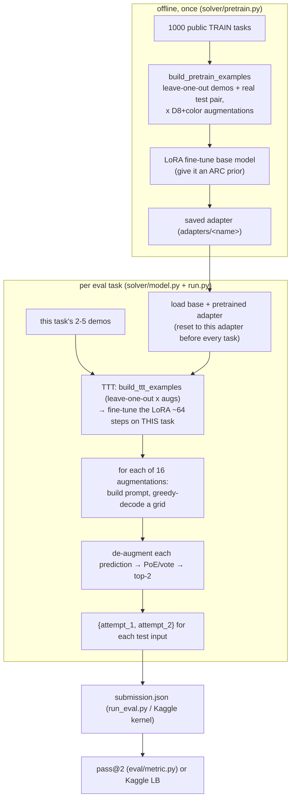
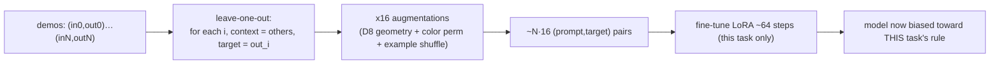
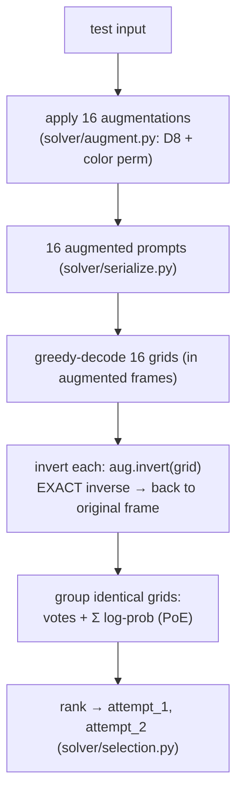
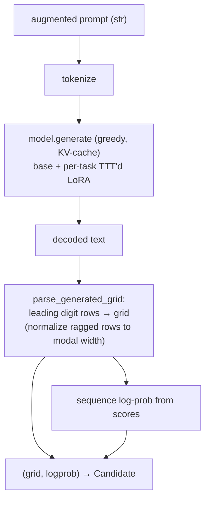
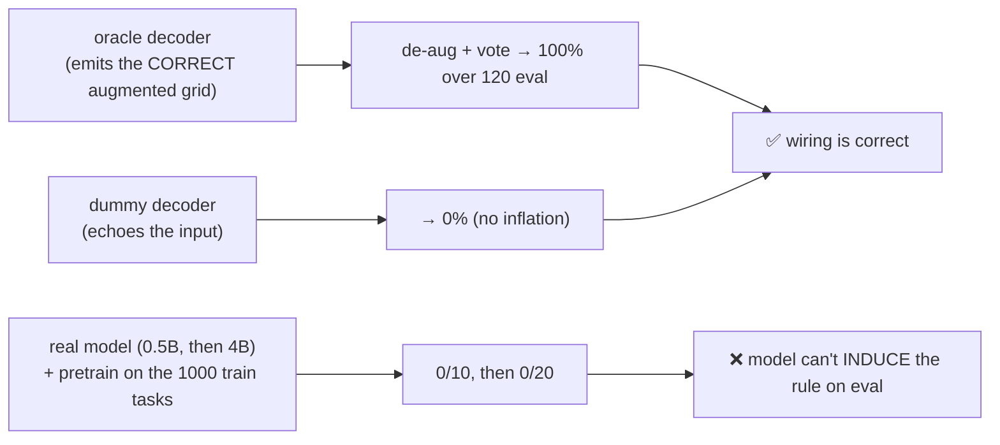
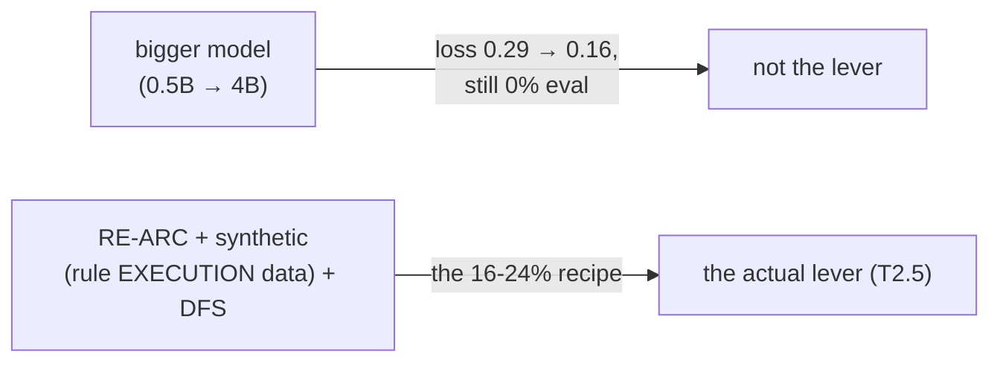
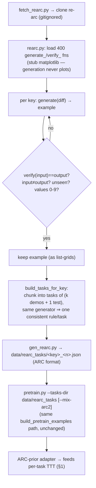

# How it works — solver logic + TTT principles (with flow diagrams)

> Companion to `ttt-recipe.md` (the source-cited recipe) and `strategy.md` (ideas). This file explains, with
> mermaid flows, **(a)** how the `solver/` code is wired end to end and **(b)** the *principles* behind
> test-time training (TTT) + augment-infer-reverse-vote (AIRV) — and **why the current build scores 0%**
> (the lever is data, not code). Read alongside the modules in `solver/` and the harness in `eval/`.

---

## TL;DR
- The task: infer a hidden grid→grid rule from 2–5 demos, output **2 candidate grids** per test input;
  exact pixel match scores (pass@2). See `rules.md`.
- Our approach is the proven Kaggle family: **offline pretrain → per-task LoRA test-time training →
  decode under many augmentations → de-augment + vote → pick top-2** (`ttt-recipe.md`).
- The pipeline is **built and validated end to end** (an oracle decoder scores 100%; a dummy scores 0%),
  but with a small base model it scores **~0% on the real eval** — a **model/data limit, not a wiring bug**
  (see §5). The whole `solver/` core is model-agnostic, so scaling up reuses it unchanged.

---

## 1. End-to-end pipeline (offline → per-task → submission)

The model is injected into the orchestrator as a `DecodeFn` (`run.solve_task`), so the CPU pipeline is
testable without a GPU and the GPU layer (`model.py`) plugs in unchanged. See §4.

---

## 2. Principle: test-time training (TTT) — "adapt to THIS task before answering"

ARC tasks each have a *novel* rule, so a fixed model can't have memorized it. TTT fine-tunes a small LoRA
on **this task's own demo pairs** at inference time, turning 2–5 examples into a training set via
**leave-one-out** (predict each demo from the others) multiplied by augmentations (`solver/ttt_data.py`).

Reset discipline: the adapter is snapshotted at load and **reset before every task**, so tasks don't leak
into each other (`TTTSolver._reset_adapter`).

---

## 3. Principle: AIRV (Augment → Infer → Reverse-augment → Vote)

A single decode is unreliable. Instead we show the model the *same task* under 16 symmetry-preserving views
(the D8 dihedral group × random color permutations), decode each, then **invert the exact transform** on
each prediction so they all live in the original frame, and **vote / Product-of-Experts** to choose 2.

Why exact inverses matter: a prediction made on a rotated+recolored grid is only useful if it maps back
perfectly. The augmentation/inverse correctness is unit-tested (the AIRV round-trip), and end-to-end the
**oracle decoder scores 100%** precisely because de-augmentation + voting compose correctly (see §5).

---

## 4. The GPU/model layer — the injected `DecodeFn` (`solver/model.py`)

Engineering notes baked in (from the snorlax runs): per-task TTT uses **batch-size 1 + gradient
checkpointing + skip (not truncate) over-long examples** to fit 24 GB; the module is named `selection.py`
(not `select.py`) to avoid shadowing Python's stdlib `select`; `dtype=`/`torch_dtype=` handles transformers
4.x↔5.x.

---

## 5. Why it scores 0% — the principle that actually decides the score

The pipeline is provably correct, yet the eval score is ~0%. These two facts are not in tension:

What the runs showed (`tracking.md`):

| Stage | pass@2 |
|---|---|
| oracle decode (correctness check) | **100%** |
| Qwen2.5-0.5B + TTT (no pretrain) | 0/10 |
| 0.5B + pretrain (loss 0.69→0.29) | 0/20 |
| **Qwen3-4B + pretrain (loss 0.69→0.16)** | **0/20** |

The 4B fit the *training* distribution far better (loss 0.16) yet still scored 0% on eval. **Principle:
ARC-AGI-2 is built so training-fit doesn't transfer** — pretraining on the 1000 train tasks teaches
*task memorization*, but eval needs *rule execution* on novel rules. The 2025 winners' 16–24% came from a
**data pipeline** (RE-ARC procedural rule regeneration + large synthetic data, which teach execution) +
DFS decode — **not** from a bigger base on the same tasks.

---

## 5b. The RE-ARC data pipeline (T2.5 — building the missing lever)

RE-ARC (Michael Hodel, MIT) ships, **per ARC-1 training task**, a `generate_<key>(diff_lb, diff_ub)` that
samples a fresh (input, output) of that task's rule and a `verify_<key>(input)` that recomputes the correct
output. So instead of pretraining on the *fixed* 1000 ARC-2 train tasks (→ memorization), we synthesize
**unlimited verified examples of each rule** → the model learns to *execute* transformations.

Key properties: **every example is verifier-checked** (no label noise), generation is **pure-Python CPU**
(runs locally, no GPU), and the output is plain ARC-format JSON so the existing pretrain/TTT/eval path
consumes it with zero changes (`arc_io.load_tasks_dir`). Acceptance mirrors re-arc's own loop
(verified + non-degenerate + de-duplicated). The open question T2.5b answers: does training on
rule-*execution* data move eval off 0% where task-memorization pretraining did not.

---

## 6. Validation discipline (how we trust a number before spending GPU/submits)
- **Metric oracle** (`eval/`): a perfect submission → 100%, a corrupted one → <100% (the scorer judges).
- **Solver oracle** (`solver/validate.py`): a decoder emitting correct *augmented* grids → 100% after
  de-aug+vote; a dummy → 0%. Proves AIRV composition before any model runs.
- **35 unit tests** cover augmentation inverses, serialization round-trips, ragged-grid parsing, and
  PoE/vote selection. Only after these pass do we spend GPU.

This is the nemo lesson encoded: never gate on a leaderboard you can't see — reproduce a known score
locally first.

---

## Links
- `ttt-recipe.md` (source-cited recipe) · `strategy.md` (ideas/challenges) · `research.md` (SOTA scan) ·
  `tracking.md` (the run log + verdicts) · `overview_zh.md` (中文介绍).
- Code: `solver/{augment,serialize,ttt_data,selection,run,model,pretrain,validate}.py`, `eval/{metric,arc_io,evaluate}.py`.
