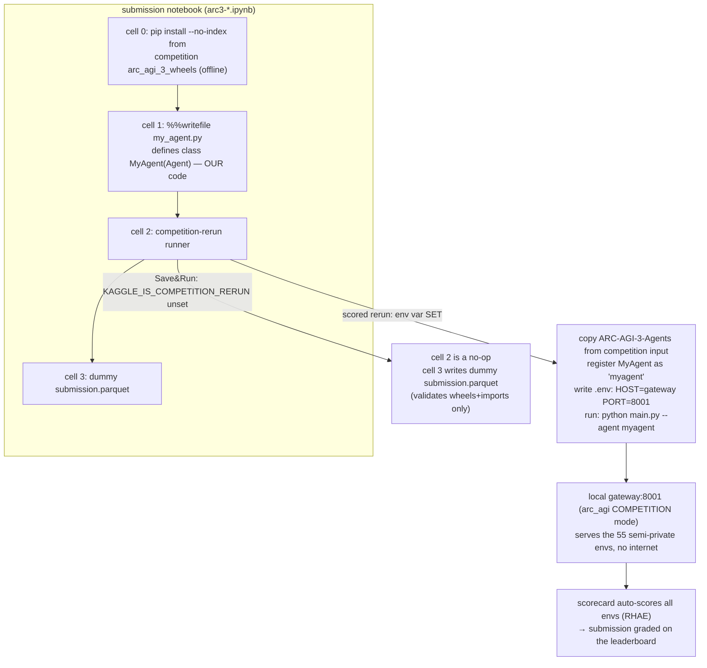
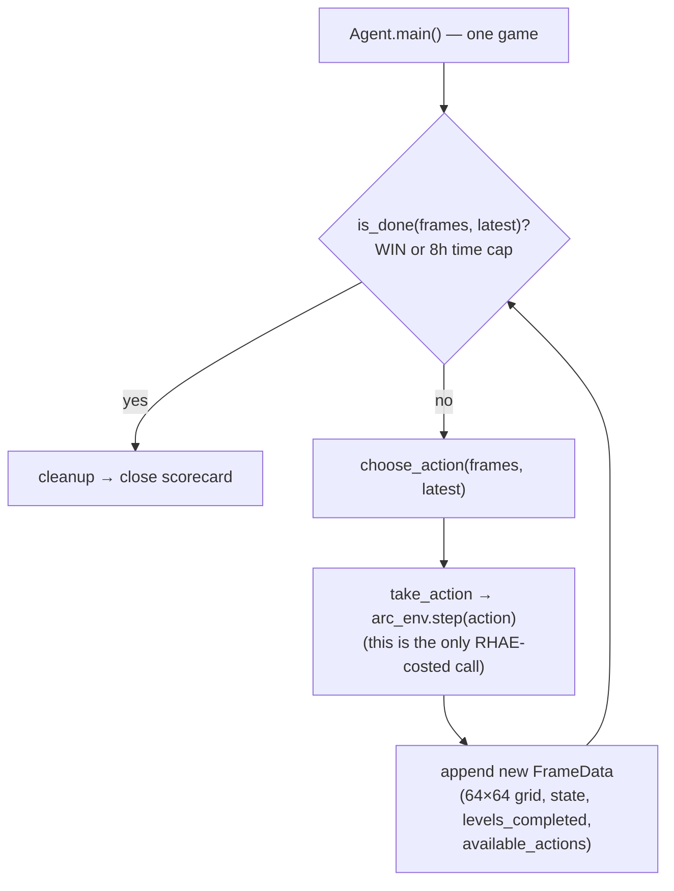
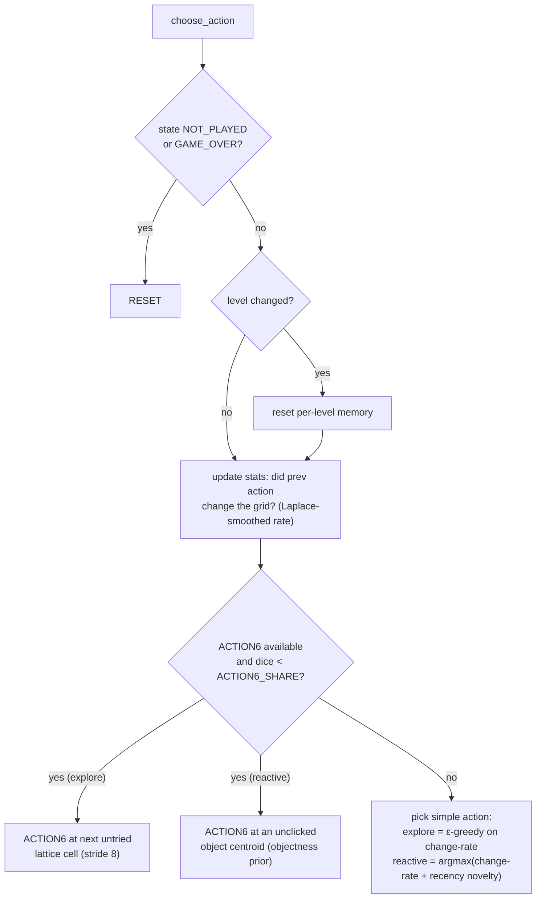
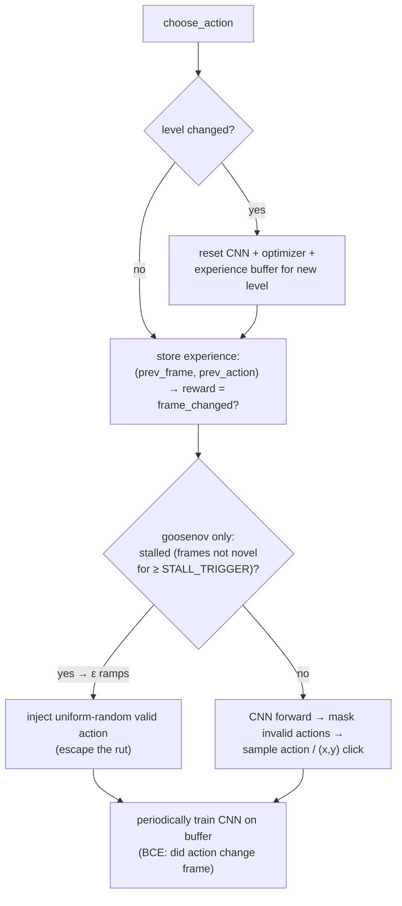

# How it works — agent logic + submission flow (with diagrams)

> Companion to `research.md` (benchmark mechanics, source-verified), `strategy.md` (ideas/hypotheses)
> and `cross-competition.md` (AGI-2 ↔ AGI-3 transfer). This file explains, with mermaid flows,
> **(a)** how our Kaggle submission notebook is wired, **(b)** the agent loop every candidate plugs
> into, and **(c)** the decision logic + principles of each of the 4 agents in `kernels/agents/`.
> Code: `kernels/agents/agent_*.py`; build: `kernels/build_notebooks.py`; config: `kca-arc-agi3.yaml`.

---

## TL;DR
- ARC-AGI-3 gives the agent **no rules, no goal, no demo pairs** — only a 64×64/16-colour frame per
  turn and ≤7 actions. Scoring is **RHAE = (human_actions / agent_actions)²** per level, so *wasted
  actions are punished quadratically*. The whole design question is: **how do you explore efficiently
  enough to win while spending few actions?**
- A Kaggle submission is a **4-cell notebook** where you customise **only the `MyAgent` class**. The
  scored run happens later in a **competition rerun** against a local `gateway:8001` env server (that
  is how "no internet at eval" + "API-only" coexist — the env is a container, not the public internet).
- We field **4 agents**, 2 per account: two learned (CNN) and two heuristic (no-NN). The heuristics
  are a deliberate hedge — they cannot crash on torch/CUDA and still produce a score.

---

## 1. The submission pipeline (notebook → my_agent.py → gateway → score)

The notebook is the official 4-cell skeleton (`kernels/build_notebooks.py` swaps cell 1 for our agent).
At **Save&Run (commit)** time there is no gateway, so it just writes a dummy `submission.parquet` to
satisfy the code-submission precondition. The **real** scoring happens during Kaggle's competition
rerun, when `KAGGLE_IS_COMPETITION_RERUN` is set and a `gateway:8001` env server is provisioned.

Key facts (verified from the official sample + SDK, see `research.md` / `kca-arc-agi3.yaml`):
- `enable_internet: false`; the only reachable server is the in-cluster `gateway:8001`.
- Comp is forced into `arc_agi.OperationMode.COMPETITION`: API-only, level-resets only, single scorecard.
- The **gateway sends `available_actions` as raw ints `[1..6]`** and omits `score` → use
  `levels_completed`. Every agent normalises both (`_avail_ids`, `_get_score`).
- **Daily submission limit = 1 per account per day** → we submit the best candidate per account first.

---

## 2. The agent loop (what `MyAgent` plugs into)

Every candidate subclasses `Agent` and implements just two methods: `is_done()` and `choose_action()`.
The framework's `main()` runs one game per agent instance until done; the Swarm runs all games
concurrently. Internal reasoning is *free* (not counted) — only `take_action` calls cost RHAE.

`GameAction`: `RESET`, `ACTION1..5` (simple), `ACTION6` (click — needs `{x,y}`), `ACTION7` (undo).
`GameState`: `NOT_PLAYED`, `NOT_FINISHED`, `WIN`, `GAME_OVER`. On `NOT_PLAYED`/`GAME_OVER` an agent
must `RESET`; on level change it resets its per-level memory.

---

## 3. The 4 candidates and their decision logic

| Kernel | Account | Family | Core idea |
|---|---|---|---|
| `arc3-goose` | harrysun2006 | learned CNN | StochasticGoose: a CNN learns *which action changes the frame*; trains online per level. |
| `arc3-goosenov` | harrysun2006 | learned CNN | goose + **count-based novelty escape**: when frames stop being novel, ramp ε-random to break ruts. |
| `arc3-explore` | firefly2006 | heuristic (no NN) | ε-greedy on per-action **change-rate** + ACTION6 **lattice sweep**. GPU-free. |
| `arc3-reactive` | firefly2006 | heuristic (no NN) | **object-centric** clicks (centroids of colour regions) + recency-novelty over simple actions. |

### 3a. Heuristic agents (`explore`, `reactive`) — no NN, robust hedge

The shared principle: the cheapest useful signal with no instructions is **"did my last action change
the world?"** Track per-action change-rate, prefer movers, and spend ACTION6 clicks where they are
most likely to matter. RHAE rewards this parsimony.

Why they differ: `explore` sweeps a **blind lattice** of coordinates (good coverage); `reactive`
clicks **object centroids** (far fewer, more meaningful clicks — cheaper under RHAE) and adds a
recency bonus so it stops spamming one direction.

### 3b. Learned agents (`goose`, `goosenov`) — CNN frame-change predictor

StochasticGoose (Tufa Labs, the best-known public baseline) learns a CNN that predicts, for the
current 64×64 frame, which of the 5 simple actions / which 64×64 click will change the frame; it
trains online from its own experience and resets the net each new level. `goosenov` adds a safe
novelty escape on top.

Principle: model-based exploration. The reward signal "*did the frame change*" is available with no
instructions, so the CNN learns the game's affordances online. `goosenov`'s only delta is the
**stall detector** — it escalates random exploration *only* when the model has demonstrably stopped
finding novelty, so it doesn't waste RHAE-costed actions when the model is already making progress.

---

## 4. Design principles (why these choices)
1. **RHAE punishes wasted actions quadratically** → every agent optimises *information per action*,
   not just task completion (object-centric clicks, change-rate priors, stall-gated exploration).
2. **Generalisation > public-set fit** → agents adapt *within an episode* (online learning / per-level
   memory reset) rather than memorising the 25 public envs (the 12.58%→0.25% cliff, see `insights.md`).
3. **Hedge the stack** → 2 learned + 2 heuristic. If torch/CUDA misbehaves in the rerun, the
   no-NN agents still produce a score; if learning pays off, the CNNs have the higher ceiling.
4. **Match the contract exactly** → ints-or-enums actions, `levels_completed` not `score`, T4 GPU only
   for CNNs, offline wheels — all validated locally against the 25 public envs before pushing.

> Validation evidence and the submission log live in `submissions.md`; the local test harness pattern
> (anonymous key → 25 public envs) is in `reference_arc_agi3_kaggle_ops` (memory) and `research.md` §7.
