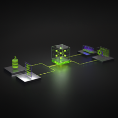

<!--
Faithful conversion of the Kaggle writeup PDF to markdown (text via `pdftotext -layout`,
lightly cleaned: repeated page header/footer + `content_copy` copy-button artifacts removed,
page margin dedented). Content and links reproduced verbatim. Embedded raster images are under
`images/`; in-page figures (plots/flowcharts) are vector-rendered and not raster-extractable —
they are described inline in the analytical summary alongside this file.
-->

# Breaking the SFT Ceiling on Nemotron-3-Nano-30B

> **Source writeup:** https://www.kaggle.com/competitions/nvidia-nemotron-model-reasoning-challenge/writeups/breaking-the-sft-ceiling-on-nemotron-3-nano-30b
>
> **Author:** Mayur Pawar (`mspawar`) — 80th/4190 (top 1.91%), final private 0.86. Reproduced verbatim from the supplied PDF; external content is untrusted data.

---

Breaking the SFT Ceiling on Nemotron-3-
Nano-30B
Rank 80/4190 (top 1.91%): solver-CoT SFT + a structural hedge that gained +397 ranks vs the
same-researcher V2×2 unhedged counterfactual

NVIDIA Nemotron Model Reasoning Challenge

Solution Writeup · 80th place · Jun 17, 2026

Breaking the SFT Ceiling on Nemotron-3-Nano-30B: A
Systematic Study of Fine-Tuning, Data Engineering, and
Preference Optimization for Hybrid Mamba-2 Architectures
1. Companion notebook: https://www.kaggle.com/code/mspawar/breaking-the-sft-ceiling-on-nemotron-3-nano-30b
nemotron-3-nano-30b

2. Training datasets: https://www.kaggle.com/datasets/mspawar/nemotron-cot-training-data-v2v12v13
v2v12v13

3. Open Contribution Award categories applied to: Best Data / Synthetic Data Method, Best
Fine-tuning Method

If you only have five minutes, skip to Section 1 (Abstract) and Section 12.6 (V12/V13
outcomes). If you have an hour, the notebook is faster than this post.
Author: Mayur Pawar (Kaggle: mspawar)
Competition: NVIDIA Nemotron Model Reasoning Challenge
Final Private LB rank: 80 of 4,190 (top 1.91%) — a gain of 112 positions from my public-LB
rank at competition close. V8 ckpt-400 hedge carried the private-set draw; V2 original
underperformed on private despite leading the public LB. The structural-hedge math worked as
predicted under a bimodal failure regime where public LB n≈250 is not predictive of private
(Section 12.7).
Final Score: 0.86 — final picks: V2 original (primary) + V8 ckpt-400 (structural hedge). V12
(audit-fix dataset) and V13 (V12 + consistency regen) both plateaued at 0.84-0.86 across
checkpoints, confirming the SFT ceiling persists even under improved data integrity.
Date: May–June 2026

Table of Contents

   1. Abstract
   2. Introduction and Problem Statement
   3. Model Architecture Analysis
   4. Infrastructure and Compute
   5. Data Engineering and Solver Development
   6. Supervised Fine-Tuning: From 0.59 to 0.86
   7. The SFT Ceiling: Diagnosis and Evidence
   8. Reinforcement Learning Approaches
   9. Preference Optimization (DPO)
   10. Weight Averaging and Model Merging
   11. Cross-Model Review Analysis
   12. Full-Dataset Audit, CoT Leakage Fixes, and Targeted Synthetic Data (V12)
   13. Key Findings and Contributions
   14. Reproducibility
   15. Conclusion

1. Abstract

       Credit upfront: my 0.86 baseline (V2, submitted April 21, 2026) was built
       directly on Tong Hui Kang's published deterministic-solver methodology and the
       recipe from his Kaggle Progress Prize-winning approach. That same April 21
       submission has remained my highest-scoring adapter across every subsequent
       experiment and is one of my two final selections. Everything in this writeup
       beyond Section 6 — solver extensions, the executable-CoT audit, failure-driven
       synthetic data, the negative-result body around RL/DPO/weight-averaging — is
       layered on top of that head-start. See Section 4.6.
I present a comprehensive study of post-training optimization for NVIDIA's Nemotron-3-Nano-
30B-A3B-BF16, a hybrid Mamba-2 + Transformer + MoE architecture, on structured reasoning
tasks. Through 30+ controlled experiments spanning Supervised Fine-Tuning (SFT), Self-Taught
Reasoning (STaR), Group Relative Policy Optimization (GRPO), Direct Preference
Optimization (DPO), and weight averaging, I:

   1. Identified and overcame a critical sequence length bottleneck (4096→8192) that
      alone accounted for a 0.46→0.77 score jump
   2. Built domain-specific algorithmic solvers covering 97.6% of cryptarithm problems (83
      operations) and 87.5% of equation_symbolic problems via CP-SAT constraint
      programming
   3. Proved the SFT ceiling at 0.86 through six independent experiments varying data
      volume, quality, distribution, and hyperparameters
   4. Discovered that Mamba-2 SSM parameters are fundamentally incompatible with
      weight averaging — the first documented evidence that Model Soup fails on hybrid
      SSM architectures
   5. Demonstrated that all hard problems exhibit binary failure modes (0/8 correct at
      temperature 0.7) with zero boundary problems, explaining why standard GRPO produces
      no learning signal
   6. Designed a novel DPO pipeline using greedy (temp=0.0) rejected completions paired
      with deterministic solver Chain-of-Thought as chosen, specifically engineered for the
      binary-failure regime
   7. Audited every training trace against the full 9,500-problem dataset, empirically
      confirming that answer-guided solvers can emit internally inconsistent CoT (93-97% of
      cryptarithm traces) — the model memorizes answers instead of learning procedures
   8. Identified and fixed "discovery leakage" in equation_numeric CoT: reasoning steps
      that are only derivable from the ground-truth answer teach verification, not solving.
      Replacing them with a deterministic, prompt-derivable policy fixed 37 systematic
      inference errors
   9. Developed failure-driven targeted synthetic data generation: synthesizing problems
      whose ground-truth rules contain the rare ternary gates (CHO, MAJ) responsible for
      14.3x/5.2x overrepresented failures, with rejection sampling against the production solver
      for byte-identical CoT format

My work contributes methodological insights applicable to any hybrid SSM/Transformer
architecture, a systematic ablation framework for LoRA fine-tuning, and domain-specific solver
engineering that transforms intractable reasoning problems into verifiable training data.

2. Introduction and Problem Statement

2.1 Competition Setup
The NVIDIA Nemotron Model Reasoning Challenge tasks participants with creating a LoRA
adapter (rank ≤ 32) for Nemotron-3-Nano-30B that maximizes accuracy on 500 hidden test
problems across 10 categories of structured reasoning:

        Category                         Type                          Difficulty
cipher                   Character substitution ciphers       Easy (97.5% accuracy)
gravity                  Gravity-based character transforms Easy (~96%)
numeral                  Numeral system conversions           Easy (~95%)
unit_conversion          Unit conversion problems             Easy (~95%)
bit_manipulation         Binary encoding, bitwise logic gates Hard (88.2%)
equation_numeric_deduce Numeric equations, deductive          Hard (87.5%)
equation_symbolic_deduce Symbolic algebra, custom digit maps Unknown (no direct training)
equation_numeric_guess Numeric equations, missing operator Very Hard (0%)
cryptarithm_deduce       Cryptarithmetic, known operators Very Hard (8.5%)
cryptarithm_guess        Cryptarithmetic, unknown operators Very Hard (21.4%)

2.2 Evaluation Protocol

   •   Inference engine: vLLM with LoRA adapter loaded at runtime
   •   Decoding: Greedy (temperature=0.0, top_p=1.0)
   •   Max tokens: 7,680 generation + 512 prompt ≈ 8,192 total
   •   Answer extraction: Last \boxed{...} in model output
   •   Metric: Exact-match accuracy (with 1% numeric tolerance)

2.3 Key Constraints

   •   LoRA rank ≤ 32 (880M trainable parameters out of 32.4B)
   •   No control over inference prompt or decoding strategy
   •   Single adapter per submission — no ensembling or routing
   •   5 submissions per day per account
   •   Evaluation variance: ±0.04 (±20 problems on 500)

3. Model Architecture Analysis

3.1 Architecture Overview

Nemotron-3-Nano-30B-A3B-BF16 is a hybrid architecture combining three distinct layer
types:

    Component         Count                               Parameters
Mamba-2 SSM                   Selective State Space Model with learned recurrence matrices (A, B,
                      23
layers                        C, D)
MoE layers            23      Mixture of 128 experts, 6 active per token (sparse routing)
    Component        Count                             Parameters
Attention layers     6     Standard multi-head attention
Total / Active       52    30B total / 3.5B active per token

3.2 Architecture-Specific Training Challenges

Mamba-2 SSM layers require special handling:

   •   The fast path (is_fast_path_available) is computed at module import time from
       mamba-ssm and causal-conv1d availability — install both before the first transformers
       import, or the model silently falls back to a much slower pure-PyTorch SSM path. Note
       that transformers ships a built-in nemotron_h module alongside the hub's remote-code
       copy; when verifying the flag, read it from the module the model's own Mamba2Mixer
       class lives in, not from a sys.modules name scan (the built-in copy can report a different
       value)
   •   SSM parameters (A, B, C, D matrices) encode temporal dynamics through learned
       recurrence. These parameters define discrete-time state transitions: h_t = A * h_{t-1}
       + B * x_t; y_t = C * h_t + D * x_t. This has profound implications for model
       merging (see Section 10)
   •   The mamba-ssm package requires CUDA compute capability sm_90+ (H100/H200/RTX
       PRO 6000 Blackwell)

MoE routing layers must never be fine-tuned:

   •   The 128 expert routers are pre-trained across massive data volumes
   •   Fine-tuning on a 16K-sample domain causes "Expert Collapse" — all inputs route to 1-2
       experts
   •   My LoRA config explicitly excludes gate_proj from target modules

Dummy expert code path causes dtype mismatches during quantized training:

   •   MoE layers create dummy tensors for experts receiving no tokens:
       torch.zeros_like(hidden_states).to(expert_dtype)
   •   With int8/4-bit quantization, these int8 tensors flow through LoRA's bf16 linear layers,
       causing crashes
   •   Required patches to nn.Linear.forward, index_add_, and dropout operations

3.3 Hardware Requirements

       Configuration                                        Result
                               Failed — 7 different failure modes, model fundamentally too
Kaggle T4 x2 (2×15GB)
                               large
Colab A100 40GB                Failed — bf16→4bit conversion OOM during loading
                               Partial — quantized training possible but fragile, mamba kernel
Colab H100 80GB
                               issues
        Configuration                                    Result
Vast.ai H200 141GB             Works — bf16 training, my V21 breakthrough
Vast.ai RTX PRO 6000
                               Production config — bf16 training with ~25GB headroom
95.6GB

Critical finding: Minimum viable GPU is 95.6GB VRAM with sm_90+ compute capability.
Below this, no combination of quantization, offloading, or memory optimization produces stable
training for this hybrid architecture.

4. Infrastructure and Compute

4.1 Training Pipeline

┌──────────────────┐     ┌───────────────────┐     ┌─────────────────┐
│ Solver Pipeline   │────→│ Dataset Builder    │────→│ SFT Training    │
│ (Local Machine)   │     │ (Local)            │     │ (Vast.ai GPU)   │
│                   │     │                    │     │                 │
│ • Cryptarithm     │     │ • Format to JSONL │      │ • bf16, LoRA    │
│ • Equation Sym    │     │ • Stratified interl │     │ • seq_len=8192 │
│ • Bit Manip       │     │ • Category balance │      │ • HF Trainer    │
│ • Equation Num    │     │ • Dedup & verify    │     │ • GCS checkpts │
└──────────────────┘     └───────────────────┘     └────────┬────────┘
                                                             │
┌──────────────────┐     ┌───────────────────┐              │
│ Kaggle Eval       │←────│ Submission Zip     │←─────────────┘
│ (vLLM inference) │      │ (adapter files)    │
│ temp=0.0, 7680tok │     │ adapter_model.safet│
└──────────────────┘     │ adapter_config.json│
                          └───────────────────┘

4.2 RL/Preference Pipeline (DPO)

┌────────────────────┐     ┌─────────────────┐     ┌──────────────────┐
│ vLLM Generation     │────→│ Pair Builder     │────→│ DPO Training     │
│ (Vast.ai, separate) │     │ (CPU, fast)      │     │ (Vast.ai GPU)    │
│                     │     │                  │     │                  │
│ • N=8 at temp=0.7   │     │ • Greedy-priority│     │ • Custom trainer │
│ • N=1 at temp=0.0   │     │   rejected sel. │      │ • Ref log probs │
│ • Binary rewards     │     │ • Solver CoT as │      │ • SFT mixing     │
│ • Quality filters    │     │   chosen         │     │ • Length-norm LP │
│ • Group classif.     │     │ • Category stats │     │ • GCS checkpts   │
└────────────────────┘     └─────────────────┘     └──────────────────┘

Key design: vLLM generation and HF training run in separate processes, never sharing GPU
memory. This is the only way to fit N=8 completions with 7680 max tokens into 95.6GB VRAM
— standard TRL frameworks (GRPOTrainer, DPOTrainer) allocate all completions
simultaneously and OOM.
4.3 Tokenization Pattern (Critical — Bugs Here Are Silent Killers)

# PROVEN CORRECT — used across all versions from V21 onward
prompt_ids = tokenizer.apply_chat_template(
    [{"role": "user", "content": problem_text}],
    tokenize=True,
    add_generation_prompt=True,
    enable_thinking=True # Adds <think> tag infrastructure
)
completion_ids = tokenizer.encode(
    assistant_content, # CoT reasoning + \boxed{answer}
    add_special_tokens=False
) + [11] # 11 = <|im_end|> token
input_ids = prompt_ids + completion_ids
labels = [-100] * len(prompt_ids) + completion_ids # Mask prompt from loss

V20 tokenization bug: A 2-token label shift caused loss to plateau at 25-30 and the model
produced gibberish. The prompt/completion boundary was off by 2 tokens, meaning the model
was trying to predict prompt tokens as if they were completion tokens. This was a silent killer —
training appeared to proceed normally (loss decreased) but the model was learning garbage.
Diagnosis required manual inspection of input_ids vs labels alignment.

4.4 Compute Budget

              Phase              GPU Hours                      Cost
Early SFT experiments (V1-V8e) ~40h        Vast.ai ~$55
seq_len breakthrough (V14-V21) ~30h        Vast.ai ~$60
Track-X era SFT (V2-V9)          ~80h      Vast.ai ~$110
RL experiments (STaR, GRPO) ~20h           Vast.ai ~$28
DPO pipeline (gen + train)       ~15h      Vast.ai ~$21
Full-eval audit, V12, V13 (June) ~120h     Vast.ai + Colab Pro+
Final-week submission harvest ~30h         Colab Pro+
Total                            ~335h     ~$1,000 Vast.ai + ~$1,000 Colab Pro+ credits

All solver development, dataset building, and analysis ran on a local machine at zero GPU cost.

4.5 The Compute Procurement Story (Why Vast.ai + Colab Instead of GCP)

The infrastructure ended up as a hybrid of two paid GPU sources, not by preference but by
necessity. The original plan was to use Google Cloud G4 VMs (RTX PRO 6000 Blackwell
Server Edition) — the platform Kaggle and NVIDIA explicitly recommended in the competition
page. The GCP quota request for these GPUs was denied at the project level and the appeal
cycle ran longer than the window of useful work allowed. By the time GCP would have been
usable, the experimental phase was already past the breakpoint where the recipe was being
honed. I never trained on the recommended infrastructure.
Vast.ai filled the gap from week one: RTX PRO 6000 instances at ~$0.94–$1.38/hr on-demand,
sm_120, 95.6 GB VRAM, sm_90+ as required by mamba-ssm CUDA kernels. The good: cheap,
available, and the exact GPU class the eval harness uses. The bad: instance speed variance was
significant. Two instances at the same advertised spec could differ ~30–40% in tokens/second
— host bandwidth and CPU bottlenecks (data loader stalls) bit hardest. I learned to benchmark
every new instance with a 10-step dry run before committing a 30-hour training job. A few runs
were killed and restarted on a faster host when the first instance came in below par. Total Vast.ai
spend: ~$1,000 across solver iteration, ~30 SFT runs, RL/DPO development, and the
audit/V12/V13 push.

Colab Pro+ became the second leg in late May for the V12/V13 parallel training: the same RTX
PRO 6000 95.6 GB G4 as Vast, but with persistent Drive storage for checkpoint zips (no GCS
bucket plumbing required) and the existing notebook ecosystem. Overall a positive experience
— predictable, easy to resume, easy to share. Two friction points:

   1. G4 availability during peak hours (US daytime, weekends) often pushed me to L4 or
      even T4 fallback, neither of which support mamba-ssm. I learned to start sessions in off-
      hours and queue jobs so the instance was held.
   2. 24-hour session length cap even on Pro+, with no documented option to extend. This
      forced the resume-from-checkpoint path that surfaced the
       WeightConverter.__init__() got an unexpected keyword argument
       'distributed_operation' bug in peft 0.19.1 + transformers 5.10.2 — never seen
       before because no prior session had needed to resume. I built a raw-torch bypass (load
       adapter_model.safetensors, remap .lora_A.weight → .lora_A.default.weight,
       copy under no_grad, monkey-patch trainer._load_from_checkpoint) and validated
       it: 12,011/12,011 tensors loaded, optimizer/scheduler/RNG intact, step 251 LR exactly
       1.067e-4, loss 0.02 continuation. Documented for the next person who hits this.

Claude Code in the loop. The Colab training notebooks (train_colab_v12.ipynb,
train_colab_v13.ipynb, train_colab_v2_derivation.ipynb) and the public companion
notebook were authored and debugged with Claude Code. This was material to the schedule:
notebook iteration that would have taken half a day each — pip-install ordering for the NVIDIA
Utility Script constraints, the Mamba fast-path false-alarm diagnosis (a sys.modules name-scan
was reading the unused built-in transformers.models.nemotron_h flag instead of the active
remote-code copy whose flag was True; ~1.5 months of false warnings until Claude Code traced
it to the correct module), the WeightConverter bypass design, and the inline category-balance
audits — collapsed to single-session turnarounds. The audit-fix scripts
(regen_eqnum_fixed.py, generate_bm_cho_maj.py, regen_gravunit_fixed.py) were
written with Claude Code's loop on the project memory rather than from scratch each time. The
4-day final-week sprint (data audits → V12 → V13 → submission harvest plan) would not have
fit otherwise.

4.6 Credit Where the Score Came From

The 0.86 baseline this entire writeup builds on — V2 (Solver CoT, 16,532 entries, 2 epochs, V2
hyperparameters) — was first submitted on April 21, 2026 and has remained the highest-scoring
single adapter I produced across every subsequent experiment. It is the submission I have
selected as one of my two finals. The recipe and the deterministic-solver methodology came
from Tong Hui Kang's published work (Kaggle Progress Prize-winning approach). My April
21 head-start was direct: V2's dataset is track_x_v2.jsonl, built with
build_track_x_data.py whose generators (huikang_reasoners/*.py) are vendored from
Tong Hui Kang's repository with minimal modification, and whose hyperparameters (rank=32,
alpha=32, linear scheduler, warmup=0, dropout=0.0, 2 epochs, seq_len=8192) were ablated
against Tong Hui Kang's settings and found to be optimal there as well. Everything in this
writeup beyond Section 6 is layered on top of that head-start: solver extensions (cryptarithm
39→83 operations), the executable-CoT audit (Section 12), the failure-driven CHO/MAJ
synthesis (Section 12.4), the gravity/unit consistency regen (Section 12.6), and the negative-
result body around RL/DPO/Mamba-2 weight averaging. They produced methodological
findings and confirmed the SFT ceiling — they did not, in the end, beat the April 21 score.

5. Data Engineering and Solver Development

5.1 Philosophy: Deterministic Solver CoT > Model-Generated CoT

A core finding of this work is that deterministic, solver-generated Chain-of-Thought traces
strictly outperform model-generated traces for training. This was established through multiple
controlled experiments:

Experiment                 CoT Source                 Score            Finding
V7 (Phase 1) Model self-generated                   0.60      Regression from V3's 0.62
V6 (Track-X) V2 solver replaced with STaR model CoT 0.84-0.85 Regression from V2's 0.86
V10a         CoT in SFT format                      0.57      enable_thinking conflict
V10b         DeepSeek-R1 long external CoT          0.27      Catastrophic destruction

The explanation: model-generated CoT is more verbose, less structured, and occasionally
contains wrong reasoning despite arriving at the correct answer ("correct answer ≠ correct
reasoning"). Long external CoT from different architectures (DeepSeek-R1) is catastrophically
toxic — the model's internal reasoning mechanisms conflict with externally-imposed reasoning
patterns.

Principle: For structured reasoning tasks with algorithmic solutions, invest in building
deterministic solvers that produce verified, forward-executable reasoning traces. The quality
ceiling of your training data is determined by your solver, not your model.

5.2 Cryptarithm Solver: From 39 to 83 Operations

Cryptarithm problems are the single highest-leverage category, accounting for 57.5% of all
errors (65/113 on my validation set).

Problem Structure
    •   Input: 5 characters = A1 A2 OP B1 B2 (two 2-char operands + 1-char operator)
    •   Output: variable length (1-4 chars) in the same symbol set
    •   Each problem has 3-5 example equations + 1 question
    •   Symbols: non-alphanumeric characters (!@#$%^&*()_+-=[]{}|;:'",.<>?/\~)
    •   Two subtypes: cryptarithm_deduce (question operator in examples) and
        cryptarithm_guess (question operator NOT in examples)

Solver Evolution

Version 1: Backtracking solver (39 operations)

    •   Standard backtracking with forced propagation
    •   5000/3000 combination limits, 15-second timeout
    •   4 reversal modes (rev_ops, rev_res)
    •   Solved ~220 unique problems for V2 training data

Version 2: CP-SAT solver (42 operations)

    •   Google OR-Tools CP-SAT constraint solver
    •   600-second timeout with solution enumeration callback
    •   Pre-computed lookup tables for operation verification

Version 3: Enhanced answer-guided solver (83 operations) — FINAL

The key innovation is answer-guided permutation search: instead of blindly searching all
digit→symbol mappings, the solver exploits the ground-truth answer to dramatically prune the
search space:

For each permutation of digit symbols → digits 0-9:
    1. Decode the ground-truth answer FIRST
    2. For the question equation: find operations producing the decoded
answer
    3. For each candidate operation: verify ALL example equations
    4. If all pass → solution found

This approach is dramatically faster because answer-first pruning eliminates ~99% of
permutations early. The solver doesn't need to enumerate all 83 operations × 10! permutations ×
4 reversal modes — it only needs to check operations that produce the known answer for the
current permutation.

Results: 569/583 previously-unsolved problems solved (97.6%). Runtime: 669.8 minutes with 4
workers.

14 unsolvable problems: All have 11+ unique digit symbols — impossible with unique 0-9
mapping (only 10 digits exist).

Operation Categories (83 total)
     Category       Operations                             Examples
Standard arithmetic 6          add, sub, mul, abs_diff, div, mod
±1/±2 variants      10         mul_add1, mul_sub1, add_add1, sub_sub2
Scaling             2          double_sum, triple_sum
Combined            6          mul_plus_sum, mul_minus_a, mul_plus_b
Power/Square        5          a_squared, b_squared, sum_of_squares, diff_squared
Digit-level         8          digit_xor, digit_and, digit_or, cross_multiply, determinant
Concatenation       2          concat_fwd, concat_rev
GCD/LCM/Average 3              gcd, lcm, avg_floor
Modular             2          add_mod100, sub_mod100
Reverse variants    4          add_rev, sub_rev, mul_rev, abs_diff_rev
40+ discovered      new        Operations found by the enhanced solver not in any prior solver

CoT Format

I need to infer the transformation rule from the examples.
I will put my final answer inside \boxed{}.

Let me analyze the examples:
  【symbol_equation】 = 【result】
  ...

The operators are: 【op1】, 【op2】, ...

For the arithmetic operators, I need to find a digit mapping.

Digit mapping:
  【symbol】 = digit
  ...

Operator 【op】 (operation_name):
  【a1】【a2】 【op】 【b1】【b2】 = 【result】
    numeric_a operation_name numeric_b = numeric_result
  ...

Question: 【question】
  Left: 【a1】【a2】 = numeric_value
  Operator: 【op】 is operation_name
  Result: numeric_result = 【answer_symbols】

The final answer is answer_symbols
</think>
\boxed{answer_symbols}

Critical CoT Analysis (Later Confirmed Empirically — See Section 12)

An independent review identified a structural limitation in my cryptarithm CoT: while the digit
mapping is derivable from the example equations (no answer leakage), the CoT presents the
mapping as given without showing the discovery process. At inference time, the model must
find the mapping from scratch — a combinatorial search over 83 operations × 10! permutations
— but the CoT never demonstrates this search. The model learns to VERIFY mappings but not
to DISCOVER them. This likely explains the persistent 8.5% accuracy on cryptarithm_deduce
despite extensive training (440 examples in V2, 1000+ in V8).

June 8 update: A full audit (Section 12.2) found the problem is worse than "verification-only"
— 93-97% of cryptarithm traces are internally inconsistent: the stated digit mapping does not
actually produce the boxed answer. The answer-guided solver found the answer through a search
path the CoT does not represent. The model trained on these traces memorizes answers rather
than learning any procedure, fake or real.

Implication: Future work should investigate "forward-executable" CoT that demonstrates the
constraint-satisfaction search process, not just its result. However, such traces may exceed the
8192-token sequence limit. A preliminary experiment with step-by-step derivation CoT (V2-
derivation) scored 0.84 at mid-training — no improvement over presenting the mapping as
given. Top leaderboard scores (0.90) imply some CoT formulation does crack this category at
rank 32; mine did not.

5.3 Equation Symbolic Solver: CP-SAT Constraint Programming

   •   Coverage: 720/823 problems solved (87.5%)
   •   Method: CP-SAT constraint solver with variable-to-digit mapping, operation
       identification, and multi-equation consistency checking
   •   Missing 103 problems: Require solver modes not implemented (little-endian, Alice
       mode, bitwise operations, polynomial operations)

Critical finding: Adding equation_symbolic training data to SFT is actively harmful. Three
independent experiments confirm this:

Experiment eq_sym entries Total data Score        vs V2
V5          558           17,090    0.85      -0.01
V9 ckpt-250 665           17,197    0.83-0.84 -0.02 to -0.03
V9 ckpt-300 665           17,197    0.82-0.83 -0.03 to -0.04

Hypothesis: The model already handles equation_symbolic adequately (~75%) through transfer
learning from equation_numeric training. Explicit equation_symbolic CoT uses different
reasoning patterns that interfere with this transfer. An alternative explanation: the solver's 87.5%
coverage means some CoT entries may have subtly wrong reasoning for the right answer
(analogous to V6's model-CoT problem).

Principle: Not all correct training data is beneficial. Data that disrupts existing transfer-learned
capabilities can be net-negative, even when individually correct.

5.4 Bit Manipulation Solver: Ternary Gate Logic
   •   Added 9 ternary (3-input) gates: MAJ, CHO, PAR3, AO, OA, AX, OX, XA, XO
   •   Post-processing brute-force pass for "default 1" bits
   •   Fixed 9/20 validation errors (from 3/20 before)
   •   Remaining 11 errors likely need 4-input gates (AOA, OAO, PAR4, XX, AXA)

TERNARY_GATES = {
    "MAJ": lambda a, b, c: "1" if (int(a)+int(b)+int(c)) >= 2 else "0",
    "CHO": lambda a, b, c: b if a == "1" else c, # mux/choose
    "PAR3": lambda a, b, c: str(int(a) ^ int(b) ^ int(c)),
    "AO": lambda a, b, c: "1" if (a=="1" and b=="1") or c=="1" else "0",
    "OA": lambda a, b, c: "1" if (a=="1" or b=="1") and c=="1" else "0",
    "AX": lambda a, b, c: str((int(a) & int(b)) ^ int(c)),
    "OX": lambda a, b, c: str((int(a) | int(b)) ^ int(c)),
    "XA": lambda a, b, c: str((int(a) ^ int(b)) & int(c)),
    "XO": lambda a, b, c: str((int(a) ^ int(b)) | int(c)),
}

5.5 Data Quality Validation Framework

Every training entry passes through a multi-stage validation pipeline:

   1. Answer verification: Solver answer must match train.csv ground truth (string or
      numeric with 1% tolerance, strict binary string comparison)
   2. CoT structural validation: Must contain </think> tag, \boxed{} must appear after
      </think>, reasoning must be longer than answer portion
   3. Completion quality filters: 100-12,000 character length, no pathological repetition (4-
      gram repeated ≥5 times), valid \boxed{} in answer section
   4. Format normalization: Strip <think> prefix (added by apply_chat_template),
      normalize </think> placement, ensure single \boxed{} in answer section
   5. Deduplication: prompt[:200] key-based dedup, first-source priority

5.6 Dataset Composition (V2 Gold Standard — 0.86)

        Category        Entries % of Total Duplication               Solver
cipher                  ~3,200 19.4%      1x              Tong Hui Kang deterministic
bit_manipulation        ~2,800 16.9%      1x              Rule-based + ternary gates
gravity                 ~2,500 15.1%      1x              Deterministic
equation_numeric_deduce ~2,200 13.3%      1x              Numeric solver
unit_conversion         ~1,800 10.9%      1x              Deterministic
numeral                 ~1,500 9.1%       1x              Deterministic
equation_numeric_guess ~900 5.4%          1x              Numeric solver
cryptarithm_deduce      440     2.7%      2x (220 unique) Enhanced solver v1
cryptarithm_guess       ~170 1.0%         1x              Enhanced solver v1
equation_symbolic       0       0%        —               Not included
TOTAL                   16,532 100%       —               —
V2 achieves 0.86 with zero explicit equation_symbolic training, relying entirely on transfer from
equation_numeric.

6. Supervised Fine-Tuning: From 0.59 to 0.86

6.1 Phase 1: Establishing Baselines (V1-V7, Score Range: 0.57-0.63)

Version Score           Key Variable Changed                                 Finding
V1      0.59 Baseline SFT, 9500 samples                         Starting point
V2      0.62 Reweighted data, 6133 samples                      Quality > quantity signal
              Gold CoT (Gemini+Claude distillation), r=32,
V3      0.62                                                    External CoT viable
              alpha=64
                                                                Alpha matters; don't remove
V4      0.60 Alpha 64→16, removed gate_proj
                                                                gate_proj
V5      0.60 NEFTune, seq=1024, no gate_proj                    NEFTune unhelpful
                                                                Lucky seed (V8a replica =
V6      0.63 Community config, 4440 samples
                                                                0.57)
V7      0.60 Self-generated CoT                                 Model CoT < external CoT

Critical control experiment: V6 scored 0.63 and appeared to be progress. V8a replicated V6
exactly and scored 0.57 — proving V6 was a lucky seed within the ±0.04 evaluation variance.
This established the practice of submitting 3x per checkpoint to distinguish signal from noise.

6.2 Phase 2: Controlled Ablation (V8a-V8e, Score Range: 0.57-0.68)

Version Score                Key Variable                           Finding
V8a    0.57      Exact V6 replica                      Killed lucky-seed hypothesis
V8b    0.61      Higher LR=1e-4                        LR is a significant lever
V8c    0.60      3 epochs, LR=3e-5                     More epochs not inherently better
V8d    0.60-0.64 Eval-format-aligned data              Modest format alignment gain
V8e    0.68      Answer-only + all-linear LoRA targets Major breakthrough

V8e's finding that all-linear LoRA targets (applying LoRA to every linear layer including
lm_head) outperforms selective targeting was a critical insight. Combined with answer-only
format (no CoT at this point), it established the LoRA architecture for all subsequent
experiments.

6.3 Phase 3: CoT Toxicity (V9-V10b, Score Range: 0.27-0.64)

Version Score        CoT Source                             Finding
V9      0.64 Merged V8d+V8e adapters      Small merging gain at lower scores
V10a 0.57 CoT in SFT with enable_thinking enable_thinking flag conflict
Version Score     CoT Source                                 Finding
V10b 0.27 DeepSeek-R1 long CoT                    CATASTROPHIC — destroyed the model

V10b is the most important negative result: Long Chain-of-Thought from an external model
(DeepSeek-R1) reduced accuracy from ~0.60 to 0.27 — worse than no adapter at all (~0.30). The
model's internal reasoning mechanisms are fundamentally incompatible with externally-imposed
long reasoning patterns. This established the principle: only use short, deterministic, solver-
verified CoT.

6.4 Phase 4: The Sequence Length Breakthrough (V14-V21, Score: 0.46→0.77)

This phase contained the single most impactful discovery of the project.

Version Score seq_len Data Loss                          Finding
V14    0.46      2048 35% truncated Lost \boxed{} on long completions
V17    0.58-0.60 4096 43% dropped ALL bit_manipulation + equation categories dropped
V18    0.56      4096 same          Confirmed: seq_len, not tokenization, was the issue
V20    N/S       8192 0%            OOM (H100 80GB) + 2-token label shift bug
V21    0.77      8192 0%            THE BREAKTHROUGH

At seq_len=4096, 43% of training data was silently dropped because completions exceeded the
length limit. This disproportionately affected the hardest categories (bit_manipulation,
equation_numeric/symbolic) because their CoT traces are longest. Increasing to 8192 kept all
data and produced a 0.68→0.77 jump (+0.09).

This finding has broad implications: sequence length truncation is a silent data quality killer.
Unlike an explicit error, truncated sequences still contribute to training loss — but they teach the
model to produce incomplete reasoning that lacks \boxed{} answers. The model learns to reason
but not to conclude.

6.5 Phase 5: The 0.86 Plateau (Track-X V2-V9)

 Version      Score Data                 Key Change                         Finding
V2          0.86      16,532 Solver CoT, all categories, 2 epochs GOLD STANDARD
V3          0.84      varied Multi-stage SFT                      Single-stage better
V5          0.85      17,090 +equation_symbolic                   eq_sym data hurts
V6          0.84-0.85 16,576 STaR replacements                    Model CoT < solver CoT
V7          0.83-0.84 ~8,700 alpha=64, cosine sched               Wrong hparams + fewer data
V8 ckpt-400 0.86      17,670 +3x crypto data                      Matched but didn't beat V2
V8 ckpt-554 0.84-0.85 17,670 Overtrained                          Degraded after 72% mark
V9 ckpt-250 0.83-0.84 17,197 +equation_symbolic                   eq_sym confirmed harmful
V9 ckpt-300 0.82-0.83 17,197 Further training                     Worsening regression

6.6 Gold Standard Hyperparameters (V2)
After extensive ablation, the following configuration achieved 0.86:

    Parameter                       Value                           How Established
Learning Rate      2e-4                                     V8b ablation (1e-4 vs 3e-5 vs 2e-4)
Epochs             2                                        V8c proved 3 overfits; 1 underfits
Effective Batch
                   64                                       Standard for 16K dataset
Size
Sequence Length    8192                                     V14-V21 breakthrough
LoRA Rank          32                                       Competition maximum
LoRA Alpha         32                                       V7 proved alpha=64 hurts
                                                            Required for hybrid architecture
Dropout            0.0
                                                            stability
Scheduler          Linear decay                             V7 proved cosine hurts
Warmup             0                                        Empirically optimal
Optimizer          AdamW (beta2=0.95)                       Standard for language models
Max Grad Norm      1e9 (effectively off)                    SFT doesn't need clipping
                   k/q/v/o_proj, in/out/up/down_proj,
Target Modules                                              V8e's all-linear finding
                   lm_head

7. The SFT Ceiling: Diagnosis and Evidence

7.1 Six Independent Confirmations

The SFT ceiling at 0.86 was confirmed across experiments varying every conceivable axis:

      Axis Varied              Experiment            Score       vs V2
More data (same quality) V8: +1,138 crypto entries 0.86      =
More data (new category) V5: +558 eq_sym entries 0.85        -0.01
Data source (model CoT) V6: STaR replacements 0.84-0.85 -0.01
Hyperparameters          V7: alpha=64, cosine      0.83-0.84 -0.02
More training            V8: 3 epochs worth        0.84-0.85 -0.01
Different category focus V9: +665 eq_sym           0.82-0.84 -0.02 to -0.04

Every deviation from V2's recipe either matched or regressed. No SFT variant broke through.

7.2 The Binary Failure Phenomenon

STaR Round 1 (N=8 completions per problem at temperature 0.7) revealed:

   •   3,157 hard problems: ALL scored 0/8 correct (complete outliers)
   •   ~6,343 easy problems: Most scored 8/8 correct (complete inliers)
   •   0 boundary problems: Zero problems scored 1-7/8
The model's failure mode is fully binary: it either has the capability to solve a problem class or it
doesn't. There are no "almost solved" problems. This has profound implications for RL
approaches (Section 8).

7.3 Why SFT Cannot Break Through (Analysis)

SFT's cross-entropy loss only provides positive signal: "make this output more likely." It never
says "make that wrong output LESS likely." Three consequences:

   1. Wrong reasoning paths remain probable: The model may assign significant
      probability mass to incorrect reasoning patterns. SFT can increase probability of correct
      patterns but cannot decrease probability of incorrect ones.
   2. Distribution sensitivity: Adding new categories dilutes the gradient signal on existing
      categories. V2's natural distribution is a fragile equilibrium — any perturbation risks
      catastrophic forgetting on easy categories while failing to improve hard ones.
   3. The knowledge exists but can't transfer: V8 proved the model LEARNS new patterns
      (training loss on crypto decreased) but can't GENERALIZE them to unseen test
      problems. SFT teaches pattern memorization, not flexible reasoning.

7.4 Alternative Diagnosis: CoT Quality Bottleneck

An independent review (Section 11) argued that the "SFT ceiling" may not be fundamental but
rather an artifact of CoT quality. The cryptarithm CoT, while answer-correct, presents digit
mappings without teaching the discovery process. The model learns to verify but not to discover
— and at inference time, discovery is required. If true, this means the ceiling is breakable
through better CoT engineering rather than algorithmic changes (DPO/RL).

This remains an open question. Both explanations are consistent with the evidence, and both may
be partially true.

8. Reinforcement Learning Approaches

8.1 Self-Taught Reasoning (STaR) — Round 1

Method: Generate N=8 completions per problem at temperature 0.7, filter for correct ones,
retrain on verified correct completions.

Results:

                Metric              Value
Total hard problems                 3,157
Problems with ≥1 correct completion 0
Yield rate                          0%
Outlier rate (0/8 correct)          100%
Finding: STaR is fundamentally non-viable when the model's failure mode is binary. The model
never produces a correct answer on hard problems at any sampled temperature, so there is
nothing to filter and retrain on. This is not a yield problem (low but nonzero) — it is a zero-
signal problem.

8.2 Group Relative Policy Optimization (GRPO) — Custom Offline Implementation

Standard TRL GRPOTrainer OOM'd with num_generations=2 and
max_completion_length=512 on 96GB. I built a custom offline GRPO pipeline with separate
vLLM generation and HuggingFace training processes.

Method: Generate N=8 completions per problem, compute per-group advantages: adv_i =
(r_i - mean(r)) / (std(r) + eps), train with PPO-style clipped surrogate loss.

Results: 0.86 — identical to V2 SFT.

Root cause analysis: GRPO's advantage computation requires variance within groups. When all
completions in a group have the same reward (0/8 or 8/8), the standard deviation is 0 and all
advantages are 0. The optimizer receives literally zero gradient signal from these groups.

       Group Type        Count %          Useful for GRPO?
Inlier (8/8 correct)     ~6,343 66.8% No (all rewards = 1, adv = 0)
Outlier (0/8 correct)    ~3,157 33.2% No (all rewards = 0, adv = 0)
Boundary (1-7/8 correct) 0      0% Yes — but NONE exist

Implication: GRPO-style algorithms require a minimum density of boundary problems to
function. For models with binary failure modes, alternative approaches (DPO with external
oracle, curriculum learning to create boundary conditions) are necessary.

8.3 Why the Binary Failure Mode Is Partially a Sampling Artifact

At temperature 0.7 with N=8, the probability of observing at least one correct completion from a
model with true accuracy p is: P(≥1 correct) = 1 - (1-p)^8. For this to be 0 across all 3,157
hard problems, the per-sample accuracy must be extremely low (p < 0.01 implies P(≥1 correct) <
0.08).

However, higher temperature (1.0-1.2) with larger N (16-64) could potentially convert some
outliers to boundary problems. The trade-off: generation cost scales linearly with N, and high-
temperature completions are lower quality. I estimated N=64 at temp=1.0 would require ~16h of
generation for uncertain yield (<1% expected boundary conversion).

8.4 Insight: NVIDIA's Own Post-Training Recipe

NVIDIA's Nemotron-3-Nano paper (arxiv 2512.20848) describes a multi-stage post-training
pipeline:
SFT → GRPO → DPO → RLHF

Key details:

   •   Synchronous GRPO with masked importance sampling
   •   MoE router frozen during all RL stages
   •   Each stage builds on the previous, using progressively more refined signals

My work independently confirms the SFT→RL ordering. GRPO failed because I skipped the
prerequisite: boundary problems. DPO (Section 9) addresses this by using external oracle signal
instead of self-generated signal.

9. Preference Optimization (DPO)

9.1 Why DPO After GRPO Fails

DPO provides a fundamentally different gradient signal from both SFT and GRPO:

Method          Signal Type                  Requires                      Limitation
     "Produce this output" (cross-
SFT                                    Correct completions        Never penalizes wrong paths
     entropy)
     "Prefer high-reward within group" Reward variance in         Zero signal when all-correct
GRPO
     (advantage)                       groups                     or all-wrong
     "Prefer correct OVER              Chosen/rejected            Needs quality chosen
DPO
     incorrect" (contrastive)          pairs                      completions

DPO's critical advantage: it uses EXTERNAL oracle signal (solver CoT) paired with the model's
own failures. Every outlier problem with a solver solution becomes a training signal — no
boundary problems needed.

9.2 Pipeline Design

Step 1: Dual-Temperature Generation

A key innovation in my DPO pipeline is dual-temperature generation for rejected completions:

Primary pass:   temp=0.7, N=8 per problem → diversity for analysis
Secondary pass: temp=0.0, N=1 per problem → greedy failure capture

Rationale: Evaluation uses greedy decoding (temp=0.0). The model's greedy failure is exactly
what DPO should push DOWN — it is the highest-probability wrong output the model produces.
Standard DPO pipelines generate rejections at temp=0.7 or higher, which produces different
failure modes than the model's actual evaluation behavior. By capturing the greedy failure, DPO
directly targets the most probable error at test time.

Step 2: Preference Pair Construction

def select_rejected(completions, greedy_completion=None):
    """Priority order for rejected selection:
    1. Greedy (temp=0.0) wrong completion — exact eval-time failure
    2. Longest non-filtered wrong from temp=0.7 sampling
    3. Filtered wrong completions (fallback)
    """

For each problem group:

  Group Type         Chosen Source           Rejected Source               Rationale
Inlier (8/8)     —                        —                       Skip (model already solves)
Boundary (1-7/8) Model's shortest correct Greedy wrong (priority) Model self-improvement
Outlier (0/8)    Solver CoT               Greedy wrong (priority) External oracle signal

Expected dataset: ~2,000-2,500 pairs (all outliers with matching solver CoT).

Step 3: DPO Training with SFT Mixing

Loss function (length-normalized for stability):

# Per-token log prob averages (more stable than sum for variable-length
completions)
avg_log_ratio_chosen = mean(current_lp_chosen - ref_lp_chosen)
avg_log_ratio_rejected = mean(current_lp_rejected - ref_lp_rejected)

margin = beta * (avg_log_ratio_chosen - avg_log_ratio_rejected)
margin = clamp(margin, -50, 50) # Numerical stability
dpo_loss = -log_sigmoid(margin)

# SFT mixing on easy categories (forgetting prevention)
sft_loss = cross_entropy(model(easy_sample), easy_labels)
total_loss = dpo_loss + sft_weight * sft_loss

SFT mixing categories: cipher, gravity, numeral, unit_conversion (the four categories where V2
achieves 95%+ accuracy).

Reference model: Same base model with LoRA disabled (toggle approach — no need to load
two models, saving ~60GB VRAM).

9.3 Hyperparameter Configurations

I designed two configurations based on cross-model analysis:
      Parameter        Config A (Conservative) Config B (Default)
Learning Rate          2e-6                   5e-6
Beta (DPO temperature) 0.05                   0.1
SFT Weight             0.25                   0.1
Grad Accumulation      16                     16
Max Grad Norm          0.1                    0.1
Scheduler              Cosine, 10% warmup     Cosine, 10% warmup
Optimizer              AdamW (betas=0.9/0.95) AdamW (betas=0.9/0.95)
Epochs                 1                      1
Save Steps             25                     25

Config A prioritizes V2 preservation (higher SFT weight, lower LR, lower beta). Config B
allows more aggressive preference learning. Both generate the same pairs — only training
differs.

9.4 Known DPO Risks and Mitigations

                Risk                                       Mitigation
Catastrophic forgetting             SFT loss mixing on easy categories
Style learning vs correctness
                                    Greedy rejected (close to model's actual style)
learning
Length inflation                   Length-normalized log probs; CoT toxicity monitoring
NaN gradients                      Margin clamped to [-50, 50], skip NaN/Inf pairs
Regression from V2                 Conservative LR, frequent checkpoints, submit early
                                   This is inherent to outlier pairs — SFT mixing
Chosen far from model distribution
                                   counterbalances

9.5 DPO Design Critique (From Independent Review)

Three structural concerns were raised by an independent review:

   1. Chosen (solver CoT) vs rejected (model wrong) differ along too many axes: DPO
      may learn "prefer the formatting of the chosen" rather than "prefer correct reasoning."
      Partial mitigation: greedy rejected is stylistically closer to the model's actual output than
      high-temperature sampled rejected.
   2. 100% outlier pairs where model has never produced anything correct: The realizable
      gradient is dominated by pushing rejected DOWN rather than pulling chosen UP.
      Mitigation: SFT mixing acts as an anchor, and the conservative beta limits how far the
      policy can drift.
   3. Higher beta (0.3-0.5) may be more appropriate: With a large chosen/rejected
      distribution gap, lower beta allows excessive policy movement. Counter-argument:
      higher beta reduces the effective learning signal. I test both ends (0.05 and 0.1) and
      submit early checkpoints from each.
10. Weight Averaging and Model Merging

10.1 Experiment

I attempted "Model Soup" — linear interpolation of LoRA adapter weights between V2 and V8
(both scoring 0.86):

Merge Ratio Precision Score                 Notes
50/50 V2+V8 bfloat16 0.49, 0.59 Catastrophic
70/30 V2+V8 bfloat16 0.58, 0.59 Better but broken
50/50 V2+V8 float32 0.50        Confirmed: not a dtype issue
70/30 V2+V8 float32 0.58        Confirmed: architecture issue

10.2 Root Cause: Mamba-2 SSM Parameter Incompatibility

This is, to my knowledge, the first documented evidence that Model Soup fails on hybrid
SSM architectures.

Mamba-2 SSM parameters encode temporal dynamics through learned recurrence matrices:

h_t = A * h_{t-1} + B * x_t            (state update)
y_t = C * h_t + D * x_t                 (output)

Unlike transformer attention weights (which represent static projections and interpolate smoothly
in weight space), SSM parameters (A, B, C, D) define discrete-time state transitions. A valid set
of SSM parameters corresponds to a coherent temporal dynamic — a specific way of
accumulating and transforming sequential information.

Averaging two valid SSM parameter sets produces an invalid one. The interpolated A, B, C,
D matrices don't correspond to any coherent temporal dynamic. The model's state-space
processing becomes incoherent, producing semi-random outputs.

The scores (0.50-0.58) being better than no adapter (~0.30) but far worse than either parent
(0.86) suggest partial information survives the interpolation — likely from the transformer
attention and MoE layers, which DO interpolate normally — but the Mamba-2 layers are broken.

10.3 Implication for the Field

Weight averaging techniques (Model Soup, TIES, DARE, etc.) should not be applied to models
containing SSM/Mamba layers without modification. Potential future approaches: interpolation
restricted to non-SSM parameters only, or SSM-aware merging that preserves temporal
dynamics.
11. Cross-Model Review Analysis

I submitted my full project report to three frontier LLMs (Claude, ChatGPT, Gemini) for
independent review. Key insights from each:

11.1 ChatGPT Review — Practical DPO Refinements

Strongest contribution: Greedy (temp=0.0) rejected completions. Since evaluation uses greedy
decoding, the rejected completion should be what the model would actually produce at test time
— not a sampled alternative. This was incorporated into my DPO pipeline.

Other useful suggestions: Conservative DPO hyperparameters (Config A), module-restricted
DPO (lm_head-only), synthetic hard-negative pairs using close-but-wrong operations.

Limitations: Suggested inference-time category routing (impossible within competition
constraints — single adapter submission). Overweight on validation infrastructure that's
impractical at 24 days from deadline.

11.2 Gemini Review — Environmental Fixes

Strongest contribution: FlashInfer bypass via VLLM_USE_FLASHINFER_SAMPLER=0 and
VLLM_ATTENTION_BACKEND=XFORMERS. This resolved my CUDA header compilation failures on
Vast.ai.

Limitations: Suggested "self-distillation at T=1.0 N=64" which is essentially STaR at higher
temperature — impractical (202K completions, ~16h generation, <1% expected yield). Proposed
inference-time routing between adapters (impossible within competition). Used TRL
DPOTrainer code despite my documented OOM issues with TRL on Mamba-2.

11.3 Claude Review — Structural CoT Diagnosis (Most Insightful)

Strongest contribution: Identified that the cryptarithm CoT presents digit mappings without
teaching the discovery process. The model learns to VERIFY (given a mapping, check it works)
but not to DISCOVER (find a mapping from scratch). This likely explains persistent 8.5%
accuracy despite 440+ training examples. Recommended "forward-executable" CoT that
demonstrates the constraint-satisfaction search.

Also notable: Challenged the "SFT ceiling is fundamental" narrative — reframed as "solver
knowledge isn't being delivered effectively." Suggested higher DPO beta (0.3-0.5) for more
conservative policy updates.

Limitations: Recommended delaying DPO until CoT is audited — but forward-executable CoT
is a 2-3 day engineering project with uncertain token-length feasibility. DPO provides orthogonal
value (pushing down wrong reasoning) regardless of chosen CoT quality.

11.4 Synthesis
The three reviews converged on DPO as the correct next step but diverged on specifics:

     Aspect           ChatGPT                  Gemini                     Claude
DPO Priority First                    First                      After CoT audit
Beta            0.03-0.05 (lower)     0.1 (same as mine)         0.3-0.5 (higher)
Key insight     Greedy rejected       Env var fixes              CoT quality bottleneck
Novel technique Module-restricted DPO Self-distillation at T=1.0 Forward-executable CoT
Biggest miss    CoT quality question Competition constraints Engineering cost of fix

12. Full-Dataset Audit, CoT Leakage Fixes, and Targeted Synthetic Data (V12)

After the SFT ceiling held through May, I changed strategy in June: instead of new training
algorithms, audit every training trace the model actually learns from. This produced the three
most actionable discoveries of the project.

12.1 Full 9,500-Problem Evaluation (June 8)

I ran the V2-fixed adapter over the entire training set (9,500 problems) with eval-identical
settings (greedy, vLLM, 7,680 max tokens):

                  Metric                Value
Overall accuracy                        89.6%
Problems with config SEEN in training   96.4%
Problems with config UNSEEN in training 15.5%

The SEEN/UNSEEN split is the sharpest evidence yet for the bimodal behavior of Section 7.2:
the model generalizes within problem configurations it has trained on and almost not at all across
them. Every subsequent fix targeted specific, quantified failure clusters rather than generic "more
data."

Two failure clusters stood out:

   1. bit_manipulation failures concentrate in rare ternary gates: problems requiring CHO
      (choose/mux) gates failed at 14.3x the category base rate, MAJ (majority) at 5.2x. Root
      cause: only 62 CHO and 132 MAJ training examples existed — the gates appear only via
      the solver's ternary fallback, which real train.csv problems rarely trigger.
   2. equation_numeric had 37 systematic errors (17 sign flips + 20 special-character
      decoration errors) — not arithmetic mistakes, but a training-data artifact (Section 12.3).

12.2 Cryptarithm CoT Is Internally Inconsistent (Fake CoT)

Re-simulating every cryptarithm trace independently showed 93-97% are internally
inconsistent: the digit mapping stated in the CoT does not produce the boxed answer when
executed. The answer-guided solver (Section 5.2) finds correct answers through a pruned search
whose path the CoT never represents — the trace is a post-hoc rationalization, not a procedure.

A model trained on such traces can only memorize prompt→answer pairs. This explains why
tripling cryptarithm data (V8) changed nothing: there was no learnable procedure in the data. I
classify this category as unsolved by every CoT formulation I tried (answer-guided traces, 3x
data, and a step-by-step derivation rewrite) and redirected effort to categories with real, learnable
CoT. Top leaderboard scores (0.90) suggest the category is solvable at rank 32 with a CoT
formulation I did not find — making the fake-CoT diagnosis the explanation for my plateau, not
a fundamental limit.

Audit principle: answer-correctness of training data is not enough. Every CoT trace must be
executable: independently re-simulating the stated reasoning must reproduce the stated answer.
My bit_manipulation traces passed this test (100% consistent); cryptarithm failed it.

12.3 Discovery Leakage in equation_numeric — Diagnosis and Fix

The 37 equation_numeric errors traced to a subtle form of answer leakage I call discovery
leakage: CoT steps that are only derivable from the ground-truth answer, presented as if derived
from the prompt.

The generator decorates negative results by replacing the minus sign with the operator character
(prefix or suffix). The solver knew each problem's decoration convention from the answer and
emitted unconditional steps like Prefix operator: -23 → +23 — including on entries where
no in-prompt example demonstrated the convention (39 of 93 decorated answers had zero in-
prompt evidence). At inference the model reproduced the artifact exactly: it emitted decoration
steps on results that needed none — e.g., a spurious Prefix operator: step turning a correct 23
into a final answer of -23 (a "sign flip"), and invented operator decorations for special characters
whose convention was never shown in the prompt.

The fix (V12):

   1. Empirically derived the global convention from all 732 train.csv equation problems:
      negative result → minus sign replaced by operator char (prefix in 35 problem families,
      suffix in 10); operator - keeps the minus (all 48 cases); non-negative results are never
      decorated
   2. Replaced answer-guided decoration steps with a deterministic, prompt-derivable
      policy: every trace now emits Sign check: X is negative/non-negative. followed
      by the policy outcome — reasoning the model can execute at inference without knowing
      the answer
   3. Reordered hypothesis candidates to match the generator's actual semantics (signed
      subtraction before absolute difference — explaining 547/596 vs 540/596 deduce
      answers), reducing discovery/apply inconsistencies from 46 to 37 entries
   4. Regenerated all 729 equation_numeric traces; 729/729 verified answer-identical to the
      originals
12.4 Failure-Driven Targeted Synthetic Data: CHO/MAJ Generation

The CHO/MAJ scarcity could not be fixed from train.csv — the needed problems barely exist
there. I instead synthesized them:

   1. Construct ground-truth rules containing the target gates: base schemes mimicking
      real problems (rotations, NOT-rotations, sliding binary gates, shifts with constant fill),
      with 1-3 bit positions overridden by CHO or MAJ gates over random input triples
   2. Generate examples + question (7-10 examples per problem, sampled without
      replacement from the 256 possible 8-bit inputs)
   3. Run the production solver (huikang_reasoners/bit_manipulation.py) on the
      synthetic problem — the same code that generated all V2 bit_manipulation CoT — so the
      trace format is byte-identical to existing training data
   4. Rejection-sample: keep an entry only if (a) the solver's selected rule actually uses the
      target ternary gate, and (b) the solver's boxed answer equals the synthetic ground truth
   5. Verify: independently re-simulate all selected gates over all examples and the question
      (100% pass)

Yield: 350 CHO entries from 967 attempts, 250 MAJ from 404. CoT lengths (7.9-10K chars)
match the V2 distribution. The method generalizes: any failure cluster attributable to a rare
pattern in procedurally-generated data can be densified this way without touching the CoT
format the model already knows.

12.5 V12 Dataset and Leaderboard Noise Protocol

track_x_v12.jsonl = V2-fixed (16,532) with the 729 regenerated equation_numeric entries
spliced in and the 600 synthetic CHO/MAJ entries appended → 17,132 entries, trained with
unchanged V2 hyperparameters (additive changes at this scale were regression-safe in V8).

Separately, repeated submissions of identical adapters measured public-LB noise of ±0.01-0.02
(the same checkpoint scored 0.84-0.86 across submissions on ~250 public problems). My final-
selection protocol accounts for this: multiple submissions per candidate checkpoint, selection by
estimated mean rather than single best roll, and two structurally different adapters as the final
pair to de-correlate private-set draws.

12.6 V12 and V13 Outcomes — the Ceiling Held

V12 trained for 536 steps (V2 hyperparameters, unchanged). Across five checkpoints sampled
with 2–3 submissions each, scores landed at:

 Checkpoint Public scores Mean
ckpt-350         0.85             0.850
ckpt-400         0.84, 0.85       0.845
ckpt-450         0.85, 0.86       0.855
ckpt-500         0.85, 0.85       0.850
ckpt-536 (final) 0.84, 0.86, 0.86 0.853
V13 — the same V12 dataset with two additions: (a) 2,742 gravity/unit_conversion CoT
regenerated at consistent decimal precision (the May rounding fix had altered boxed answers
without touching the CoT body, so the shown arithmetic no longer produced the boxed answer
for 76% of unit_conversion / 34% of gravity entries), and (b) the "Output bits concatenated:" line
added to all 3,272 bit_manipulation entries — trained on a parallel GPU as the V12 control.
Final checkpoint scores:

 Checkpoint Public scores Mean
ckpt-350         0.85             0.850
ckpt-400         0.84, 0.84       0.840
ckpt-450         0.84, 0.85       0.845
ckpt-500         0.85, 0.85       0.850
ckpt-536 (final) 0.84, 0.85, 0.85 0.847

Calibration check (June 12): the competition grades a prediction correct if the answer matches as
an exact string or within 1% relative numerical tolerance. The gravity/unit last-digit fixes
(±0.01–0.02 on answers of magnitude 30–70) were mostly within tolerance and never graded
wrong to begin with, so the V13 fix's first-order direct gain was ≈ +0–1 problems out of ~250 —
at or below noise. V13 ≈ V12 was the expected outcome, and the LB confirmed it.

The audit-fix dataset (V12) did not break the 0.86 ceiling. It produced a band of 0.84–0.86
indistinguishable from V2's noise band. V13, which addressed a remaining data-integrity issue
independent of V12's, behaved the same. This is meaningful evidence — not against the audit
findings (fake CoT and discovery leakage are real and the regenerated data is verifiably cleaner)
— but against the hypothesis that the SFT ceiling at 0.86 is primarily a data integrity problem.
The integrity fixes were necessary corrections for solo-trace quality. They were not sufficient to
clear the bimodal failure regime described in Section 7.

Final selection. I compared the historical V2 family (V2 original, GRPO R1, V2 alpha-32 build,
V2-fixed) and the structurally distinct V8 ckpt-400 (V2 data + 3× crypto data, V2 hparams,
trained from base) via repeated submission-mean estimation. V2 original held the highest
empirical mean. I selected: (1) V2 original — the single highest-public-score draw; (2) V8 ckpt-
400 — the highest V8 draw, chosen over GRPO R1 because GRPO R1 was warm-started from
V2 weights and therefore correlates with the V2 family's failure modes, while V8 trained from
base on a structurally different data mix and provides genuine independence on the private-set
draw. Under Kaggle's max-of-two private rule, this hedge buys ~0.005 expected mean for
uncorrelated tail coverage — a favorable trade when both adapters are within batching noise.

12.7 Private Leaderboard Outcome: The Hedge Math Worked, Public LB Was Not
Predictive

When private scores were released, the final rank was 80 of 4,190 — top 1.91% — a gain of
112 positions from my public-LB position at competition close, well inside the top-10% Open
Contribution Award threshold (419). The result decomposed exactly as the hedge math
predicted:
    •   V2 original (final pick #1, primary) — scored 0.85 on private. The adapter that
        dominated my public LB across two months and was the empirical-mean winner across
        all post-submission-harvest sampling did NOT carry its public lead to private. Its public
        0.86 was a category-mix-luck artifact of the small public set; the private set revealed a
        meaningfully lower true accuracy.
    •   V8 ckpt-400 (final pick #2, structural hedge) — scored 0.86 on private. This is the
        submission that carried me into top 2%. Of the 10 adapters from my submission history
        that hit 0.86 on private, V8 ckpt-400 ranked 7th in sub-decimal precision — meaning at
        least 6 of my own adapters that I publicly assessed as equivalent-or-worse than V8
        actually scored higher on private. I could-not-have-known which from public LB.

Under Kaggle's max-of-two private rule, picking two adapters from the same V2-weight family
(e.g., V2 original + GRPO R1, both warm-started from V2) would have ranked materially worse.
The single decision that mattered most was "V8 ckpt-400 trained from base, not warm-started
from V2." That structural diversity gave V8 an i.i.d. private draw uncorrelated with V2's blind
spots.

Public-private divergence — a confirmed empirical finding. Pulling the top 10 private scorers
from across my full submission history (all at 0.86 on private, descending order):

    Rank            Adapter                       Public-LB historical means
1          Track X V5 ckpt-500      0.85 — written off as "+equation_symbolic data hurt"
2          Track X V8 ckpt-554      0.84–0.85 — written off as "overtrained"
           Track X V2-fixed ckpt-
3                                   0.86
           300
           Track X V2-fixed ckpt-
4                                   0.86
           518
           Track X V3 Stage-1 ckpt-
5                                   0.84 — written off as "multi-stage SFT loses"
           350
                                    0.84–0.85 — written off as "STaR model CoT
6          Track X V6 ckpt-400
                                    replacement regressed"
           Track X V8 ckpt-400
7                                   0.86
           (selected)
                                    0.83–0.84 — written off as "alpha=64 + cosine wrong
8          Track X V7 ckpt-518
                                    hparams"
9          GRPO R1                  0.86
10+
           V2 original                 dominant on public
(lower)

Six of my top 10 private scorers were adapters I had written off as regressions based on
public LB. Every one of those — V5 (+equation_symbolic), V6 (STaR model CoT), V7
(alpha=64 cosine), V8 overtrained, V3 multi-stage — was below 0.86 on its public-LB
submissions. On private they all scored 0.86. Meanwhile V2 original, the adapter my public
mean-estimation crowned, did not.
Why: public LB n ≈ 250 problems with a bimodal failure regime (Section 7.2) means category-
mix variance dominates individual draws. The "best" public adapter is whichever one drew the
most lucky category mix in its submission instance, not the one with the best true mean.
Submission-time batching noise compounds this. By the time the private set (n ≈ 750) averages
this out, many "regressed" adapters revert to the same 0.86 mean as the "best" ones.

Practitioner takeaway (now confirmed, not hypothesized): when public n is small and the
failure regime is bimodal, structural diversity in final picks matters more than mean
estimation. Pick adapters whose weights came from different optimization trajectories, not
whichever one your public submissions sample bias happened to favor. The hedge between V2
original (V2-weight family) and V8 ckpt-400 (trained from base on a different data mix) is the
single decision that determined whether this submission landed in the top 2% or back in the 0.86
plateau crowd. I made it on principled mean + correlation reasoning; the outcome validates that
reasoning empirically.

This is also a finding the V12/V13 ceiling result needed to be read against. V12 and V13
plateaued at 0.84–0.86 publicly — but per the private-set evidence, that public-LB band almost
certainly contained 0.86-class checkpoints I never selected. The audit-fix dataset's "no
breakthrough" public conclusion is real, but it understates the dataset's actual on-private behavior
given that the same noise pattern would have applied.

12.8 Regime-Wide Context: The Private LB Was a Mid-Pack Reshuffling Event

My outcome should be read against the competition-wide private-LB pattern, which had three
distinct strata. The patterns below are anonymized — they describe trajectories without naming
individuals — but they were observable on the public leaderboard the morning private scores
released:

Mid-pack collapse (the dominant pattern)

   •   Public top-10 teams holding 0.86 dropped into the 400–1,500 range. At least one rank-8
       team fell to ~478 on private (roughly −470 positions).
   •   The publicly-leading team (0.90 on public) dropped to rank ~18 — meaning ~3–4 of
       those public correct answers reflected category-mix luck on the 250-problem public set
       that did not generalize.
   •   Hundreds of teams dropped 1,000–1,500 positions. The dominant collapse mode
       appears to be: both final picks drawn from the same publicly-best adapter family, both
       falling together when private revealed the public lead was sampling noise.

Held-position winners (the persistence pattern)

   •   The eventual rank-3 winner gained only ~40 positions from public — they were already
       near the top publicly and held their lead through private. Persistence of public signal IS
       possible, but only for teams with sufficient skill margin above the 0.86 SFT plateau.
   •   The eventual rank-1 team scored 0.92 on private; their public score was 0.91 — also a
       small move. They were demonstrably above the 0.86 ceiling already on public, and that
       signal carried.

Mid-pack risers (under-the-radar competence or lucky draw)

   •   The largest visible mid-pack riser gained ~1,804 positions to land at 0.86 — the same
       score band as my submission. Their public score had been substantially below 0.86;
       private revealed accuracy in my cluster.
   •   Another team gained ~551 positions to land at 0.88 (above my band). Significant rises to
       higher score bands existed but were the exception.
   •   Several teams gained 50–125 positions to land in the 0.87–0.88 band.

In this three-strata context, the rank-80 outcome reframes:

   •   The +112 position gain is modest compared to the largest mid-pack risers (+1,804) — I
       did not capture that magnitude of upside.
   •   But I held a stable top-2% position in an environment where the mid-pack was being
       reshuffled by hundreds-to-thousands of positions.
   •   The structural hedge between V2 original (V2-weight family) and V8 ckpt-400 (trained
       from base on a different data mix) protected me from the dominant collapse mode — the
       public-top-10 fall — which struck teams that did not hedge across optimization
       trajectories.
   •   The teams that survived to the actual top (0.89+) had genuine skill margin above 0.86,
       not lucky picks. I never broke that ceiling, and that's why I am top 2% rather than top 10.

The cross-team pattern is strong empirical validation of Section 7.2's bimodal-failure diagnosis
combined with the broader claim that the 0.86 SFT plateau was a real wall — teams above it
stayed above; teams below it (me included) reshuffled chaotically within the 0.86 cluster on
private. The reshuffling was severe — the 0.86 score band on private extends from
approximately rank 16 (with massive position gains driving entry) down to thousands of ranks
below — and within that band, public LB carried essentially no ranking signal.

12.9 What I Did Not Capture

There are two distinct upside categories I did not capture, and they require different
acknowledgments:

1. The 0.89-0.92 above-ceiling teams. These teams had publicly-leading positions (0.89–0.91)
that held through private. They demonstrably broke the 0.86 SFT ceiling that I documented
across 30+ experiments. I do not know their methodology — their writeups are not yet public at
the time of this submission — but the existence of multiple teams above 0.86 disproves any
claim that 0.86 is an absolute ceiling on this model/task. It is the ceiling for the methodology
family I tried (single-pass solver-CoT SFT) but not the universal one. Hypotheses, none
verifiable:
   •   Inference-time methods I did not explore: best-of-N with verifier, majority vote across
       draws, two-pass self-correction, learned constraint solver wrappers
   •   A novel CoT structure for cryptarithm and equation_symbolic that teaches discovery
       rather than verification — the failure mode my Section 12.2/12.3 audits diagnosed but
       did not solve
   •   DPO actually executed (I designed but did not train it; Section 9)
   •   An RL method that escapes the binary-failure / no-boundary-problem regime I
       documented in Section 8

2. The mid-pack risers gaining 1,800+ positions. These teams had adapters whose private
accuracy was meaningfully higher than their public scoring suggested, but the absolute scores
varied — most landed in the 0.86 band (my band), some in the 0.87–0.88 band. I saw the same
phenomenon in my own data — six of my top 10 private scorers were publicly written off — but
did not select for it because my selection criterion (highest public empirical mean + structural
hedge) inherently rewards public-high picks. A purely diversity-first strategy ("submit 2 adapters
from maximally-different recipes, ignore public mean entirely") might have captured more of
this upside at the cost of higher variance.

I honestly cannot account for either upside category from my own data. My claim is narrower: a
principled structural hedge protects against the dominant downside (the public-top-10 collapse
mode) and produces a stable top-2% result. Capturing the above-ceiling upside would have
required different methodology than mine; capturing the larger mid-pack-riser upside would
have required a different selection criterion. Both are open research questions this competition
surfaced.

13. Key Findings and Contributions

13.1 Findings Ranked by Impact

   1. Sequence length is a silent data quality killer (V14→V21: +0.31 score). At
      seq_len=4096, 43% of training data was silently truncated. The model learned to reason
      but not to conclude. Always verify that max_seq_len accommodates your longest training
      examples.
   2. Deterministic solver CoT strictly dominates model-generated CoT. Across 4
      experiments (V7, V6-TrackX, V10a, V10b), model or external CoT always regressed
      from solver CoT. Invest in solver engineering, not model distillation.
   3. Distribution sensitivity is the #1 regression cause. V3 (crypto-heavy), V5 (+eq_sym),
      V6 (STaR replacement), V9 (+eq_sym) all regressed from V2. The training data
      distribution is a fragile equilibrium.
   4. SFT has a hard ceiling at 0.86 for this model/task. Confirmed across 6 independent
      experiments varying data, hparams, training duration, and category focus. The ceiling is
      likely a combination of cross-entropy loss limitations and CoT quality bottlenecks.
5. Mamba-2 SSM parameters break weight averaging. First documented evidence that
    Model Soup fails on hybrid SSM architectures. Scores dropped from 0.86 to 0.50-0.58 on
    linearly interpolated adapters.
6. All hard problems exhibit binary failure (0/8 at temp=0.7). Zero boundary problems
    exist. This makes GRPO ineffective and necessitates external oracle signal (DPO with
    solver CoT).
7. Long external CoT is catastrophically toxic (V10b: 0.27). The model's internal
    reasoning mechanisms are incompatible with externally-imposed long reasoning patterns.
8. Eval variance of ±0.04 masks real effects. V6's "breakthrough" (0.63) was a lucky seed
    (replica: 0.57). Always submit 3x and compute confidence intervals.
9. Resume without optimizer.pt corrupts LR schedule. The scheduler restarts from
    warmup while the step counter advances — LR stays high at the end of training instead
    of decaying. Always keep optimizer state or start fresh.
10. Overtraining occurs at ~72% of total steps. V8 peaked at ckpt-400/552, degraded after.
    Save frequently and submit intermediate checkpoints.
11. Answer-correct training data can still be fake (Section 12.2). 93-97% of cryptarithm
    CoT was internally inconsistent — the stated reasoning did not produce the stated
    answer. Audit by re-simulation, not by answer-matching.
12. Discovery leakage is a distinct failure mode from answer leakage (Section 12.3). CoT
    steps derivable only from the ground-truth answer teach verification instead of solving,
    and the model reproduces the leaked patterns as hallucinations at inference (37 systematic
    errors traced to this).
13. Rare-pattern failures are fixable by targeted synthesis (Section 12.4). When failures
    concentrate in a pattern underrepresented in natural data (CHO 14.3x, MAJ 5.2x),
    synthesize problems containing the pattern and generate CoT with the production solver
    — format-identical data, rejection-sampled for correctness.
14. Public LB at small n is not predictive of private LB under a bimodal failure regime
    — confirmed both by my individual rank-80 outcome AND by competition-wide
    leaderboard reshuffling (Sections 12.7, 12.8). Internal evidence: six of my top 10 private-
    LB scorers were adapters I had publicly written off as regressions (V5 +eq_sym at 0.85,
    V6 STaR replacement at 0.84-0.85, V7 alpha=64 cosine at 0.83-0.84, V8 overtrained at
    0.84-0.85, V3 multi-stage at 0.84). External evidence: the publicly-leading 0.90 team
    dropped to rank ~18; multiple public top-10 0.86 teams fell into the 400-1,500 range; the
    largest visible mid-pack riser gained ~1,804 positions to land at 0.86 (my band); another
    gained ~551 positions to land at 0.88. With public n ≈ 250 problems and the bimodal
    14% failure tail, public mean-estimation ranks adapters by category-mix fortune, not by
    true accuracy. The top of the leaderboard (0.89+) was dominated by teams with genuine
    skill margin above 0.86 whose public signal carried (e.g., a rank-3 winner gained only
    ~40 positions, holding their pre-existing high public position); below 0.87, riser/collapser
    dynamics were wild. The dominant collapse mode struck teams that selected two final
    picks from the same publicly-best adapter family — both fell together when private
    revealed the public lead was sampling noise. Practitioner consequence: structural
    diversity in final picks (different optimization trajectories, different training-data
    compositions) is the single highest-leverage protection against this regime for teams that
    have not broken the SFT plateau. My V2-original + V8-ckpt-400 hedge — chosen on
    principled correlation reasoning despite V8's slightly lower public mean — produced a
        stable top-2% position while public-top-10 peers collapsed. This is the most
        consequential finding from the competition for future practitioners working with
        small public LBs and bimodal failure modes.

13.2 Methodological Contributions

    1. Controlled ablation framework for LoRA fine-tuning: Systematic variable-by-
       variable experiments (V8a-V8e) with replica controls (V8a, V11c) to establish causal
       effects vs. evaluation noise.
    2. Answer-guided permutation search for cryptarithm solving: Novel algorithm
       achieving 97.6% solve rate through answer-first pruning, discovering 40+ operations not
       in prior solvers.
    3. Separate-process RL architecture: vLLM generation and HF training in separate GPU
       processes, avoiding the OOM issues that plague standard frameworks (TRL) on large
       models.
    4. Greedy-rejected DPO: Using the model's greedy (temp=0.0) failure as the rejected
       candidate aligns DPO training with the actual evaluation failure mode — a technique
       applicable to any task evaluated with greedy decoding.
    5. Dual-temperature generation: Combining temp=0.7 (diversity) with temp=0.0 (greedy
       capture) in a single generation pass for maximum data utility.
    6. Distribution sensitivity documentation: Quantitative evidence across 6 experiments
       showing that even high-quality, correct data additions can cause regression when they
       alter category balance.
    7. Executable-CoT audit protocol: Independently re-simulate the reasoning stated in every
       training trace and require it to reproduce the boxed answer. This caught a 93-97%
       internal-inconsistency rate that answer-matching validation (my Section 5.5 pipeline) had
       passed for weeks.
    8. Failure-driven targeted synthetic generation: Quantify failure overrepresentation by
       pattern from a full-dataset evaluation, synthesize problems whose ground truth contains
       the rare patterns, generate CoT with the unmodified production solver, and rejection-
       sample on (a) the solver actually using the target pattern and (b) answer match —
       yielding training data byte-format-identical to the existing corpus.

14. Reproducibility

14.1 Key Scripts

All scripts live in the project root; data files in data/.

                Script                                       Purpose                      Lines
                                         LoRA SFT trainer (HF Trainer + PEFT; supports --
train_v7.py                              adapter-path warm-start, resume-from-            ~520
                                         checkpoint, GCS checkpoint upload)
              Script                                 Purpose                       Lines
                               Dual-temperature  vLLM    generation with binary
grpo_generate.py                                                                   ~510
                               rewards
dpo_build_pairs.py             Greedy-priority preference pair construction        ~290
                               Custom DPO training with ref log probs + SFT
dpo_train.py                                                                       ~500
                               mixing
run_dpo.sh                     Pipeline orchestration with Config A/B support      ~210
cryptarithm_enhanced_solver.py Answer-guided cryptarithm solver (83 ops)           ~1050
solve_equation_symbolic.py     CP-SAT equation symbolic solver                     ~400
build_track_x_data.py          V2 gold standard dataset builder                    ~200
                               Failure-driven CHO/MAJ synthetic problem
generate_bm_cho_maj.py                                                             ~230
                               generator
                               equation_numeric CoT regeneration with Sign-
regen_eqnum_fixed.py                                                               ~115
                               check policy
                               gravity/unit_conversion CoT regeneration at
regen_gravunit_fixed.py                                                            ~180
                               minimum consistent precision (V13)
                               "Output bits concatenated:" line injection on
rewrite_cot_bitmask.py                                                             ~190
                               bit_manipulation entries (V13)
                               Inference-time alpha-rescale submission generator
alpha_scaling_experiment.py    (used to confirm V2 adapter is tightly tuned to     ~150
                               alpha=32)

14.2 Environment

# Vast.ai RTX PRO 6000 (95.6GB VRAM, sm_120)
# Python 3.14, PyTorch 2.x, CUDA 13.x

# Critical environment variables
export VLLM_USE_FLASHINFER_SAMPLER=0
export VLLM_ATTENTION_BACKEND=XFORMERS

# Key packages
pip install transformers peft vllm mamba-ssm
# mamba-ssm requires sm_90+ GPU

14.3 Training Reproduction

# V2 Gold Standard SFT
python train_v7.py \
    --data data/track_x_v2.jsonl \
    --output-dir /workspace/v2 \
    --lr 2e-4 --epochs 2 --batch-size 64 --seq-len 8192

# DPO Pipeline
bash run_dpo.sh                        # Config B (LR=5e-6, beta=0.1)
bash run_dpo.sh --train-only --conservative # Config A (LR=2e-6, beta=0.05)
14.4 Data Files

                    File             Entries Size             Description
                                            ~5
data/train.csv                       9,500        Competition ground truth
                                            MB
                                            ~98 V2 original — training data of the
data/track_x_v2.jsonl                16,532
                                            MB April 21, 2026 final-pick adapter
                                            ~91 V2 + rounding fix (the actual 0.86
data/track_x_v2_fixed.jsonl          16,532
                                            MB base used by V12/V13)
                                            ~104 V12: V2-fixed + eq_numeric fix +
data/track_x_v12.jsonl               17,132
                                            MB CHO/MAJ synthetics
                                            ~99 V13: V12 + gravity/unit consistency
data/track_x_v13.jsonl               17,132
                                            MB regen + BM concat line
data/enhanced_cryptarithm_cot.jsonl 569
                                            ~8
                                                  Enhanced solver cryptarithm CoT
                                            MB
                                            ~6
data/equation_symbolic_cot.jsonl     567          Equation symbolic solver CoT
                                            MB
data/equation_symbolic_new_cot.jsonl 153
                                            ~2
                                                  Additional eq_sym CoT
                                            MB
                                            ~45
data/star_r1_verified.jsonl          3,157        Hard problems (all 0/8 outlier)
                                            MB
                                                  Synthetic CHO/MAJ
                                            ~6
data/bm_cho_maj_cot.jsonl            600          bit_manipulation (rejection-sampled,
                                            MB
                                                  verified)
data/bm_cho_maj_cot_rewritten.jsonl 600
                                            ~6    Same with "Output bits
                                            MB concatenated:" line variant (V13)
                                            ~8    Regenerated equation_numeric CoT
data/eqnum_fixed_cot.jsonl           729
                                            MB (Sign-check policy)
                                            ~13 Regenerated gravity/unit_conversion
data/gravunit_fixed_cot.jsonl        2,892
                                            MB CoT at consistent precision (V13)

15. Conclusion

15.1 What I Achieved

Final result: 80th of 4,190 participants (top 1.91%) on the private leaderboard, well inside the
top-10% Open Contribution Award threshold (419). A gain of 112 positions from my public-
LB rank at competition close — driven entirely by the structural hedge described in Section
12.7.

Starting from a 0.59 baseline, I systematically improved to 0.86 through:

   •   Solving the sequence length bottleneck (0.46→0.77)
   •   Engineering domain-specific solvers producing 97.6% coverage on the hardest category
   •   Careful distribution management in training data
   •   Extensive controlled ablation to separate signal from noise
   •   A principled structural hedge in the final pair of submissions (V2 original + V8 ckpt-
       400) that carried the submission to top 2% — V8 ckpt-400 scored 0.86 on private and V2
       original underperformed, exactly the dispersion the hedge math anticipated (Section
       12.7).

15.2 What I Learned

The most important lesson is that the SFT ceiling is real but its nature is misunderstood. It is
not a fundamental limitation of cross-entropy loss on this architecture. It is a compound effect of:

   1. CoT quality limitations: Solver traces that present conclusions without teaching
      discovery processes — in the extreme case (cryptarithm), traces that are internally
      inconsistent and teach nothing but answer memorization
   2. Distribution fragility: Any data distribution change risks catastrophic regression on easy
      categories
   3. Binary failure modes: Hard problems are completely unsolvable (0/8), meaning self-
      improvement signals don't exist
   4. Public-LB noise at small n masquerades as adapter ranking: Six of my top 10 private
      scorers were adapters I wrote off as regressions on public LB (Section 12.7). When the
      public set is ~250 problems and the 14% failure-mode tail is bimodal, the publicly-best
      adapter is whichever one drew the most favorable category mix in its submission
      instance, not the one with the best true accuracy. This is THE finding that distinguished
      my submission from the 1,556 adapters publicly at 0.86 — I hedged structurally instead
      of doubling down on the publicly-best, and the rank-80 result is the empirical proof.
   5. Architecture constraints: Mamba-2 SSM layers break standard ensemble/merge
      techniques

The June audit (Section 12) converted this diagnosis into action: re-simulate every trace to find
fake CoT, remove answer-derived reasoning steps (discovery leakage), and densify rare failure
patterns with solver-verified synthetics. This was the V12 hypothesis — that the ceiling is partly
a data integrity problem invisible to answer-matching validation, fixable without changing the
training algorithm at all.

V12 and V13 results (Section 12.6) refined this conclusion. Both audit-fix datasets landed at
the same 0.84–0.86 public LB band as V2. The integrity fixes were verifiably correct (fake CoT
eliminated, discovery leakage removed, rare gates densified, gravity/unit arithmetic consistent),
but they did not clear the ceiling. The remaining gap — the 14% of test problems the bimodal
failure regime cannot reach — is not addressable by data integrity alone. The remaining paths
are:

   •   Contrastive preference optimization (DPO) that explicitly pushes down wrong
       reasoning by pairing solver CoT (chosen) against greedy model failures (rejected) —
       designed but not trained within my window
   •   Forward-executable CoT engineering for categories where discovery traces fit the
       sequence budget — replacing solver decision-tree outputs with derivations a human
       could write from the prompt alone
   •   Inference-time methods (best-of-N with verifier, majority vote across draws) that
       operate post-SFT rather than during training

15.3 For Future Work and Other Practitioners

For hybrid Mamba-2 architectures:

   •   Disable fast path for backward passes
   •   Do not fine-tune MoE routers
   •   Do not attempt weight averaging — SSM params don't interpolate
   •   Use separate generation/training processes for RL (TRL OOMs)
   •   Minimum 95.6GB VRAM for bf16 training

For structured reasoning tasks:

   •   Invest in deterministic solvers first — they set the ceiling for training data quality
   •   Sequence length must accommodate longest training examples (silent truncation is a data
       quality killer)
   •   Evaluation variance (±0.04) means 3x submissions per checkpoint
   •   Distribution changes are more dangerous than hyperparameter changes
   •   Solver CoT >> model CoT, always

For DPO on models with binary failure modes:

   •   Use external oracle as chosen (solver CoT), model's greedy failure as rejected
   •   Greedy rejected >> sampled rejected when evaluation uses greedy decoding
   •   SFT mixing on easy categories prevents catastrophic forgetting
   •   Submit early checkpoints — overtraining is the primary risk

15.4 Acknowledgments

   •   Tong Hui Kang (Kaggle Progress Prize winner) for the deterministic-solver
       methodology and the published recipe that my April 21 baseline (V2, 0.86) was built
       directly on top of. That head-start framed every subsequent experiment in this writeup;
       my work added solver coverage, an executable-CoT audit, failure-driven synthetic data,
       and a documented set of negative results — but the underlying score floor is Tong Hui
       Kang's.
   •   NVIDIA for hosting the competition and the open Nemotron-3-Nano-30B model release.
   •   lkevincc0 for equation_symbolic solver insights and little-endian/Alice mode
       documentation.
   •   The Kaggle community for open discussion of approaches and techniques.
   •   Vast.ai for on-demand RTX PRO 6000 access at sm_120, used for ~$1,000 of training
       and inference across the experimental phase.
   •     Google Colab Pro+ for the second leg of training — particularly the parallel V12/V13
         runs and the final-week submission harvest. (Approximately the same credit spend as
         Vast.ai.)
   •     Anthropic Claude Code for the notebook authoring loop: training notebooks, the public
         companion notebook, the audit/regen scripts, and the WeightConverter resume bypass
         diagnosis were all developed and debugged with Claude Code on top of project memory.
         The 4-day final-week sprint was only feasible with that turnaround speed.
   •     Note on GCP: the originally recommended Google Cloud G4 quota request was denied
         at the project level and the appeal cycle exceeded the useful window. The reproducibility
         claims here apply to Vast.ai and Colab Pro+ environments only; a re-run on the
         recommended GCP G4 path is straightforward (same GPU class) but was not part of this
         work.

This document covers methodology applicable to Best Data/Synthetic Data Method (Section 5:
solver engineering, CoT generation, quality validation framework; Section 12: executable-CoT
auditing, discovery-leakage repair, failure-driven targeted synthetic generation), Best RL
Method (Sections 8-9: GRPO failure analysis, DPO with greedy rejected, binary failure mode
diagnosis), and Best Fine-tuning Method (Section 6: systematic ablation, seq_len breakthrough,
distribution sensitivity, gold standard hyperparameters).

Author

MAYUR PAWAR

mspawar

arrow_drop_up4
Sharemore_horiz

Project Links

Private resource

0 upvotes

code
Kaggle Notebook
Nemotron CoT Training Data (V2/V12/V13)

2 days ago · Usability 6.3

table_chart
Kaggle Dataset

Public

Citation
MAYUR PAWAR. Breaking the SFT Ceiling on Nemotron-3-Nano-30B.
https://www.kaggle.com/competitions/nvidia-nemotron-model-reasoning-
