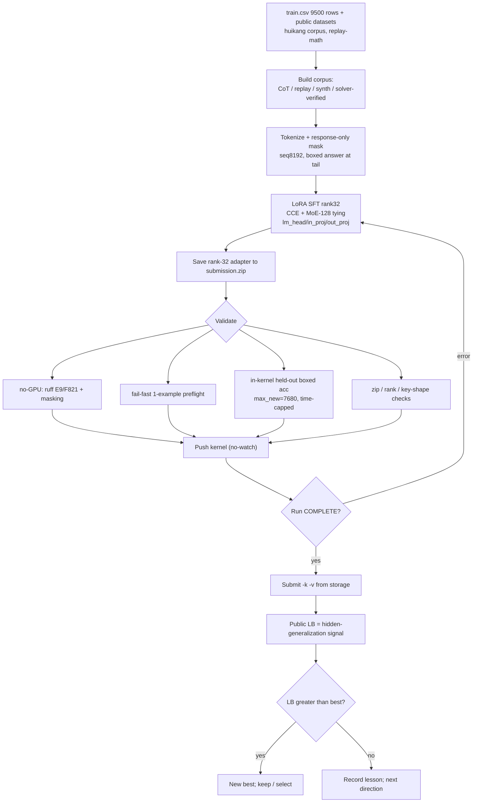
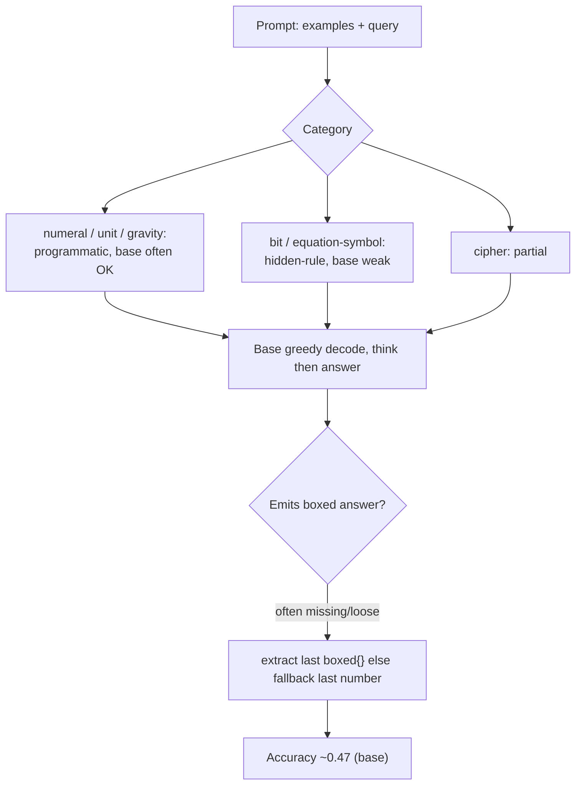
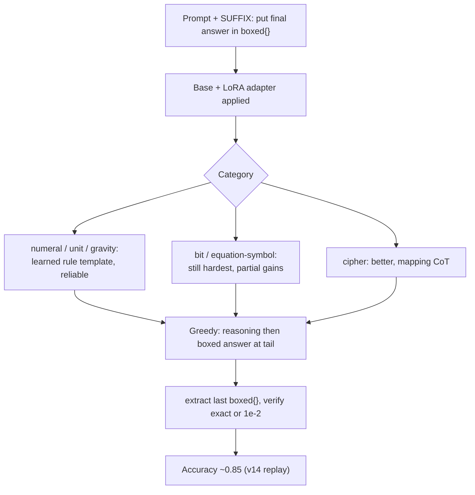
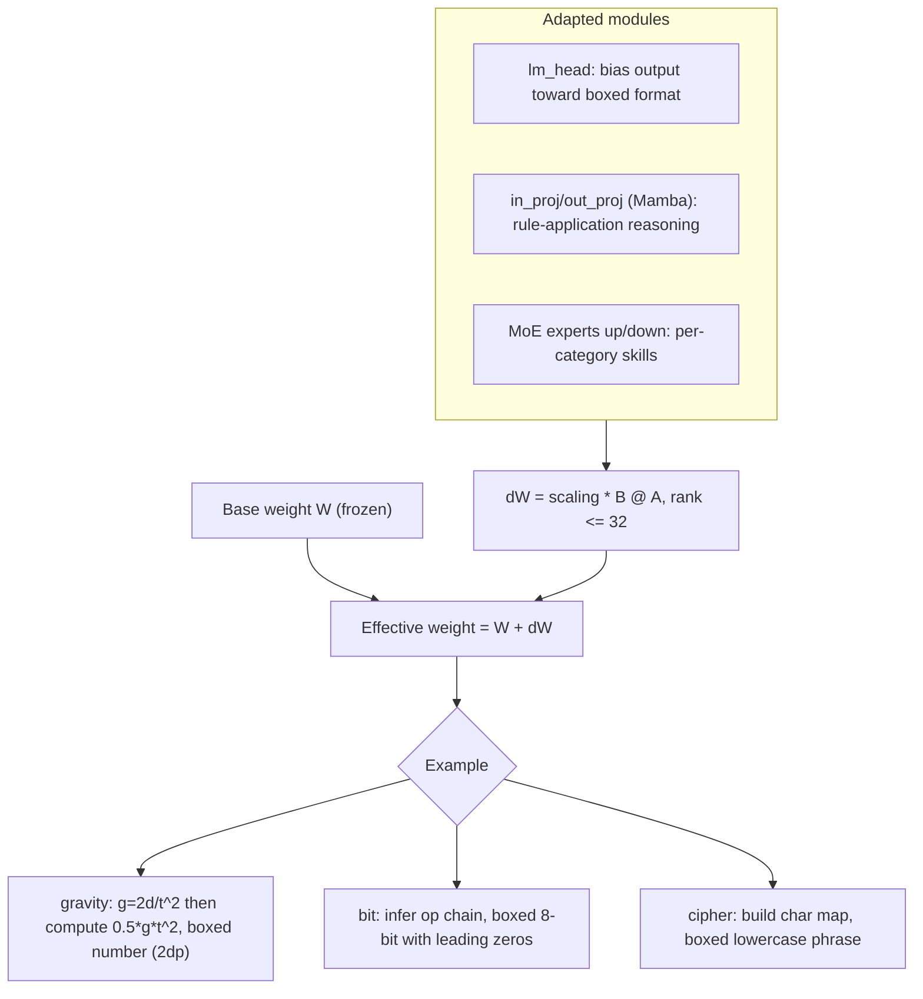

# Notes — NVIDIA Nemotron Model Reasoning Challenge

> English canonical. Chinese equivalent: [`notes_zh.md`](./notes_zh.md) (kept aligned section-by-section).
> Validation / RL workflow notes. Evidence: `README.md`, `rules.md`, `tracking.md`, `submissions.md`,
> `bugs.md`, `insights.md`, `strategy.md`, `tasks.md`, `competition.yaml`, `kernels/README.md`,
> `work/00.nemo.md`, and a read-only solver-coverage pass over the local `train.csv`. `unknown` = not in
> available evidence. No GPU / 30B inference was run to produce this doc.

## 1. Current validation reality
- **There is no single canonical CV.** `competition.yaml` records `cv_score: null`; each kernel only ran a
  tiny in-kernel **held-out boxed-accuracy** check (`EVAL_N = 8` rows). The leaderboard is the only
  trustworthy signal we have, and the public test set is just **3 rows** (≈ first 3 train rows per
  `work/00.nemo.md`) — a sanity check, not a score driver. The real target is a **hidden** benchmark.
- The held-out check was **misleading until fixed**: `EVAL_MAX_NEW = 512` truncated long CoT before the
  `\boxed{}` tail, so good adapters read `0/8` (bug **B4 / T13**; fixed to `7680` + an `EVAL_TIME_CAP=1800s`).
  After the fix, v15's local held-out read `3/4` while the LB was 0.84 — i.e. even the fixed local check is a
  noisy 8-sample proxy, not a CV.
- Net: validation today = **(a)** no-GPU static checks pre-push, **(b)** a fail-fast 1-example preflight,
  **(c)** an 8-row in-kernel boxed-accuracy sniff, **(d)** the public LB. A proper category/hard-case CV
  (T12) was **planned but never run**.

## 2. How to validate a fine-tuned Nemotron adapter
A layered pipeline, cheap checks first (most are no-GPU and already exist; the GPU ones run inside the kernel):

1. **Local smoke (no GPU)** — `kernels/validate_kernel.py`: `ruff` E9/F821 (catch undefined-name typos like
   the v7 `texts` NameError) + response-only **masking** check on assembled examples. Run before every push.
2. **Fail-fast preflight (in-kernel, minutes)** — run the generate→extract path on **one** example right
   after model load, *before* the long train, so runtime bugs (e.g. v8 `.shape` / BatchEncoding **B3**)
   surface in minutes, not after ~2h.
3. **Official-metric compatibility** — mirror the grader exactly: **greedy decode, `max_tokens=7680`,
   `temp=0`, `top_p=1.0`**; extract the **last `\boxed{...}`**; compare **exact string (case-insensitive)
   OR numeric within rel 1e-2**. Porting the official `score()`/`extract_final_answer()`/`verify()` locally
   is **T12 (not yet done)**; an aligned local extractor is required or local scores mislead (INS-002).
4. **Decode length** — the official cap is 7680 new tokens; any local eval must match it (B4). Too-short
   decode = false negatives; CoT models routinely need thousands of tokens before the boxed answer.
5. **`\boxed{}` extraction + formatting** — verify the model **always** closes with a single extractable
   `\boxed{}`; watch the format edges that silently fail the string match:
   binary answers keep **leading zeros** (`01000011`, not `1000011`); numeric `gravity`/`unit` keep
   **2 decimals**; `cipher` is **lowercase, single-spaced, no trailing punctuation**; symbol/`equation`
   answers must be emitted **verbatim** (preserve quotes/backslashes/special chars).
6. **Adapter zip / rank checks** — `submission.zip` has **root-level** `adapter_config.json` +
   `adapter_model.safetensors` (no nested dir), **rank ≤ 32**, `alpha` as trained, keys match the base
   (`base_model.model.backbone…`); the merge kernel asserts file size + names (avoids the B3-class
   "loads in my notebook but not in the grader" failure).
7. **Kaggle LB** — the real signal. Submit from kernel storage (`--kernel/--version`); a push is **not** a
   submission (#77). Quota 5/team/day (shared across both accounts).
8. **Hidden generalization** — the LB approximates a hidden, **new-rule** benchmark. A train-derived
   number that doesn't move the LB (e.g. cryptarithm 8%→71% single-category but total stuck ~0.86, **B8**)
   tells you the local signal didn't transfer. Treat LB deltas, not local accuracy, as ground truth.

## 3. Train/validation split strategy
**Should we randomly split `train.csv` into train/test/validation?** Only for **smoke / regression** — not
as the primary quality signal. The task is **hidden-rule generalization**: every prompt embeds a *new*
transformation rule, so a random split leaves train and val drawn from the *same* rule distribution and
**overstates** generalization (the model can pattern-match siblings). Better, evidence-aligned splits:

- **Category-stratified** — hold out per category (bit / cipher / numeral / unit / gravity / equation) so you
  see *where* a change helps or hurts (the v10/v15 lesson: a gain in one category can be a net loss).
- **Template-aware** — split by prompt template / example-count / operator set so the val rule is **not**
  a near-duplicate of a train rule (closest to the hidden setting).
- **Answer-type** — bucket by `binary8` / `numeric` / `string-symbol` to track the format-edge failure modes
  (leading zeros, decimals, verbatim symbols) that the metric punishes independently of reasoning.
- **Hard-val** — a small fixed set of the *hardest-to-fit* rows (see §4): rows a deterministic solver cannot
  crack, multi-step bit rules, symbol-rewrite equations, ambiguous cipher. This is the closest cheap proxy
  to the hidden benchmark and the right thing to track per experiment (T12 / `work/00.nemo.md` §9-Idea F).

Recommended: keep a tiny **random smoke split** for pipeline regressions **and** a **category-stratified +
hard-val** set scored with the official extractor for the real read.

## 4. Hard validation rows and selection criteria
Selection criteria (evidence-based, from a read-only solver-coverage pass on the local `train.csv`; a
deterministic per-category solver solved gravity/numeral/unit 100%, **cipher 38%, bit 10%, equation 0.4%** —
the *unsolved* rows are the hard-to-fit ones):

- **bit** — multi-op compositions (XOR/AND/OR + shift/rotate + majority/choice) the bounded solver can't fit
  (≈90% unsolved): rule induction from ~8 pairs is genuinely hard.
- **equation (symbol-rewrite)** — `A op B = result` symbol strings whose rewrite rule isn't in a small fixed
  library (≈99.6% unsolved); plus the **numeric** equation variant (arithmetic answers) mixed into the same
  category — needs two-track handling (`work/00.nemo.md` Idea E).
- **cipher** — query needs a character never seen in the examples, or a non-clean substitution (≈62% unsolved).
- **format edges** — binary answers with leading zeros; numeric with rounding sensitivity.

| id | category | why hard | answer type | validation purpose | source/evidence |
|---|---|---|---|---|---|
| 74339109 | bit | multi-op rule, solver-unfit (90% of bit unsolved) | binary8 | bit rule-induction generalization | solver-coverage pass |
| 368f20dd | bit | multi-op rule, solver-unfit | binary8 | bit rule-induction generalization | solver-coverage pass |
| 8bca1334 | bit | multi-op rule, solver-unfit | binary8 | bit rule-induction generalization | solver-coverage pass |
| da931308 | equation | symbol-rewrite not in fixed rule library | string/symbol | symbolic transform + verbatim output | solver-coverage pass |
| 1a493b13 | equation | symbol-rewrite, short symbol answer | string/symbol | symbolic transform + verbatim output | solver-coverage pass |
| 124db55f | equation | **numeric** equation answer (arithmetic track) | numeric | two-track equation (numeric vs symbol) | solver-coverage pass |
| db677e8c | cipher | query char(s) unseen in examples / mapping gap | string/symbol | cipher generalization beyond lookup | solver-coverage pass |
| 902410ec | cipher | longer phrase, mapping coverage gap | string/symbol | cipher generalization + spacing format | solver-coverage pass |
| 000b53cf | bit | **leading-zero** binary answer (`01000011`) | binary8 | leading-zero formatting (string-match) | train.csv (also a public test row) |
| 001b24c4 | numeral | easy rule, but exact-string Roman output | string | format/regression anchor (should always pass) | train.csv |

> All ids are from the local `train.csv` (`~/competitions/kaggle-…/data/train.csv`, 9500 rows). Per-row LB
> contribution is `unknown` (hidden test). If `train.csv` is unavailable in another environment, re-derive
> with the same criteria: take solver-**unsolved** rows per category + leading-zero/decimal format edges.

## 5. RL / self-distillation attempts and lessons
What was actually **tried, scored, planned, or never run** (LB from `submissions.md` / `tracking.md`):

| Approach | Status | LB | Lesson |
|---|---|---|---|
| Answer-only SFT (v5) | tried, scored | 0.61 | learns the boxed format; ceiling low |
| CoT SFT + response-only masking (v7 / ctx4k) | tried, scored | 0.65 / 0.67 | masking is essential (v6 unmasked = 0.44, **B2**) |
| Replay-recipe SFT (**v14**) | tried, scored | **0.85 (best)** | CCE + MoE-128 tying + lm_head/in_proj/out_proj LoRA + seq8192 + huikang corpus + replay-math = the single biggest lever |
| Synthetic augmentation (v15; b1/b2) | scored | v15 0.84; **b1 0.85, b2 0.84** | dose matters: low-dose b1 (~9%) recovered to **0.85** (vs v15 24%→0.84) — confirms dilution; none exceeded 0.85 |
| SVD multi-adapter merge (T7) | tried, scored | 0.82 | strong+weak merge **dilutes** (INS-003); route closed |
| Solver-distillation on real prompts (c1/c2) | scored | **c1 0.85, c2 0.83** | verified real-prompt CoT (Idea A/D) tied **0.85** (c1, balanced); hard-cat emphasis (c2) diluted to 0.83 |
| **SVD model-soup (v14+c1+b1)** | scored | **0.86 (NEW BEST)** | weighted soup (0.4/0.3/0.3) of three *comparable, complementary* 0.85 adapters (replay / verified-solver-CoT / cryptarithm-synth, all full v14 structure) **beat every member** — the §9b-H condition T7 lacked; merge route validated |
| **v11 rejection-sampling self-distillation** | **planned, NEVER run** | — | D2-approved but out of GPU/time budget; sample base model → keep correct → SFT |
| **GRPO / PPO / any RL** | **NEVER attempted** | — | `work/00.nemo.md` §8.5 proposed verifiable-reward RL (exact-match reward + format/length penalties) *after* stable SFT; never reached |

### What actually differs between v14 / b1 / b2 / c1 / c2 / soup
All are **rank-32 LoRA on the same base** (Nemotron-3-Nano-30B-A3B) and — except the soup — share the
**identical v14 training backbone** (CCE + MoE-128 expert tying + LoRA on lm_head/attention/in_proj/out_proj
+ seq8192 + 7h guard). The only differences are the **training data added** (and, for the soup, that it is a
merge, not a training run):

| Version | LB | What it is (vs the v14 backbone) |
|---|---:|---|
| **v14** | 0.85 | The base recipe: huikang recorded-order corpus + replay-math (2M answer tokens). No extra data. |
| **b1** | 0.85 | v14 **+ ~800 cryptarithm-only *synthetic* CoT** (~9% of mix). Low synth dose. |
| **b2** | 0.84 | v14 **+ ~1000 cryptarithm+bit *synthetic* CoT** (~11%). More synth + a bit slice. |
| **c1** | 0.85 | v14 **+ ~1800 *verified real-prompt* solver-CoT** (balanced cipher/bit/numeral/gravity/unit; kept only where a solver reproduced the ground-truth answer). |
| **c2** | 0.83 | v14 **+ ~1000 verified solver-CoT, hard-category-weighted** (bit/equation/cipher heavy, less easy data → more dilution). |
| **soup** | **0.86** | **Not a training run** — an SVD **model-soup** (weighted avg 0.4/0.3/0.3 → rank-32) of **v14 + c1 + b1**. Combines the three comparable, complementary members. |

So: **v14** = recipe only; **b1/b2** add *synthetic* (made-up) puzzle CoT; **c1/c2** add *verified real-prompt*
solver-distilled CoT (answers checked against ground truth); **soup** merges v14+c1+b1 into one rank-32 adapter
and is the only one that exceeded 0.85 (the model-soup effect — INS-004).

**Honest summary:** no reinforcement-learning run has happened. "RL-adjacent" ideas are rejection-sampling
self-distillation (planned, not run) and the deterministic **solver-distillation** (c1=0.85 / c2=0.83). Every
attempt to add signal **on top of** the clean replay recipe regressed or **tied** (best add-on = 0.85);
the **v14+c1+b1 model-soup reached 0.86** — a new best. RL, if attempted, should come only after a stable
SFT base and a real local metric (T12), with reward = official exact-match/numeric-tolerance + `\boxed{}` format.

> **Merge route CONFIRMED (audit §9b-H):** b1 and c1 both hit 0.85 on *different* data (cryptarithm synth
> vs verified real-prompt CoT) — *comparable + complementary*, the condition T7 lacked (strong+weak → 0.82).
> The SVD model-soup of **v14 + c1 + b1** (weights 0.4/0.3/0.3, rank-32) scored **0.86 (+0.01, new best,
> own real-training)** — a same-basin soup beating each member. This is the validated path, not the
> strong+weak merge.

## 6. Workflow charts

### 6.1 End-to-end training / fine-tuning / validation flow

### 6.2 Base / original Nemotron inference (by data type)

### 6.3 Fine-tuned Nemotron inference (by data type)

### 6.4 LoRA adapter contribution (with examples)

## 7. Practical recommendations
1. **Build the local metric first (T12)** — port official `score()`/`extract_final_answer()`/`verify()`,
   match `max_tokens=7680`/`temp=0`, and keep a **category-stratified + hard-val** set (§4). Without it,
   every experiment is judged by an 8-row sniff or a 5/day LB slot.
2. **Protect v14 (0.85)** — it's the banked best and the ceiling of current levers; LB keeps the max, so
   experiments can't lower it, but don't burn quota on additions that the evidence says dilute it.
3. **Highest-EV untried direction**: verified **real-prompt** reasoning for the hard categories — expand the
   solver's symbol-rewrite library (currently 0.4% on `equation`) by reverse-engineering real rules, and/or
   teacher-distill CoT toward the known answers for bit/equation. Caveat B8 (single-cat may not move total).
3a. **RL only after** a stable SFT base + real metric; reward = exact-match/1e-2 + `\boxed{}` format reward.
4. **Formatting is free accuracy** — enforce leading zeros, 2-decimal numerics, lowercase single-spaced
   cipher, verbatim symbols; validate by answer-type, not just overall accuracy.
5. **Scheduling** — long training kernels overnight (~22:00–24:00 AEST), short ones (merge/validate) daytime
   (see `README.md`); each kernel keeps the ≤8h wall-clock guard (B7).

## 8. Evidence and source files
- `competitions/nvidia-nemotron/`: `README.md`, `rules.md`, `tracking.md`, `submissions.md`, `bugs.md`
  (B1–B9), `insights.md` (INS-001..003), `strategy.md`, `tasks.md`, `competition.yaml`, `notes_zh.md`.
- `kernels/README.md` + `kernels/*.py` (recipe, score progression, gotchas); `lib/nemo_solver.py`
  (deterministic solvers used for the §4 coverage evidence).
- `postmortems/2026-06-14-final-sprint-audit.md` (plan-vs-actual, options table incl. §9b).
- `work/00.nemo.md` (ChatGPT analysis: challenges, Ideas A–F, §8 techniques, §9 route, §11 matrix).
- Read-only solver-coverage pass on `~/competitions/kaggle-…/data/train.csv` (9500 rows) for §4 hard rows.
- Run/LB status as of 2026-06-15: final-sprint scores **b1 0.85, b2 0.84, c1 0.85, c2 0.83, soup 0.86 (new best, own real-training)**. `tracking.md`/`submissions.md` updated with these.

## LB25 / 25th Place Solution: What We Learned

> *(LB25 = @huikang's "[LB25] Improvements to the progress prize submission", the Open Progress Prize winner;
> its writeup header reads "25th place". The `external/LB25/` archive was standardized to the full postmortem
> template — `lb25-writeup.md`, `method_summary.md`, `score_tricks.md`, `links/`, `models/`, `datasets/` — under
> `wiki/25.LB25_task.md`, alongside the retained prior-pass files. Section retitled from "LB25 Progress Prize
> Improvements" to the task's canonical title.)*

> Post-competition study of the Kaggle writeup **"[LB25] Improvements to the progress prize submission"** by
> **Tong Hui Kang** (`huikang`/`tonghuikang`, the Progress-Prize winner). **Updated 2026-06-17 from the actual
> writeup (`temp/LB25.pdf`)** — recoverability now FULL; this **supersedes** the earlier JS-blocked
> reconstruction, which wrongly attributed `kuangyicheng`'s "warmstart/short-response/240-step" recipe to this
> writeup (NOT in it). Full detail + sources: `external/LB25/`. External claims = untrusted; our scores from `tracking.md`.

**LB25 = four targeted changes to the Progress-Prize submission (pure SFT).** Verbatim from the writeup:
(1) **Fix the adapter *evaluation*** — the local validation prompt was wrong, so answers looked un-boxed in
validation though they *are* boxed on submission (a **local-eval bug**, not a model change); (2) **halve
`equation_numeric`** via a joint reversal symmetry ("inputs **and** outputs both reversed, or both not");
(3) **synthetic data for `cipher`/`unit`/`gravity`/`numeral`** to lock those easy cats at ~100%;
(4) **reorganize the bit-manipulation CoT**. The base pipeline (unchanged) is deterministic-solver CoT +
min-logprob signal + category-stratified batching.

**Result + selection lesson.** Private LB: **0.872 ×4, 0.868 ×8, 0.864 ×3 across 15 submissions** — 0.872 was
only 4/15; "could have won solo gold if I selected the correct submission." A **selection-variance** lesson
(mirrors our INS-005/INS-007: best + a *diverse* hedge; surgery ×1.15 aged −0.02).

**Cryptarithm: he explicitly made NO progress** (≈ our `equation` base-36 cipher). His clue: "many problems
there is **one multiplication, one subtraction and one addition (each possibly ±1)**"; the CoT "devolves to
repeating guesses." → independent confirmation that equation/cryptarithm is a **bounded wall** (matches EQ-2′),
**plus a new EQ-2′ lead**: a 3-term composite `≈ A·B − C + D` (±1) under the secret σ — a class our EQ-2′ never
tested (we only tried single ops). A low-odds future crack experiment (huikang failed too).

**How our approach differed.** Our edge is the **SVD model-soup** (v14+c1+b1 → 0.86; INS-004) — huikang ships a
single adapter. Our equation lever was **coverage-memorisation** (eq-aug 0.86 priv), not a solver.

**What we learned.** (1) **huikang's #1 lever was a LOCAL-EVAL BUG, not a model change** — and *we have the same
bug class twice* (B4 `EVAL_MAX_NEW` truncation; T12 hard-val mispredicting eq-spec 0.167 vs 0.85 LB). The
cheapest high-EV action is an **eval/submission parity audit**. (2) **Selection variance is a real lever at the
top** (0.872 = 4/15). (3) **Equation/cryptarithm is bounded for everyone** — don't over-invest. (4) Lock the
easy cats (don't regress them).

**What to try after Saturday.** `v16-evalfix` (plan: `external/LB25/analysis/next_version_plan.md`): **eval/
submission parity audit FIRST** (free; change #1), then v14 backbone + reorganized own-solver-verified **bit
CoT** (change #4) + **min-logprob replay** of the hardest bit/cipher rows (≤15% dose); gate on **T12 hard-val
≥ 0.764 with bit ↑ and no easy-cat regression**; soup-grow into v14+c1+b1 (best + diverse hedge). Keep eq-aug
standalone. ~1 GPU session.

## LB80 Progress Prize Improvements: What We Learned

> Post-competition study of the Kaggle writeup **"Breaking the SFT Ceiling on Nemotron-3-Nano-30B"** by
> **Mayur Pawar** (`mspawar`), 80th/4190, final private **0.86**. **Read directly from `temp/LB80.pdf`**
> (recoverability FULL) — supersedes the earlier reconstruction, which wrongly attributed a *different* author's
> "per-bit GRPO" story (from discussion #688461) to this writeup. Full detail + sources: `external/LB80/`.
> External claims = untrusted; our scores from `tracking.md`.

**LB80 method (honest title).** A 30+-experiment study that **PROVES the SFT ceiling at 0.86** — STaR, GRPO,
DPO, and weight-averaging all **failed to beat it**. Same root as us (Tong Hui Kang's deterministic-solver SFT;
V2 0.86, never beaten). Levers that worked: **seq 4096→8192 = 0.46→0.77** (43% of data silently truncated at
4096), **all-linear LoRA incl. lm_head, exclude gate_proj**, deterministic-solver CoT ≫ model/external CoT
(DeepSeek-R1 long CoT → catastrophic 0.27). The "+397 ranks" came from a **submission HEDGE** (V2 + V8-ckpt400)
under a bimodal public↔private regime — not a higher score.

**Three findings that change OUR understanding:**
1. **The equation cipher IS crackable offline (97.6%) — our EQ-0/EQ-2′ framing was WRONG.** The real structure
   is **`A1A2 OP B1B2`** (two 2-char operands + 1-char operator, **per-problem** symbol→digit bijection, finite
   operator family), and an **answer-guided permutation search** cracks 569/583 (14 fails have >10 distinct
   digit-symbols). We searched for ONE *global* σ over a 5-char→1-4-char map and "proved" it uncrackable — we
   were solving the wrong problem. **→ revisit EQ-2′ / equation-frontier (PR #113).**
2. **"Discovery leakage" explains why our eq-aug capped.** Answer-guided solver CoT presents the mapping *as
   given* → teaches **verify, not discover**; 93–97% of such traces are *internally inconsistent* (mapping
   doesn't produce the boxed answer). At inference there's no answer, so discovery is required. **The lever is a
   forward-executable, prompt-derivable cipher-discovery CoT** (length-budget permitting; top LB 0.90 implies it exists).
3. **Standard RL is the wrong tool; DPO-with-oracle is the right shape.** Binary failure (3,157 hard all 0/8,
   ~6,343 easy all 8/8, **0 boundary**) → STaR 0% yield, GRPO advantage=0 (no variance). Our previously-designed
   binary-reward GRPO would have failed identically. DPO uses solver-CoT (chosen) vs **greedy-failure** (rejected)
   — but even mspawar's DPO (V12/V13) plateaued 0.84–0.86.

**Tension to resolve.** mspawar reports **"Model Soup FAILS on Mamba-2 SSM"**, yet our **SVD soup gained +0.01**.
Likely reconciled by *what* is averaged (he: full SSM A/B/C/D recurrence; us: LoRA *deltas* on a frozen base +
SVD rank-cap, a gentler same-basin merge). **Worth an explicit ablation** before generalizing either claim.

**What to try after Saturday.** `v17-discovery` + `v17-dpo` (plan: `external/LB80/analysis/next_version_plan.md`):
**(A)** re-model equation as `A1A2 OP B1B2`, build an answer-guided solver, then a **forward-executable
discovery CoT** (internal-consistency audited) woven ≤15% — the real path past eq-aug memorisation; **(B)**
optional **DPO-with-oracle** (greedy-failure rejected, solver-CoT chosen, easy-cat SFT mix) for bit. Plus a
**Mamba-2 merge ablation**. Equation work feeds back to PR #113. RL needs external GPU (#83); expectations modest.

## LB92 Progress Prize Improvements: What We Learned

> Post-competition study of the Kaggle writeup **"92th PLACE SOLUTION"** by a **team** (Yoshinari Kawashima +
> MedudentYamatai; DOI 10.34740/kaggle/w/88245). **Read directly from `temp/LB92.pdf`** (recoverability FULL) —
> supersedes the earlier ecosystem-only reconstruction (author/score/method were `unknown`). Full detail +
> sources: `external/LB92/`. External claims = untrusted; our scores from `tracking.md`.

**LB92 method (data-engineering first).** Same root as us (huikang reasoner ~unchanged, 87.8% train; built on
the public 0.85 notebooks). Explicit goal: **don't lose already-solvable problems**, not solve the hard ones.
Three pillars: (1) reproduce the reasoner faithfully; (2) **a statistics-matched synthetic generator** (char
freq / numeric ranges / transform-method distributions from train.csv) with a **synthetic-vs-original eval-gap
QC loop** (train-synth / eval-both / close-the-gap), final **2.5:1 synth:original**; (3) two stability tricks —
**per-character tokenization** (synthetic tokens forcing 1 symbol = 1 token, fixing BPE merges like `}!` in
cryptarithm) and **gradient clipping at 1.5** (the public 1e9-off caused instability + submission-to-submission
variance; a grad-norm spike to 25,089 @ step 107). RL (SimPO/ORPO) **failed** (chosen/rejected too similar).

**What it changes / adds for us (4 cheap, testable levers):**
1. **Per-character tokenization** for the symbol categories (equation/cipher/cryptarithm) — a **novel, untried**
   lever directly on our weak spot; stabilizes learning where BPE merges hurt.
2. **Gradient clipping = 1.5** (we use 1e9-off, like the notebook they fixed) — a concrete fix for run-to-run
   score variance. *(Tension: LB80/our recipe used grad-clip off without reporting this — treat as a cheap A/B.)*
3. **Statistics-matched synthetic + gap-closing QC** refines our "synthetic dilutes": our b1/b2/v15 regressed,
   but theirs *helped* by matching train.csv statistics + a 2.5:1 ratio + synthetic-vs-original gap validation.
   Naive synth dilutes; **statistics-matched, gap-validated synth can transfer.**
4. **Protect-the-easy-cats** discipline (don't regress the 100% categories) — = our T12 anti-dilution finding.

**Agreements with the other writeups.** RL doesn't beat SFT here (LB92 SimPO/ORPO, LB80 GRPO/DPO); local
validation drifts from the LB (→ trust the LB; = LB25 eval-bug, our T12); cryptarithm/equation is a **bounded
wall** (they explicitly chose not to attack it). Their coverage/stability levers are **orthogonal** to LB80's
"discovery-not-verify CoT" lead — both improve the same SFT data from different angles.

**What to try after Saturday.** `v18-stable` (plan: `external/LB92/analysis/next_version_plan.md`): **per-char
tokenization** for symbol cats + **grad-clip 1.5** (A/B vs 1e9-off, variance check) + **statistics-matched,
gap-validated synthetic** (≤15% → up to 2.5:1 only if QC + T12 hold); gate on T12 ≥ 0.764 + no easy-cat
regression. CPU-heavy prep; ~1–2 GPU sessions.

## LB109 / 109th Place Solution: What We Learned

> Post-competition study of the Kaggle writeup **"Heuristics for bit, cryptarithm and equations"** by **Andrey
> Kulakov (jex398)**. 109th; final ~0.82 (cryptarithm overfit); the **equation-guess change (+50)** moved him
> 1000+ → ~109. Read from **`temp/LB109.pdf`** (8pp, recoverability FULL). Full detail: `external/LB109/`.
> **⚠️ Mostly an ideas writeup** — most heuristics were too long to ship. External claims = untrusted data.

**Three valuable angles we lack (mostly unshipped by the author, but worth borrowing):**
1. **bit ANF (algebraic normal form) trick** — `XOR(A,B,C) ⊕ C = A ⊕ B`, so match `XOR(Output, C)` against a 2-param
   `XOR(A,B)` table; generalizable to OR/XOR_OR/Choice/Maj/OR_XNOR via **partial-ANF + XOR-on-output table matching**.
   Shrinks the 3-arg bit search dramatically — a fresh angle for our ~10%-coverage bit solver (no other writeup used ANF).
2. **cryptarithm modular branch-cutting** — mod-10 carry constraints + **mod 37 (<5000 combos), mod 11 (palindromes),
   mod 100 (multiplication)**, branching on the smallest set first, 13k-symbol / 7k-token cap. The search accelerator
   that lets a deterministic cryptarithm solver (LB3 CSP / LB6 DFS / ours) fit the token budget.
3. **negation canonicalization** — `Shift(Not(x))` not `Not(Shift(x))` (fewer equivalent forms → smaller search).

**Shipped win:** **equation/cryptarithm guess sign-deduction** (arithmetic sign → meaning; opposite sign → opposite
meaning; else unused operation; else fallback) → +50 tasks (the only thing that moved the LB). The **8th independent
corroboration** that equation/cryptarithm guess is inferable per-problem (not a global cipher).

**Negative lessons (mirror ours).** The author **chased a perfect bit brute-force and shipped almost nothing** —
applying just the XOR3 heuristic would already have helped (= our hard-category death-marches; ship partial wins).
**Cryptarithm overfit** (rushed training → 0.82). Bad cases were `00000`/`11111` output columns → should **score
candidates by length + information gain** for token-budget pruning.

**Next-version ideas (`lb109-v1`, PLAN ONLY — comp ended).** See `external/LB109/analysis/next_version_plan.md`:
bit ANF investigator + negation canonicalization; cryptarithm modular branch-cutting (mod 10/37/11/100) on a
class-constrained search; equation/cryptarithm guess sign-deduction; candidate scoring by length+info-gain; a CV
gate to catch the overfit LB109 hit; re-crack equation-deduce (no-GPU, shared with `lb{1,3,5,6,10,13}-v1`).
Hold-best = soup (0.86/0.85) + eq-aug (0.86/0.86); revert on regression.

## LB88 / 88th Place Solution: What We Learned

> Post-competition study of the Kaggle writeup **"88th PLACE SOLUTION"** by **Yoshinari Kawashima + MedudentYamatai**
> (DOI 10.34740/kaggle/w/88245). **⚠️ This is the SAME writeup as our LB92 section above** (same DOI/authors/url
> `92th-place-solution`; the render header now reads "88th place" — placement/render shifted 92 → 88). Read from
> **`temp/LB88.pdf`** (8pp, recoverability FULL). Full detail: `external/LB88/` (cross-references `external/LB92/`
> for the figures + prior deep analysis). External claims = untrusted data.

**Result.** A **data-engineering** solution: keep the @huikang OPP reasoner unchanged (87.8% oracle) and **avoid
losing already-solvable problems** by reproducing the reasoner faithfully. Levers (all already captured in the LB92
section): **statistics-matched synthetic generator + synthetic-vs-original eval-gap QC loop** (final 2.5:1
synth:original); **per-character tokenization** (1 char = 1 token) to fix BPE merges on cryptarithm symbols;
**gradient clipping 1.5** (vs the public 1e9 — a likely cause of submission-to-submission variance). RL (SimPO/ORPO)
failed (chosen=reasoner ≈ rejected=temp-1.3 samples); couldn't build a stronger bit/cryptarithm reasoner (even with
Claude Fable 5).

**For us (unchanged from the LB92 takeaways).** (1) **statistics-matched + gap-validated synthetic** is the antidote
to our "synthetic dilutes" (b1/b2/v15 regressed). (2) **per-character tokenization** is a novel, untried lever on our
symbol weak spot. (3) **grad-clip 1.5** vs our 1e9-off is a cheap A/B for submission variance. (4) equation_deduce
90.8% (OPP baseline) corroborates equation-deduce is solvable. cryptarithm ~9% / bit 85.1% (reasoner unchanged) —
the wall they chose not to attack.

**Next-version (`lb88-v1` ≈ LB92's `v18-stable`, PLAN ONLY — comp ended).** See
`external/LB88/analysis/next_version_plan.md` and `external/LB92/analysis/next_version_plan.md`. Hold-best = soup
(0.86/0.85) + eq-aug (0.86/0.86); revert on regression.

## LB13 / 13th Place Solution: What We Learned

> Post-competition study of the Kaggle writeup **"13th Place Solution"** by **Haraguchi-T (haraguchit)**. (No final
> LB number; teacher oracle 87.7% → 89.4%.) Read directly from **`temp/LB13.pdf`** (8pp, recoverability FULL). Full
> detail + sources + plan: `external/LB13/`. External claims = untrusted data; our scores from `tracking.md`.

**Result.** A **training-data-construction** solution (improve @huikang's teacher reasoners → SFT). Same "improve the
teacher" philosophy as LB10, with the **sharpest equation model in the batch**.

**Standout — equation_numeric structural model (deduce 95.3%, guess 50.7% = highest in the batch).** Three
assumptions: (1) **4 mutually-exclusive operator categories** (add/mul/sub/concat); (2) **exclusivity** (distinct
symbols can't share a category); (3) **reversal symmetry** — reverse applies to **both inputs+outputs or neither**,
**shared across all examples in a task**. Global reversal via **majority vote**; deduce verifies with target-operator
examples; guess **strictly picks an unused family** (ties sub>add>mul>concat). This even cracks **half** the guess set.

**Two data findings (converging with LB10) that challenge our c1/c2.**
- **Keeps teacher-INCORRECT traces, rebalanced 1:1** (correct:incorrect) — fallback tasks were overrepresented. LB10
  independently found **excluding failed traces HURTS**. Our c1/c2 keep **only solver-correct** rows → we likely
  discard useful failure-pattern signal. **A/B keeping + balancing failures.**
- **Robust aggregation** — an operation is a valid candidate if it matches **≥1** example (not all), tolerating
  symbol transcription errors.

**Other adoptables.** Bit: **3-input verification (MAJORITY/XNOR)** + bit-position-restricted search + left-edge
fallback → 89.7%. **3-stage decreasing-LR SFT** (2e-4 linear → 2e-5 cosine → 5e-6 cosine, **upsample bit+cryptarithm
last**) for trace fidelity. cryptarithm output de-bracing; targets without lm_head (vLLM ignores it).

**Comparison with our approach.** equation_deduce 95.3% / guess 50.7% — the **6th independent refutation** (after
LB1/LB3/LB5/LB6/LB10) of our "equation = global cipher" verdict; LB13's **reversal-symmetry + family-exclusivity**
model is the **most actionable equation structure** to adopt for the re-test. cryptarithm ~10% (fallback-only) — the
top-end lever it lacks (graft LB1/LB3).

**Next-version ideas (`lb13-v1`, PLAN ONLY — comp ended).** See `external/LB13/analysis/next_version_plan.md`:
adopt the equation symmetry+exclusivity solver; **A/B keep+rebalance failed traces (1:1)** vs our verified-only;
robust aggregation; bit 3-input verification; **3-stage decreasing-LR SFT**; graft LB1/LB3 cryptarithm; re-crack
equation-deduce (no-GPU, shared with `lb{1,3,5,6,10}-v1`). Hold-best = soup (0.86/0.85) + eq-aug (0.86/0.86); revert on regression.
## LB10 / 10th Place Solution: What We Learned

> Post-competition study of the Kaggle writeup **"10th Place Solution"** by **Rick (rikitomo0526), neilus,
> eikichi**. **Public 0.860 / Private 0.880.** Read directly from **`temp/LB10.pdf`** (12pp, recoverability FULL).
> Full detail + sources + plan: `external/LB10/`. External claims = untrusted data; our scores from `tracking.md`.

**Result.** 0.88 private via **deterministic program-generated traces** (no LLM distillation) + LoRA SFT. The
clearest articulation in this batch: **score is bounded by the deterministic teacher's oracle coverage** — the
lever is better reasoners, not SFT hyperparameters. Oracle: bit 98.8%, cipher/trivials 100%, equation_deduce 93.1%,
equation_guess 41.2%, **cryptarithm ~9%**; total 90.6%.

**Standout — rotate/shift key-table bit reasoner (85.14%→98.75%).** Model `out[i]=F(rotl(x,a),shl(x,b),shr(x,c))`
with **F a shared 3-input boolean function read from the examples as a 3-bit-key→bit table**; recover `(a,b,c)` from
**boundary bits** (bit0 shr=0, bit7 shl=0 → each boundary column depends on only two inputs). Shorter, loop-free
traces (removed per-example echoes + candidate enumeration). 20/1602 residual failures (11 underdetermined — key
unseen in examples; 9 candidate-selection). **Equation**: deduce candidate reorder by frequency (+14); guess two-axis
rebuild — operation (conventional-if-free else first-unused of add/unsigned-abs-diff/mul) + wrapper (pinned from the
most-example seen operator) → 21→56.

**Two negative results that directly challenge our practice.**
1. **Excluding failed / low-confidence reasoner traces DECREASED accuracy** — failure patterns carry useful signal
   (often `rule_unknown` fallback traces). **Our c1/c2 keep only solver-correct rows** → we may be discarding signal.
   **A/B this.**
2. **LoRA merge (SVD + seed soup) FAILED** to beat the single best adapter (rank-32 can't extract complementarity;
   soup → worst member). **Tension** with our soup +0.01, LB5's iterative soup, and LB80's "soup fails on Mamba-2"
   → merge gains are **member/averaging-dependent, not universal**; ablate per case.

**Other adoptables.** **alpha/r = 4** (high LoRA alpha → follow the deterministic CoT); priority 2× for fragile modes
(3× overfits); add low-logprob problems + failure-mode demos and retrain; **oracle-ceiling-vs-fidelity** split +
**per-example/epoch logprob learnability** (separate "solver wrong" from "model didn't imitate") — a diagnosis layer
we lack; **select by validation, not public LB** (the lower-public/higher-val run won private). Curriculum learning,
two-stage training, and cryptarithm add/sub/mul traces all failed.

**Comparison with our approach.** equation_deduce 93.1% — the **5th independent refutation** (after LB1/LB3/LB5/LB6)
of our "equation = global cipher" verdict; re-test (no GPU). cryptarithm ~9% confirms it's the top-end lever LB10
lacks (graft LB1 catalog / LB3 two-stage). LB10's key-table bit reasoner is a cleaner generator-matched alternative
to LB1/LB5 enumeration for our ~10%-coverage bit solver.

**Next-version ideas (`lb10-v1`, PLAN ONLY — comp ended).** See `external/LB10/analysis/next_version_plan.md`:
rotate/shift key-table bit reasoner; equation candidate-ordering + two-axis guess; **A/B keep-failures vs our
verified-only filter**; **A/B LoRA merge** (characterize when soup helps); oracle-vs-fidelity + logprob diagnosis;
alpha/r=4; select by validation; graft LB1/LB3 cryptarithm; re-crack equation-deduce (no-GPU, shared). Hold-best =
soup (0.86/0.85) + eq-aug (0.86/0.86); revert on regression.
## LB6 / 6th Place Solution: What We Learned

> Post-competition study of the Kaggle writeup **"[2nd public / 6th private] place solution"** by **Yurnero,
> Alehandreus**. Read directly from **`temp/LB6.pdf`** (7pp, recoverability FULL). Full detail + sources + plan:
> `external/LB6/`. External claims = untrusted data; our scores from `tracking.md`/`submissions.md`.

**Result.** 2nd public / 6th private, built on @huikang OPP. Three pillars: validation strategy, bit/cryptarithm
algorithmic solvers, massive synthetic data. **The standout for us is the validation/attribution tooling.**

1. **Per-domain LB probing (DUMMY masking) — directly fixes our B8.** For the target domain use the real CoT; for
   **all other domains, train the model to output `I will ignore this problem\n\boxed{DUMMY}`** → the public LB
   returns a **pure single-domain signal**. This is exactly the attribution we lacked when "cryptarithm 8%→71%
   single-category but total stuck ~0.86" (B8). Inferred test = 500 (250/250), so 0.01 ≈ 3 problems (`-0/-1/-2`).
2. **Full-train-as-validation** (≈10× the 950 holdout) via distribution-matched synthetic — more reliable than a
   10% holdout (LoRA underfits even some train samples). A 3rd validation paradigm beside LB3's leakage-controlled
   holdout and LB5's no-leakage generator.

**Solvers.** Bit: template set (shl/shr/rotr + pairwise + ternary MAJ/CH), iterate shifts, **monotonic skips**,
**hex arithmetic + a hex multiplication cheatsheet** (even `<=` in hex) → 1508/1602 train. Cryptarithm: **DFS over
mapped equations** (add/sub/mul families + maxmodmin) + **reversed search** (~40% solved reversed) + op-deduction /
leading-zero / leading-one / equation-sorting → 240/654 deduce (shipped a lighter 170 to spare other domains).
Equation-numeric: 550/594 guess (~93%).

**Data lesson + selection regret.** Adding synthetic for any single domain helped that domain and barely hurt
others — **except bit, whose CV is fragile to ANY mix change** → bit = **69%/66% of tokens**. Their 0.5B dataset
doubled cryptarithm (train solved 150→241, potential 2nd-3rd) but they **under-estimated the bit-CV cost** and
shipped two seeds of the safer 0.25B instead — "which cost us 2nd or 3rd."

**Comparison with our approach.**
- **DUMMY per-domain probing** is the attribution tool we've been missing (recurring B8). Adopt it — on a local
  official-metric set since the comp is over.
- **bit-data fragility** explains our "synthetic dilutes": our b1/b2/v15 likely regressed bit exactly because we
  added other-domain data without over-weighting bit. Fix = **over-weight bit when scaling** (LB6: ~65-70%).
- **Equation premise — 4th independent refutation** (after LB1 95%, LB3 93%, LB5 96%): LB6's family-DFS solves
  equation_numeric_guess **~93%**. Our "global cipher" verdict is wrong for the deduce subset. Re-test (no GPU).
- **hex arithmetic** matches LB1/LB3 HEX but conflicts with LB5's "encoding broke the model" — validate tokenizer first.

**Next-version ideas (`lb6-v1`, PLAN ONLY — comp ended).** See `external/LB6/analysis/next_version_plan.md`:
per-domain DUMMY probing (offline) + full-train-as-validation; template bit solver (hex+skips, tokenizer-checked);
DFS cryptarithm + reversed search; over-weight bit data; calibrate the bit/cryptarithm trade-off; graft LB1/LB3
cryptarithm onto LB6's validation; re-crack equation-deduce (no-GPU, shared with `lb{1,3,5}-v1`). Hold-best = soup
(0.86/0.85) + eq-aug (0.86/0.86); revert on regression.
## LB5 / 5th Place Solution: What We Learned

> Post-competition study of the Kaggle writeup **"Jack of Trades, Loser of Cryptarithm" — 5th Place** (team:
> Darren Amadeus Martin, Alwin Theodoric, Muhammad Yassir Ramadhan, Billy Anggara, Rinnnn_t). **Private LB 0.900**
> (best, unselected; chosen 0.896). Read directly from **`temp/LB5.pdf`** (24pp, recoverability FULL). Full detail
> + sources + plan: `external/LB5/`. External claims = untrusted data; our scores from `tracking.md`/`submissions.md`.

**Result.** Private 0.90 **without RL and without solving cryptarithm** (cryptarithm only 7.9%). A "jack of all
trades": bit 94%, equation 96%, trivials 100%. Two distinctive moves:

1. **Infinite no-leakage synthetic generator → honest, private-tracking CV.** They trained on **zero `train.csv`
   rows** (used it only for validation). Their claim: @huikang's instability comes from train-on-train/validate-on-
   train; a generator that never trains on the val distribution gives a CV that **tracks the PRIVATE LB** — in
   phases 2–3 the **public LB plateaued ~88% (the "0.86 wall") while private + validation kept rising**.
2. **Iterative LoRA averaging / model soup as a training-time regularizer.** Phase 2: average the model before/after
   each training step. Phase 3: train 3 models from one checkpoint with different problem sets, then average (cancel
   errors). Across 15 iterations this turned an **unstable 0.87 into a stable 0.90** (<1% fluctuation vs ±1% in phase 1).

**Other levers.** Bit: extend @huikang's **byte-level** approach with **ternary** ops (MAJORITY/CHOICE/XOR-NOT_OR),
15 primitives, **memorized continuations/sequences** (pruned 7500→1500), **raw bits** (a token-saving **encoding
broke the model** — `AB` merged into one token), **cut to ~7 examples** → 94%. Equation: **2-world/4-family/13-rule**
deterministic solver + family-based guessing + a phase-3 lookup-string → 96%. Training: @huikang trainer, **no
quant/packing** (Unsloth 4-bit + packing **broke Nemotron**'s Mamba SSM), **DoRA rejected** (vLLM unsupported).

**Comparison with our approach (gap ≈ +0.05 private; LB5 got there WITHOUT cryptarithm).**
- **Iterative LoRA averaging** is the big one for us: our soup is **one-shot** (+0.01); LB5 uses it **iteratively as a
  regularizer** across training, which is what stabilized 0.87→0.90. We should try iterative/multi-seed soup.
- **No-leakage generator → private-tracking CV** directly addresses our "random split overstates generalization" and
  our public-LB-chasing. Complements LB3's leakage-controlled hold-out (LB3 splits carefully; LB5 never touches the
  val distribution).
- **Equation premise — 3rd independent refutation (after LB1 95%, LB3 93%):** LB5's per-prompt 13-rule solver hits
  **~96%**. Our "global cipher" verdict (EQ-0/EQ-2′) is wrong for the **deduce** subset. Re-test (no GPU).
- **Cryptarithm priority signal:** LB5 reached 0.90 with **7.9%** cryptarithm — so 0.90 doesn't require it, but the
  0.90→0.92 gap to LB1 **is** cryptarithm. Prioritize cryptarithm only when aiming for the very top.
- **Encoding tension:** LB1/LB3 succeeded with **HEX**; LB5's encoding **broke the model**. Likely tokenization
  (merged tokens) — validate our tokenizer before any HEX work.

**Next-version ideas (`lb5-v1`, PLAN ONLY — comp ended).** See `external/LB5/analysis/next_version_plan.md`:
iterative LoRA averaging + multi-seed soup; no-leakage generator → private-tracking CV; ternary byte-level bit
solver (raw bits, 7-example cut); 2-world/4-family/13-rule equation; A/B HEX-vs-raw-bits (tokenizer probe);
re-crack equation-deduce (no-GPU, shared with `lb1-v1`/`lb3-v1`); optionally graft LB3's two-stage cryptarithm onto
a soup-stabilized base to chase >0.90. Hold-best = soup (0.86/0.85) + eq-aug (0.86/0.86); revert on regression.
## LB3 / 3rd Place Solution: What We Learned

> Post-competition study of the Kaggle writeup **"3rd Place Solution"** by **YS-L (liauys)**. **Private LB 0.900**
> (local validation 90.46%). Read directly from **`temp/LB3.pdf`** (17pp, recoverability FULL). Full detail +
> sources + plan: `external/LB3/`. External claims = untrusted data; our scores from `tracking.md`/`submissions.md`.
> (NB: `wiki/25.LB3_task.md`'s `notes_section_en` has a copy-paste typo saying "1st Place"; the writeup is **3rd**, so we use the correct heading here.)

**Result.** Private 0.900 **without RL**. Two standout moves on top of llkh0a/huikang/youkinasa/kemshim:

1. **Two-stage training (memorize → execute)** — the headline. Stage 1 pretrains the model to **recall a lookup
   table** (`<RECALL_DOMAINS>`/`<RECALL_ROWS>` drill completions, 16 packed/sample, request masked); stage 2 inits
   from that adapter and learns to **execute** the trace (+3K drills to retain memory). ~3× more sample-efficient:
   on 12K cryptarithm samples, **direct training solved 0, two-stage solved 7** (direct needs 36K to match).
   Stage-1 recall quality: overall-exact 97.1%. Modular — solver/format changes reuse the stage-1 model.
2. **CSP cryptarithm solver** — identify MUL examples → emit per-symbol domains + candidate mappings from a
   mul-pattern lookup → **intersect/join across MUL examples** → anchor mapping(s) → **bounded backtracking**
   (≤2 unknowns/eq, least-unknowns-first). 24.2% within budget (deduce 27.8%, guess 9.8%). Lighter than LB1's
   full 4,205-signature catalog (LB3 memorizes only the multiplication patterns).

**Other levers.** Bit: **hex + literal tail-2-bits** column compression (**−25% tokens**) → frees budget for **MAJ
search**; OR-NOT-first ordering (+0.6%). Numeric: a **minimal 13-op solver** + **operation-family guessing** for
unseen operators (deduce 93.79% ceiling). Modeling: huikang's **CCE loop**, **MoE tie weights OFF**, **small
effective batch (4)** (large under-trains), manual LM-head LoRA, rank32/α32, LR 2e-4 linear, grad-norm 10.
Augment by **resampling original problems** (not free-gen) to preserve official-generator artifacts.

**Validation (very important for us).** 10% stratified hold-out, excluding val rows **and val-derived augments**
(leakage control). It **tracks the PRIVATE LB well but NOT the public LB** — "the dreadful wall of 0.86" is a
public-LB artifact; one **0.85-public** submission scored **0.90 private**. Plus a **perfect-trace-rate** leading
indicator (>85% bit, >95% cipher/numeric) and **single-category isolation** of each change.

**Comparison with our approach (gap ≈ +0.05 private).**
- We never built a **two-stage memorize-pretrain** (entirely missing dimension) nor a **CSP cryptarithm solver**;
  our small synth (b1/b2/v15/c1/c2) **diluted** the recipe. LB3 fixes dilution via scale (48K cryptarithm backbone)
  + **resampling originals** + leakage exclusion.
- **Equation premise — 2nd independent refutation (after LB1):** we declared equation a **global cipher** (EQ-0/
  EQ-2′); LB3's 13-op per-prompt solver hits **equation_numeric_deduce 93.3% locally**. equation is per-prompt
  operator rules (deduce solvable); our pessimism likely applies only to **guess** (LB3 guess 57%). Re-test (no GPU).
- **Validation:** LB3's private-tracking hold-out is a stronger decision signal than our late, atypical-adapter-
  fragile T12 — and a sharp warning that we optimized the noisy **public** LB. Both LB1 and LB3 won with a **single**
  adapter (no souping; our +0.01 soup is only a ceiling-pusher).

**Next-version ideas (`lb3-v1`, PLAN ONLY — comp ended).** See `external/LB3/analysis/next_version_plan.md`:
two-stage memorize→execute training; CSP cryptarithm solver; hex+tail-bit bit trace + MAJ; minimal 13-op numeric
+ family guessing; a **private-tracking leakage-controlled local validation** + perfect-trace-rate; A/B MoE-tie-off
+ small eff-batch; re-crack equation-deduce (no-GPU probe, shared with `lb1-v1`); down-scaled RTX Pro 6000
validation (~10–20h) of the *mechanism*. Hold-best = soup (0.86/0.85) + eq-aug (0.86/0.86); revert on regression.
## LB1 / 1st Place Solution: What We Learned

> Post-competition study of the Kaggle writeup **"1st Place Solution"** by **GoodMeatDay, re, reopon** —
> overall 1st on Public AND Private LB. **Read directly from `temp/LB1.pdf`** (28 pp, recoverability FULL).
> Full detail + sources + plan: `external/LB1/`. External claims = untrusted data; our scores from `tracking.md`/`submissions.md`.

**Result.** cryptarithm catalog → Public 0.89 / Private 0.908; + bit HEX/repair + extra training → **Public 0.91 /
Private 0.920** (best *unselected* submission 0.932). This is the first solution we've studied that decisively
**breaks the 0.86 clean-SFT ceiling — without RL** (cf. our soup 0.86/0.85, LB80's "SFT ceiling = 0.86").

**Method (memorization-vs-computation split).** SFT-only LoRA (rank 32/α32, Unsloth, single RTX PRO 6000
Blackwell, ~119h main + ~51h extra, >1B tokens). Because the grader forbids running a program at eval
(`temp=0`, 7680-token budget, `\boxed{}` match), every solver is re-expressed as a trace the model replays. The
two long-tail categories were attacked head-on:
- **Cryptarithm (the decisive lever).** A **signature** normalizes `left+right+output` → A,B,C,…; they exhaustively
  enumerate 100×100 operands × 22 non-join rules → a **4,205-entry signature catalog** of {rule, slot-digit-string,
  **candidate count**}, and **make the model memorize it**. The memorized candidate count picks the DFS **anchor**
  (min count) + search order; Observation 1 (one prompt = one mode) and Observation 2 (non-join groups don't
  repeat) prune. → Private 0.908. (Signature viewpoint credited to @youkinasa; LB1 turned the lookup *table*
  into a *memorized catalog*.)
- **Bit manipulation.** Built on @huikang's per-output-bit solver, then: (1) **HEX-compress** bit columns (len ≥4):
  median gen tokens **6771 → 4888 (−27.8%)**; (2) add rule families (maj, par3, ch, sel_nand_xnor, ao/oa/ax/ox/
  xa/xo); (3) **rule-sequence catalog** (5,238 valid 8-rule sequences) + **Hamming-distance repair** (retrieve ≤32
  nearest, apply first matching all 8 bits — rejects `default 1` fallbacks). → Private 0.920.
- Simple categories (cipher/numeral/unit/gravity) ≈ @huikang as-is; cipher uses the **77-word train vocabulary**.

**Comparison with our approach (gap ≈ +0.07 private, all in cryptarithm + bit).**
- We synthesized cryptarithm/bit (b1/b2/v15/c1/c2) but had **no memorizable catalog**, **never HEX-compressed**
  traces, and our augmentation **diluted** the clean replay recipe (regressed the hard slice ≤ base). LB1 used
  ~100× our synth volume as the **backbone**, not a bolt-on.
- **Equation premise to re-check (important):** we declared equation-numeric a **global cipher / unrecoverable
  PRF** (EQ-0/EQ-2′). LB1's coverage table shows **equation-numeric *deduce* (seen operator) ≈ 95% solvable** via
  per-prompt 24-rule operator inference — our pessimism likely applies only to the *guess* (unseen-operator) subset
  (their guess ≈ 52%). A cheap no-GPU probe should settle this.
- **Souping:** LB1 did NOT soup (single continuation adapter); our +0.01 soup is a ceiling-pusher, not a substitute
  for solving the hard categories. Selection variance bit them too (0.932 unselected vs 0.920 selected) — confirms
  "submit your true best; trust the LB aggregate" (= INS-002 / T12 caveat).

**Lessons.** (1) The 7680-token budget is the **primary design constraint** — measure "correct within budget."
(2) Re-express solvers as **memorizable catalogs + short in-trace verification**, not free CoT. (3) **HEX
compression** is a cheap, generic unblock for long-string traces. (4) Protect the clean recipe; scale synth with
**rule-enforced consistency** (Obs.1/Obs.2), don't dilute. (5) Novelty audit (`external/LB1/source_index.md`):
HEX, signature catalog, candidate-count memorization, rule-sequence catalog + Hamming repair are **LB1's
additions** — absent from @huikang's public code.

**Next-version ideas (`lb1-v1`, PLAN ONLY — comp ended).** See `external/LB1/analysis/next_version_plan.md`:
signature catalog + candidate-count + staged DFS trace (cryptarithm); HEX + extra rule families + rule-sequence
catalog + Hamming repair (bit); re-test the equation deduce premise (no-GPU probe first); port "correct within
7680 tokens" into the local scorer; down-scaled validation on the RTX Pro 6000 (~7–14h) — validate the
*mechanism*, not LB1's 170h volume. Hold-best = soup (0.86/0.85) + eq-aug (0.86/0.86); revert on regression.
