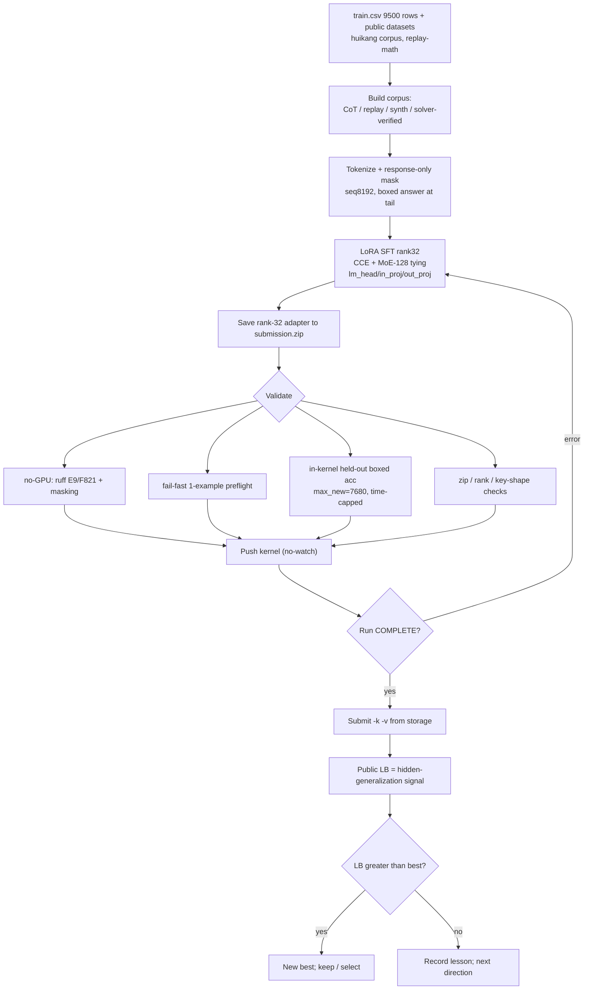
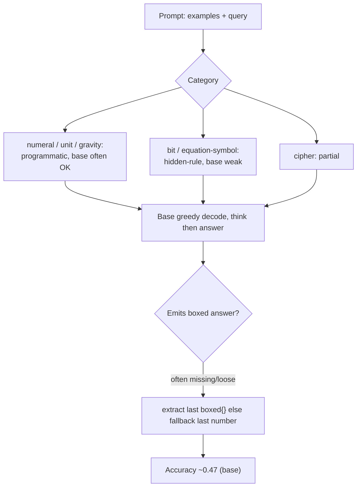
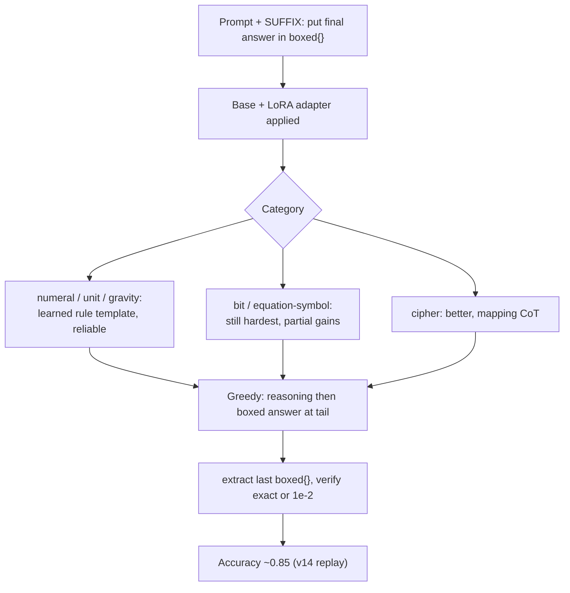
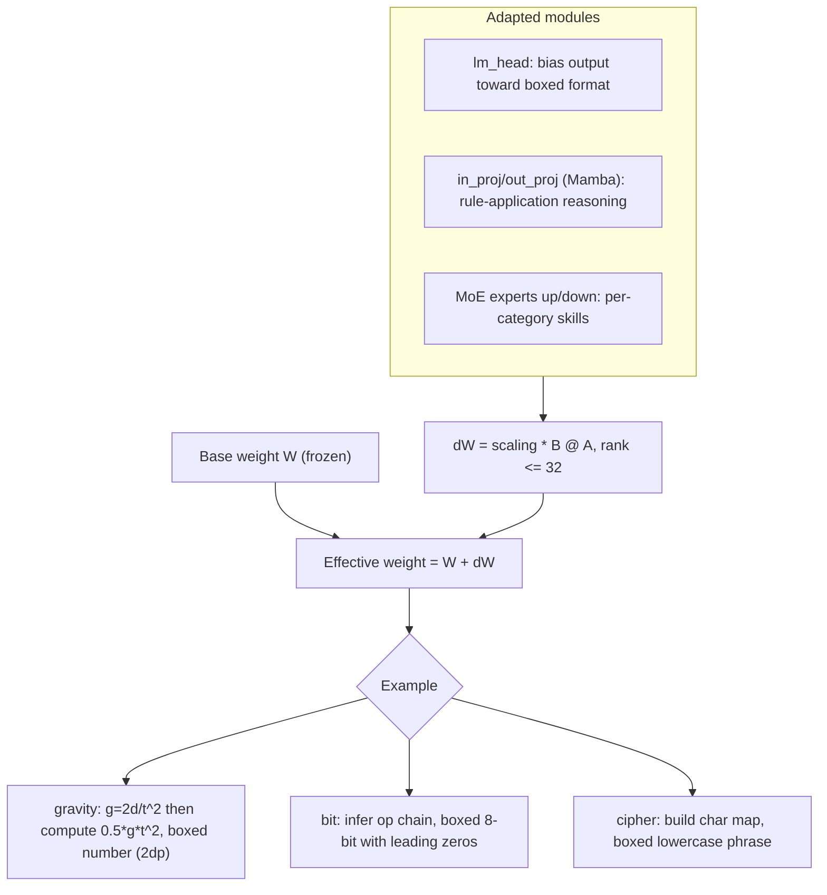

# Notes — NVIDIA Nemotron Model Reasoning Challenge

> English canonical. Chinese equivalent: [`notes_zh.md`](./notes_zh.md) (kept aligned section-by-section).
> Validation / RL workflow notes. Evidence: `README.md`, `rules.md`, `tracking.md`, `submissions.md`,
> `bugs.md`, `insights.md`, `strategy.md`, `tasks.md`, `competition.yaml`, `kernels/README.md`,
> `work/00.nemo.md`, and a read-only solver-coverage pass over the local `train.csv`. `unknown` = not in
> available evidence. No GPU / 30B inference was run to produce this doc.

## 1. Current validation reality
- **There is no single canonical CV.** `competition.yaml` records `cv_score: null`; each kernel only ran a
  tiny in-kernel **held-out boxed-accuracy** check (`EVAL_N = 8` rows). The leaderboard is the only
  trustworthy signal we have, and the public test set is just **3 rows** (≈ first 3 train rows per
  `work/00.nemo.md`) — a sanity check, not a score driver. The real target is a **hidden** benchmark.
- The held-out check was **misleading until fixed**: `EVAL_MAX_NEW = 512` truncated long CoT before the
  `\boxed{}` tail, so good adapters read `0/8` (bug **B4 / T13**; fixed to `7680` + an `EVAL_TIME_CAP=1800s`).
  After the fix, v15's local held-out read `3/4` while the LB was 0.84 — i.e. even the fixed local check is a
  noisy 8-sample proxy, not a CV.
- Net: validation today = **(a)** no-GPU static checks pre-push, **(b)** a fail-fast 1-example preflight,
  **(c)** an 8-row in-kernel boxed-accuracy sniff, **(d)** the public LB. A proper category/hard-case CV
  (T12) was **planned but never run**.

## 2. How to validate a fine-tuned Nemotron adapter
A layered pipeline, cheap checks first (most are no-GPU and already exist; the GPU ones run inside the kernel):

1. **Local smoke (no GPU)** — `kernels/validate_kernel.py`: `ruff` E9/F821 (catch undefined-name typos like
   the v7 `texts` NameError) + response-only **masking** check on assembled examples. Run before every push.
2. **Fail-fast preflight (in-kernel, minutes)** — run the generate→extract path on **one** example right
   after model load, *before* the long train, so runtime bugs (e.g. v8 `.shape` / BatchEncoding **B3**)
   surface in minutes, not after ~2h.
3. **Official-metric compatibility** — mirror the grader exactly: **greedy decode, `max_tokens=7680`,
   `temp=0`, `top_p=1.0`**; extract the **last `\boxed{...}`**; compare **exact string (case-insensitive)
   OR numeric within rel 1e-2**. Porting the official `score()`/`extract_final_answer()`/`verify()` locally
   is **T12 (not yet done)**; an aligned local extractor is required or local scores mislead (INS-002).
4. **Decode length** — the official cap is 7680 new tokens; any local eval must match it (B4). Too-short
   decode = false negatives; CoT models routinely need thousands of tokens before the boxed answer.
5. **`\boxed{}` extraction + formatting** — verify the model **always** closes with a single extractable
   `\boxed{}`; watch the format edges that silently fail the string match:
   binary answers keep **leading zeros** (`01000011`, not `1000011`); numeric `gravity`/`unit` keep
   **2 decimals**; `cipher` is **lowercase, single-spaced, no trailing punctuation**; symbol/`equation`
   answers must be emitted **verbatim** (preserve quotes/backslashes/special chars).
6. **Adapter zip / rank checks** — `submission.zip` has **root-level** `adapter_config.json` +
   `adapter_model.safetensors` (no nested dir), **rank ≤ 32**, `alpha` as trained, keys match the base
   (`base_model.model.backbone…`); the merge kernel asserts file size + names (avoids the B3-class
   "loads in my notebook but not in the grader" failure).
7. **Kaggle LB** — the real signal. Submit from kernel storage (`--kernel/--version`); a push is **not** a
   submission (#77). Quota 5/team/day (shared across both accounts).
8. **Hidden generalization** — the LB approximates a hidden, **new-rule** benchmark. A train-derived
   number that doesn't move the LB (e.g. cryptarithm 8%→71% single-category but total stuck ~0.86, **B8**)
   tells you the local signal didn't transfer. Treat LB deltas, not local accuracy, as ground truth.

## 3. Train/validation split strategy
**Should we randomly split `train.csv` into train/test/validation?** Only for **smoke / regression** — not
as the primary quality signal. The task is **hidden-rule generalization**: every prompt embeds a *new*
transformation rule, so a random split leaves train and val drawn from the *same* rule distribution and
**overstates** generalization (the model can pattern-match siblings). Better, evidence-aligned splits:

- **Category-stratified** — hold out per category (bit / cipher / numeral / unit / gravity / equation) so you
  see *where* a change helps or hurts (the v10/v15 lesson: a gain in one category can be a net loss).
- **Template-aware** — split by prompt template / example-count / operator set so the val rule is **not**
  a near-duplicate of a train rule (closest to the hidden setting).
- **Answer-type** — bucket by `binary8` / `numeric` / `string-symbol` to track the format-edge failure modes
  (leading zeros, decimals, verbatim symbols) that the metric punishes independently of reasoning.
- **Hard-val** — a small fixed set of the *hardest-to-fit* rows (see §4): rows a deterministic solver cannot
  crack, multi-step bit rules, symbol-rewrite equations, ambiguous cipher. This is the closest cheap proxy
  to the hidden benchmark and the right thing to track per experiment (T12 / `work/00.nemo.md` §9-Idea F).

Recommended: keep a tiny **random smoke split** for pipeline regressions **and** a **category-stratified +
hard-val** set scored with the official extractor for the real read.

## 4. Hard validation rows and selection criteria
Selection criteria (evidence-based, from a read-only solver-coverage pass on the local `train.csv`; a
deterministic per-category solver solved gravity/numeral/unit 100%, **cipher 38%, bit 10%, equation 0.4%** —
the *unsolved* rows are the hard-to-fit ones):

- **bit** — multi-op compositions (XOR/AND/OR + shift/rotate + majority/choice) the bounded solver can't fit
  (≈90% unsolved): rule induction from ~8 pairs is genuinely hard.
- **equation (symbol-rewrite)** — `A op B = result` symbol strings whose rewrite rule isn't in a small fixed
  library (≈99.6% unsolved); plus the **numeric** equation variant (arithmetic answers) mixed into the same
  category — needs two-track handling (`work/00.nemo.md` Idea E).
- **cipher** — query needs a character never seen in the examples, or a non-clean substitution (≈62% unsolved).
- **format edges** — binary answers with leading zeros; numeric with rounding sensitivity.

| id | category | why hard | answer type | validation purpose | source/evidence |
|---|---|---|---|---|---|
| 74339109 | bit | multi-op rule, solver-unfit (90% of bit unsolved) | binary8 | bit rule-induction generalization | solver-coverage pass |
| 368f20dd | bit | multi-op rule, solver-unfit | binary8 | bit rule-induction generalization | solver-coverage pass |
| 8bca1334 | bit | multi-op rule, solver-unfit | binary8 | bit rule-induction generalization | solver-coverage pass |
| da931308 | equation | symbol-rewrite not in fixed rule library | string/symbol | symbolic transform + verbatim output | solver-coverage pass |
| 1a493b13 | equation | symbol-rewrite, short symbol answer | string/symbol | symbolic transform + verbatim output | solver-coverage pass |
| 124db55f | equation | **numeric** equation answer (arithmetic track) | numeric | two-track equation (numeric vs symbol) | solver-coverage pass |
| db677e8c | cipher | query char(s) unseen in examples / mapping gap | string/symbol | cipher generalization beyond lookup | solver-coverage pass |
| 902410ec | cipher | longer phrase, mapping coverage gap | string/symbol | cipher generalization + spacing format | solver-coverage pass |
| 000b53cf | bit | **leading-zero** binary answer (`01000011`) | binary8 | leading-zero formatting (string-match) | train.csv (also a public test row) |
| 001b24c4 | numeral | easy rule, but exact-string Roman output | string | format/regression anchor (should always pass) | train.csv |

> All ids are from the local `train.csv` (`~/competitions/kaggle-…/data/train.csv`, 9500 rows). Per-row LB
> contribution is `unknown` (hidden test). If `train.csv` is unavailable in another environment, re-derive
> with the same criteria: take solver-**unsolved** rows per category + leading-zero/decimal format edges.

## 5. RL / self-distillation attempts and lessons
What was actually **tried, scored, planned, or never run** (LB from `submissions.md` / `tracking.md`):

| Approach | Status | LB | Lesson |
|---|---|---|---|
| Answer-only SFT (v5) | tried, scored | 0.61 | learns the boxed format; ceiling low |
| CoT SFT + response-only masking (v7 / ctx4k) | tried, scored | 0.65 / 0.67 | masking is essential (v6 unmasked = 0.44, **B2**) |
| Replay-recipe SFT (**v14**) | tried, scored | **0.85 (best)** | CCE + MoE-128 tying + lm_head/in_proj/out_proj LoRA + seq8192 + huikang corpus + replay-math = the single biggest lever |
| Synthetic augmentation (v15; b1/b2) | v15 scored; **b1/b2 submitted, LB pending** | 0.84; b1/b2 `unknown` (PENDING) | category-weighted synth diluted v14 (single ≠ total, **B8**); b1/b2 are lower-dose retries |
| SVD multi-adapter merge (T7) | tried, scored | 0.82 | strong+weak merge **dilutes** (INS-003); route closed |
| Solver-distillation on real prompts (c1/c2) | **running** (LB pending) | `unknown` | verified real-prompt CoT (Idea A/D); the never-built lever, now attempted |
| **v11 rejection-sampling self-distillation** | **planned, NEVER run** | — | D2-approved but out of GPU/time budget; sample base model → keep correct → SFT |
| **GRPO / PPO / any RL** | **NEVER attempted** | — | `work/00.nemo.md` §8.5 proposed verifiable-reward RL (exact-match reward + format/length penalties) *after* stable SFT; never reached |

**Honest summary:** no reinforcement-learning run has happened. "RL-adjacent" ideas are rejection-sampling
self-distillation (planned, not run) and the deterministic **solver-distillation** (running now). Every
attempt to add signal **on top of** the clean replay recipe (synth, merge) regressed or tied; v14's faithful
replay (0.85) remains the best. RL, if attempted, should come only after a stable SFT base and a real local
metric (T12), with reward = official exact-match/numeric-tolerance + a `\boxed{}` format reward.

## 6. Workflow charts

### 6.1 End-to-end training / fine-tuning / validation flow

### 6.2 Base / original Nemotron inference (by data type)

### 6.3 Fine-tuned Nemotron inference (by data type)

### 6.4 LoRA adapter contribution (with examples)

## 7. Practical recommendations
1. **Build the local metric first (T12)** — port official `score()`/`extract_final_answer()`/`verify()`,
   match `max_tokens=7680`/`temp=0`, and keep a **category-stratified + hard-val** set (§4). Without it,
   every experiment is judged by an 8-row sniff or a 5/day LB slot.
2. **Protect v14 (0.85)** — it's the banked best and the ceiling of current levers; LB keeps the max, so
   experiments can't lower it, but don't burn quota on additions that the evidence says dilute it.
3. **Highest-EV untried direction**: verified **real-prompt** reasoning for the hard categories — expand the
   solver's symbol-rewrite library (currently 0.4% on `equation`) by reverse-engineering real rules, and/or
   teacher-distill CoT toward the known answers for bit/equation. Caveat B8 (single-cat may not move total).
3a. **RL only after** a stable SFT base + real metric; reward = exact-match/1e-2 + `\boxed{}` format reward.
4. **Formatting is free accuracy** — enforce leading zeros, 2-decimal numerics, lowercase single-spaced
   cipher, verbatim symbols; validate by answer-type, not just overall accuracy.
5. **Scheduling** — long training kernels overnight (~22:00–24:00 AEST), short ones (merge/validate) daytime
   (see `README.md`); each kernel keeps the ≤8h wall-clock guard (B7).

## 8. Evidence and source files
- `competitions/nvidia-nemotron/`: `README.md`, `rules.md`, `tracking.md`, `submissions.md`, `bugs.md`
  (B1–B9), `insights.md` (INS-001..003), `strategy.md`, `tasks.md`, `competition.yaml`, `notes_zh.md`.
- `kernels/README.md` + `kernels/*.py` (recipe, score progression, gotchas); `lib/nemo_solver.py`
  (deterministic solvers used for the §4 coverage evidence).
- `postmortems/2026-06-14-final-sprint-audit.md` (plan-vs-actual, options table incl. §9b).
- `work/00.nemo.md` (ChatGPT analysis: challenges, Ideas A–F, §8 techniques, §9 route, §11 matrix).
- Read-only solver-coverage pass on `~/competitions/kaggle-…/data/train.csv` (9500 rows) for §4 hard rows.
- Run/LB status mirrors `submissions.md`/`tracking.md` as of 2026-06-15; **b1/b2 submitted (LB PENDING), c1/c2 running** — all four LB = `unknown` at write time.
