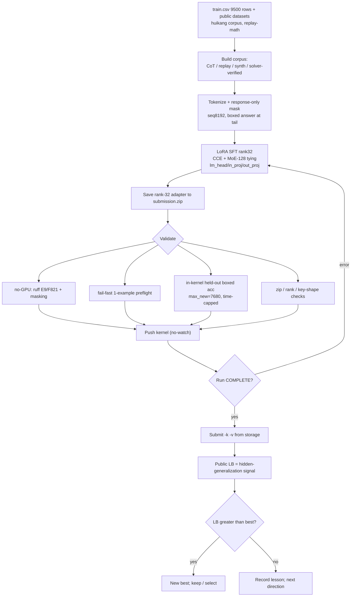
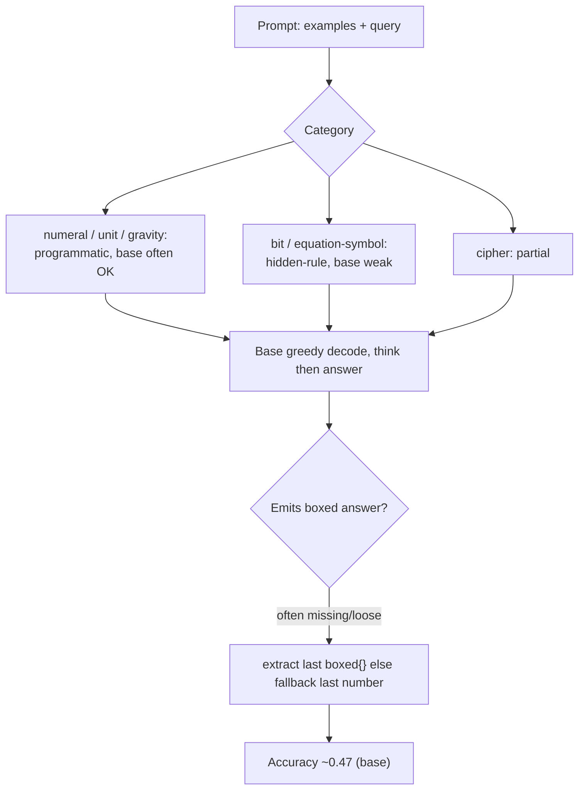
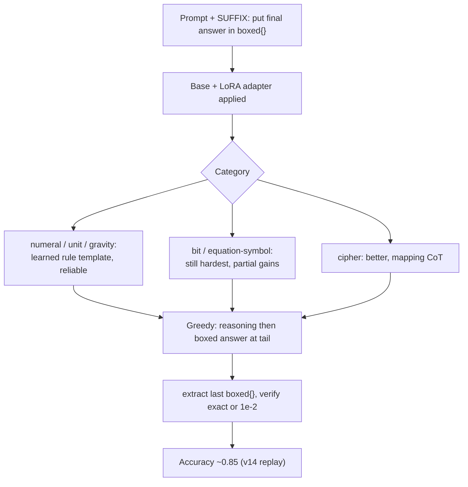
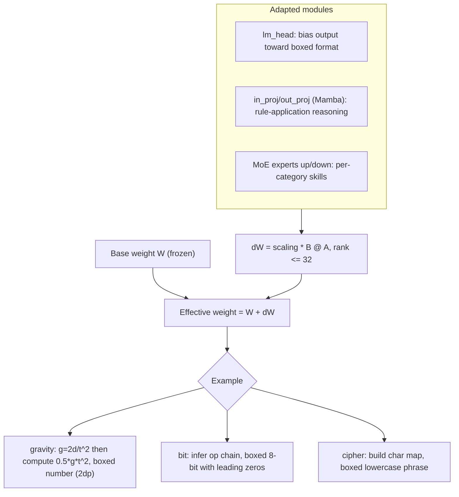

# Notes — NVIDIA Nemotron Model Reasoning Challenge

> English canonical. Chinese equivalent: [`notes_zh.md`](./notes_zh.md) (kept aligned section-by-section).
> Validation / RL workflow notes. Evidence: `README.md`, `rules.md`, `tracking.md`, `submissions.md`,
> `bugs.md`, `insights.md`, `strategy.md`, `tasks.md`, `competition.yaml`, `kernels/README.md`,
> `work/00.nemo.md`, and a read-only solver-coverage pass over the local `train.csv`. `unknown` = not in
> available evidence. No GPU / 30B inference was run to produce this doc.

## 1. Current validation reality
- **There is no single canonical CV.** `competition.yaml` records `cv_score: null`; each kernel only ran a
  tiny in-kernel **held-out boxed-accuracy** check (`EVAL_N = 8` rows). The leaderboard is the only
  trustworthy signal we have, and the public test set is just **3 rows** (≈ first 3 train rows per
  `work/00.nemo.md`) — a sanity check, not a score driver. The real target is a **hidden** benchmark.
- The held-out check was **misleading until fixed**: `EVAL_MAX_NEW = 512` truncated long CoT before the
  `\boxed{}` tail, so good adapters read `0/8` (bug **B4 / T13**; fixed to `7680` + an `EVAL_TIME_CAP=1800s`).
  After the fix, v15's local held-out read `3/4` while the LB was 0.84 — i.e. even the fixed local check is a
  noisy 8-sample proxy, not a CV.
- Net: validation today = **(a)** no-GPU static checks pre-push, **(b)** a fail-fast 1-example preflight,
  **(c)** an 8-row in-kernel boxed-accuracy sniff, **(d)** the public LB. A proper category/hard-case CV
  (T12) was **planned but never run**.

## 2. How to validate a fine-tuned Nemotron adapter
A layered pipeline, cheap checks first (most are no-GPU and already exist; the GPU ones run inside the kernel):

1. **Local smoke (no GPU)** — `kernels/validate_kernel.py`: `ruff` E9/F821 (catch undefined-name typos like
   the v7 `texts` NameError) + response-only **masking** check on assembled examples. Run before every push.
2. **Fail-fast preflight (in-kernel, minutes)** — run the generate→extract path on **one** example right
   after model load, *before* the long train, so runtime bugs (e.g. v8 `.shape` / BatchEncoding **B3**)
   surface in minutes, not after ~2h.
3. **Official-metric compatibility** — mirror the grader exactly: **greedy decode, `max_tokens=7680`,
   `temp=0`, `top_p=1.0`**; extract the **last `\boxed{...}`**; compare **exact string (case-insensitive)
   OR numeric within rel 1e-2**. Porting the official `score()`/`extract_final_answer()`/`verify()` locally
   is **T12 (not yet done)**; an aligned local extractor is required or local scores mislead (INS-002).
4. **Decode length** — the official cap is 7680 new tokens; any local eval must match it (B4). Too-short
   decode = false negatives; CoT models routinely need thousands of tokens before the boxed answer.
5. **`\boxed{}` extraction + formatting** — verify the model **always** closes with a single extractable
   `\boxed{}`; watch the format edges that silently fail the string match:
   binary answers keep **leading zeros** (`01000011`, not `1000011`); numeric `gravity`/`unit` keep
   **2 decimals**; `cipher` is **lowercase, single-spaced, no trailing punctuation**; symbol/`equation`
   answers must be emitted **verbatim** (preserve quotes/backslashes/special chars).
6. **Adapter zip / rank checks** — `submission.zip` has **root-level** `adapter_config.json` +
   `adapter_model.safetensors` (no nested dir), **rank ≤ 32**, `alpha` as trained, keys match the base
   (`base_model.model.backbone…`); the merge kernel asserts file size + names (avoids the B3-class
   "loads in my notebook but not in the grader" failure).
7. **Kaggle LB** — the real signal. Submit from kernel storage (`--kernel/--version`); a push is **not** a
   submission (#77). Quota 5/team/day (shared across both accounts).
8. **Hidden generalization** — the LB approximates a hidden, **new-rule** benchmark. A train-derived
   number that doesn't move the LB (e.g. cryptarithm 8%→71% single-category but total stuck ~0.86, **B8**)
   tells you the local signal didn't transfer. Treat LB deltas, not local accuracy, as ground truth.

## 3. Train/validation split strategy
**Should we randomly split `train.csv` into train/test/validation?** Only for **smoke / regression** — not
as the primary quality signal. The task is **hidden-rule generalization**: every prompt embeds a *new*
transformation rule, so a random split leaves train and val drawn from the *same* rule distribution and
**overstates** generalization (the model can pattern-match siblings). Better, evidence-aligned splits:

- **Category-stratified** — hold out per category (bit / cipher / numeral / unit / gravity / equation) so you
  see *where* a change helps or hurts (the v10/v15 lesson: a gain in one category can be a net loss).
- **Template-aware** — split by prompt template / example-count / operator set so the val rule is **not**
  a near-duplicate of a train rule (closest to the hidden setting).
- **Answer-type** — bucket by `binary8` / `numeric` / `string-symbol` to track the format-edge failure modes
  (leading zeros, decimals, verbatim symbols) that the metric punishes independently of reasoning.
- **Hard-val** — a small fixed set of the *hardest-to-fit* rows (see §4): rows a deterministic solver cannot
  crack, multi-step bit rules, symbol-rewrite equations, ambiguous cipher. This is the closest cheap proxy
  to the hidden benchmark and the right thing to track per experiment (T12 / `work/00.nemo.md` §9-Idea F).

Recommended: keep a tiny **random smoke split** for pipeline regressions **and** a **category-stratified +
hard-val** set scored with the official extractor for the real read.

## 4. Hard validation rows and selection criteria
Selection criteria (evidence-based, from a read-only solver-coverage pass on the local `train.csv`; a
deterministic per-category solver solved gravity/numeral/unit 100%, **cipher 38%, bit 10%, equation 0.4%** —
the *unsolved* rows are the hard-to-fit ones):

- **bit** — multi-op compositions (XOR/AND/OR + shift/rotate + majority/choice) the bounded solver can't fit
  (≈90% unsolved): rule induction from ~8 pairs is genuinely hard.
- **equation (symbol-rewrite)** — `A op B = result` symbol strings whose rewrite rule isn't in a small fixed
  library (≈99.6% unsolved); plus the **numeric** equation variant (arithmetic answers) mixed into the same
  category — needs two-track handling (`work/00.nemo.md` Idea E).
- **cipher** — query needs a character never seen in the examples, or a non-clean substitution (≈62% unsolved).
- **format edges** — binary answers with leading zeros; numeric with rounding sensitivity.

| id | category | why hard | answer type | validation purpose | source/evidence |
|---|---|---|---|---|---|
| 74339109 | bit | multi-op rule, solver-unfit (90% of bit unsolved) | binary8 | bit rule-induction generalization | solver-coverage pass |
| 368f20dd | bit | multi-op rule, solver-unfit | binary8 | bit rule-induction generalization | solver-coverage pass |
| 8bca1334 | bit | multi-op rule, solver-unfit | binary8 | bit rule-induction generalization | solver-coverage pass |
| da931308 | equation | symbol-rewrite not in fixed rule library | string/symbol | symbolic transform + verbatim output | solver-coverage pass |
| 1a493b13 | equation | symbol-rewrite, short symbol answer | string/symbol | symbolic transform + verbatim output | solver-coverage pass |
| 124db55f | equation | **numeric** equation answer (arithmetic track) | numeric | two-track equation (numeric vs symbol) | solver-coverage pass |
| db677e8c | cipher | query char(s) unseen in examples / mapping gap | string/symbol | cipher generalization beyond lookup | solver-coverage pass |
| 902410ec | cipher | longer phrase, mapping coverage gap | string/symbol | cipher generalization + spacing format | solver-coverage pass |
| 000b53cf | bit | **leading-zero** binary answer (`01000011`) | binary8 | leading-zero formatting (string-match) | train.csv (also a public test row) |
| 001b24c4 | numeral | easy rule, but exact-string Roman output | string | format/regression anchor (should always pass) | train.csv |

> All ids are from the local `train.csv` (`~/competitions/kaggle-…/data/train.csv`, 9500 rows). Per-row LB
> contribution is `unknown` (hidden test). If `train.csv` is unavailable in another environment, re-derive
> with the same criteria: take solver-**unsolved** rows per category + leading-zero/decimal format edges.

## 5. RL / self-distillation attempts and lessons
What was actually **tried, scored, planned, or never run** (LB from `submissions.md` / `tracking.md`):

| Approach | Status | LB | Lesson |
|---|---|---|---|
| Answer-only SFT (v5) | tried, scored | 0.61 | learns the boxed format; ceiling low |
| CoT SFT + response-only masking (v7 / ctx4k) | tried, scored | 0.65 / 0.67 | masking is essential (v6 unmasked = 0.44, **B2**) |
| Replay-recipe SFT (**v14**) | tried, scored | **0.85 (best)** | CCE + MoE-128 tying + lm_head/in_proj/out_proj LoRA + seq8192 + huikang corpus + replay-math = the single biggest lever |
| Synthetic augmentation (v15; b1/b2) | scored | v15 0.84; **b1 0.85, b2 0.84** | dose matters: low-dose b1 (~9%) recovered to **0.85** (vs v15 24%→0.84) — confirms dilution; none exceeded 0.85 |
| SVD multi-adapter merge (T7) | tried, scored | 0.82 | strong+weak merge **dilutes** (INS-003); route closed |
| Solver-distillation on real prompts (c1/c2) | scored | **c1 0.85, c2 0.83** | verified real-prompt CoT (Idea A/D) tied **0.85** (c1, balanced); hard-cat emphasis (c2) diluted to 0.83 |
| **SVD model-soup (v14+c1+b1)** | scored | **0.86 (NEW BEST)** | weighted soup (0.4/0.3/0.3) of three *comparable, complementary* 0.85 adapters (replay / verified-solver-CoT / cryptarithm-synth, all full v14 structure) **beat every member** — the §9b-H condition T7 lacked; merge route validated |
| **v11 rejection-sampling self-distillation** | **planned, NEVER run** | — | D2-approved but out of GPU/time budget; sample base model → keep correct → SFT |
| **GRPO / PPO / any RL** | **NEVER attempted** | — | `work/00.nemo.md` §8.5 proposed verifiable-reward RL (exact-match reward + format/length penalties) *after* stable SFT; never reached |

### What actually differs between v14 / b1 / b2 / c1 / c2 / soup
All are **rank-32 LoRA on the same base** (Nemotron-3-Nano-30B-A3B) and — except the soup — share the
**identical v14 training backbone** (CCE + MoE-128 expert tying + LoRA on lm_head/attention/in_proj/out_proj
+ seq8192 + 7h guard). The only differences are the **training data added** (and, for the soup, that it is a
merge, not a training run):

| Version | LB | What it is (vs the v14 backbone) |
|---|---:|---|
| **v14** | 0.85 | The base recipe: huikang recorded-order corpus + replay-math (2M answer tokens). No extra data. |
| **b1** | 0.85 | v14 **+ ~800 cryptarithm-only *synthetic* CoT** (~9% of mix). Low synth dose. |
| **b2** | 0.84 | v14 **+ ~1000 cryptarithm+bit *synthetic* CoT** (~11%). More synth + a bit slice. |
| **c1** | 0.85 | v14 **+ ~1800 *verified real-prompt* solver-CoT** (balanced cipher/bit/numeral/gravity/unit; kept only where a solver reproduced the ground-truth answer). |
| **c2** | 0.83 | v14 **+ ~1000 verified solver-CoT, hard-category-weighted** (bit/equation/cipher heavy, less easy data → more dilution). |
| **soup** | **0.86** | **Not a training run** — an SVD **model-soup** (weighted avg 0.4/0.3/0.3 → rank-32) of **v14 + c1 + b1**. Combines the three comparable, complementary members. |

So: **v14** = recipe only; **b1/b2** add *synthetic* (made-up) puzzle CoT; **c1/c2** add *verified real-prompt*
solver-distilled CoT (answers checked against ground truth); **soup** merges v14+c1+b1 into one rank-32 adapter
and is the only one that exceeded 0.85 (the model-soup effect — INS-004).

**Honest summary:** no reinforcement-learning run has happened. "RL-adjacent" ideas are rejection-sampling
self-distillation (planned, not run) and the deterministic **solver-distillation** (c1=0.85 / c2=0.83). Every
attempt to add signal **on top of** the clean replay recipe regressed or **tied** (best add-on = 0.85);
the **v14+c1+b1 model-soup reached 0.86** — a new best. RL, if attempted, should come only after a stable
SFT base and a real local metric (T12), with reward = official exact-match/numeric-tolerance + `\boxed{}` format.

> **Merge route CONFIRMED (audit §9b-H):** b1 and c1 both hit 0.85 on *different* data (cryptarithm synth
> vs verified real-prompt CoT) — *comparable + complementary*, the condition T7 lacked (strong+weak → 0.82).
> The SVD model-soup of **v14 + c1 + b1** (weights 0.4/0.3/0.3, rank-32) scored **0.86 (+0.01, new best,
> own real-training)** — a same-basin soup beating each member. This is the validated path, not the
> strong+weak merge.

## 6. Workflow charts

### 6.1 End-to-end training / fine-tuning / validation flow

### 6.2 Base / original Nemotron inference (by data type)

### 6.3 Fine-tuned Nemotron inference (by data type)

### 6.4 LoRA adapter contribution (with examples)

## 7. Practical recommendations
1. **Build the local metric first (T12)** — port official `score()`/`extract_final_answer()`/`verify()`,
   match `max_tokens=7680`/`temp=0`, and keep a **category-stratified + hard-val** set (§4). Without it,
   every experiment is judged by an 8-row sniff or a 5/day LB slot.
2. **Protect v14 (0.85)** — it's the banked best and the ceiling of current levers; LB keeps the max, so
   experiments can't lower it, but don't burn quota on additions that the evidence says dilute it.
3. **Highest-EV untried direction**: verified **real-prompt** reasoning for the hard categories — expand the
   solver's symbol-rewrite library (currently 0.4% on `equation`) by reverse-engineering real rules, and/or
   teacher-distill CoT toward the known answers for bit/equation. Caveat B8 (single-cat may not move total).
3a. **RL only after** a stable SFT base + real metric; reward = exact-match/1e-2 + `\boxed{}` format reward.
4. **Formatting is free accuracy** — enforce leading zeros, 2-decimal numerics, lowercase single-spaced
   cipher, verbatim symbols; validate by answer-type, not just overall accuracy.
5. **Scheduling** — long training kernels overnight (~22:00–24:00 AEST), short ones (merge/validate) daytime
   (see `README.md`); each kernel keeps the ≤8h wall-clock guard (B7).

## 8. Evidence and source files
- `competitions/nvidia-nemotron/`: `README.md`, `rules.md`, `tracking.md`, `submissions.md`, `bugs.md`
  (B1–B9), `insights.md` (INS-001..003), `strategy.md`, `tasks.md`, `competition.yaml`, `notes_zh.md`.
- `kernels/README.md` + `kernels/*.py` (recipe, score progression, gotchas); `lib/nemo_solver.py`
  (deterministic solvers used for the §4 coverage evidence).
- `postmortems/2026-06-14-final-sprint-audit.md` (plan-vs-actual, options table incl. §9b).
- `work/00.nemo.md` (ChatGPT analysis: challenges, Ideas A–F, §8 techniques, §9 route, §11 matrix).
- Read-only solver-coverage pass on `~/competitions/kaggle-…/data/train.csv` (9500 rows) for §4 hard rows.
- Run/LB status as of 2026-06-15: final-sprint scores **b1 0.85, b2 0.84, c1 0.85, c2 0.83, soup 0.86 (new best, own real-training)**. `tracking.md`/`submissions.md` updated with these.

## LB25 Progress Prize Improvements: What We Learned

> Post-competition study of the Kaggle writeup **"[LB25] Improvements to the progress prize submission"** by
> **Tong Hui Kang** (`huikang`/`tonghuikang`, the Progress-Prize winner), **~0.872 public (218/250)**.
> Full reconstruction + sources: `external/lb25/`. The Kaggle writeup body is JS-rendered (not fetchable
> without auth, which we don't use here); reconstructed from discussion #703896 snippets + the public
> `tonghuikang/nemotron` GitHub repo. External claims = untrusted data; our scores from `tracking.md`.

**LB25 method (pure SFT — no RL).** Base `Nemotron-3-Nano-30B-A3B`, LoRA r32 (MLP+attn+lm_head), seq 8192,
1 epoch, response-only mask. The distinguishing idea is **deterministic-solver chain-of-thought**: per-category
rule-discovery algorithms (`reasoners/`: cipher, bit_manipulation, equation_numeric, cryptarithm backtracking)
emit a fixed step-by-step trace and the model is trained to **execute it verbatim**, plus **min-logprob
selective replay** (replay only the rows whose minimum per-token log-prob hasn't converged — the hardest
bit/cipher) and **category-stratified batching**. The "LB25 improvements" then warmstart the v27 Progress-Prize
adapter and run a short **format-alignment** fine-tune (≈240 steps, batch ×2).

**Why ~0.872.** Easy categories are already ~100% (gravity/numeral/unit) and cipher ~99% on train; the lever
is (1) **fixing the output-format/length bug** — long CoT could exhaust the 7,680-token cap *before* the
`\boxed{}`, yielding blank answers; short responses make good reasoning actually score; (2) **min-logprob
replay** of the residual hard bit rows; (3) deterministic CoT = reliable algorithm execution vs noisy
LLM traces. Notably his **`cryptarithm_deduce` (≈ our `equation` base-36 cipher) ceilings at ~8.95% on train
even with a backtracking CSP solver** — independent confirmation of our EQ-2′ "strong cipher, not
closed-form-recoverable" verdict.

**How our approach differed.** We also did pure-SFT replay (v14, 0.85) but our edge was the **SVD model-soup**
(v14+c1+b1 → 0.86; INS-004) which huikang does not use. We used the *huikang corpus* as data; he *generated*
it from solvers. We never used **min-logprob adaptive replay** (we used a fixed replay-math dose) nor a
**deterministic-solver CoT across all categories** (our solver covered bit/cipher only partially; equation 0.4%).
Our equation lever was **coverage-memorisation** (eq-aug, 0.86 private) rather than a backtracking solver —
same ~8–9% wall on the unseen tail.

**What we learned.** (1) The path to ~0.872 is **bit + format reliability, not equation** — both sides confirm
equation/cryptarithm is a bounded ~8–9% cipher wall. (2) **Min-logprob selective replay** is a cheap,
dilution-safe way to target exactly the rows SFT under-fits (vs our uniform high-dose synth that *regressed* —
b2/v15/c2). (3) **Output-length/format is free accuracy** — verify no answer truncates before `\boxed{}`.
(4) Deterministic-solver CoT > LLM-generated traces for reliability.

**What to try after Saturday.** `v16-mlp` (plan: `external/lb25/analysis/next_version_plan.md`): v14 backbone +
**min-logprob selective replay** of the hardest bit/cipher rows (≤15% dose) + a short **format-alignment** pass
warmstarted from the 0.86 soup; gate on **T12 hard-val ≥ 0.764** + a length-truncation audit before any submit;
then soup-grow into v14+c1+b1. Keep eq-aug standalone (it doesn't soup). ~1 GPU session.

## LB80 Progress Prize Improvements: What We Learned

> Post-competition study of the Kaggle writeup **"Breaking the SFT Ceiling on Nemotron-3-Nano-30B"**.
> Full reconstruction + sources: `external/LB80/`. **Recoverability PARTIAL** — the Kaggle writeup body is
> JS-rendered + post-close unindexed (not fetchable without auth, which we don't use); the **author and exact
> score are `unknown`** (the task template's "~0.872" is a placeholder). Reconstructed from competition
> **discussion #688461** (a detailed per-bit GRPO reward scheme) + the public RL ecosystem (NeMo-RL, Logic-RL,
> ProRL, Tina). External claims = untrusted data.

**LB80 method (the lever = go BEYOND SFT).** Two stages: **(1) SFT cold-start** to the known 0.85–0.86 baseline,
then **(2) GRPO / RLVR with a DENSE per-step verifiable reward** — partial credit at every trace step (output-
column layout, operation choice, per-bit gate computation, a VER cross-check, each answer bit) plus a
**superlinear "champagne" bonus** (8/8 correct → +5 flat) that makes perfection worth far more than a near-miss.
This converts the reward landscape from a sparse cliff into a dense gradient climb, targeting **bit-manipulation**
(cleanest verifier) and equation/symbol. A second, non-RL above-SFT path in the ecosystem is **adapter surgery**
(lopure ~0.89: amplify the top-50% LoRA singular values).

**Why it breaks the ceiling.** SFT's answer-level signal is **sparse** — a near-correct 8-bit answer scores the
same 0 as random, so the hardest rows get vanishing gradient (our T12: equation ≤2/16 everywhere, bit caps
~14/16, and *augmentation regressed* the hard tail). A dense per-step reward gives gradient on partial
correctness; the champagne bonus shapes toward completion — the Logic-RL/RLVR result that rule-based RL on
puzzles generalizes past SFT.

**How our approach differed.** **We never ran RL** — our biggest method gap. `research.md §4` *designed* GRPO
but with a **binary terminal reward** (0/1) and it was deferred (GPU/time). We are AT the 0.86 SFT ceiling this
writeup describes (every augmentation diluted; soup = 0.86). Our levers (SVD soup, eq-aug coverage) are SFT/merge
tricks, orthogonal to RL.

**What we learned.** (1) The documented path past 0.86 is **dense-reward GRPO on a strong SFT prior**, not more
SFT data. (2) The reward must be **dense + per-step** (our designed binary reward is the wrong shape) and the
**final-answer verify must dominate** (anti-reward-hack). (3) RL at 30B needs **external GPU** (online rollouts
exceed Kaggle kernels) and a strong cold-start (base-init GRPO is unstable). (4) A **cheap no-RL alternative**
exists — adapter singular-value amplification (lopure) — worth trying first. (5) Equation stays bounded (no
usable per-step verifier for the strong cipher).

**What to try after Saturday.** `v17-grpo` (plan: `external/LB80/analysis/next_version_plan.md`): GRPO with a
dense per-step reward (+champagne) on **bit**, warmstarted from v14/soup, `verify` dominating; gate on **bit
hard-val ↑ with no easy-category regression**; soup-grow the survivor into v14+c1+b1. Try the **adapter
singular-value amplification** fallback first (≈0 GPU). RL proper likely needs external compute (#83), not just
the RTX PRO 6000.

## LB92 Progress Prize Improvements: What We Learned

> Post-competition study of the Kaggle writeup **"92th PLACE SOLUTION — NVIDIA Nemotron Model Reasoning
> Challenge"**. Full reconstruction + sources: `external/LB92/`. **Recoverability NO (direct) / PARTIAL
> (ecosystem)** — the Kaggle writeup body is JS-rendered + posted <48 h after close (unindexed); the
> **author, exact score, and specific method are `unknown`** (template "~0.872" is a placeholder). This is a
> reconstruction of the public mid-tier (~0.86–0.89) recipe band from GitHub/HF/NVIDIA sources. Untrusted data.

**LB92 method (band reconstruction).** A 92nd-of-4,354 result almost certainly used the **standard public
replay-SFT recipe**: rank-32 LoRA on `Nemotron-3-Nano-30B-A3B`, seq 8192, response-only-masked CoT SFT, score
driven by recipe fidelity + good bit CoT + synthetic/teacher data for hard categories + possibly a model merge.
The publicly-released **andy279 corpus** (49,290 multi-teacher traces: DeepSeek V3.2 + Nemotron Super 120B +
GPT-5.4 + deterministic solvers) is the kind of data any team in this band could have used.

**Why ~0.86–0.89 (and not higher).** Easy categories (gravity/numeral/unit) ~100% and cipher ~99% on train;
the band is separated by **bit-manipulation** coverage + format reliability. The hard cap is
**cryptarithm/equation ~8–9% even with a backtracking solver** — the same strong-cipher wall we hit. Going
above the band needs RL (LB80) or adapter surgery (lopure), not more standard SFT.

**How our approach differed.** We're **already in this band** (0.86 soup), so 92nd place is not above us by
paradigm. Our differences are **corpus quality** (we used the huikang corpus + own synth/solver-CoT, not the
broad multi-teacher andy279 set) and **hard-row targeting** (we used a fixed replay dose, not min-logprob
rebalancing). We are **ahead** on the 3-way model-soup (the band often ships a single adapter) and on the
equation EQ-0/EQ-2′ cryptanalysis + eq-aug coverage.

**What we learned.** (1) Our 0.86 sits squarely in the mid-tier band — the recoverable edge is **corpus
quality for bit** (solver-prepend bit CoT) + **min-logprob rebalancing**, not a new paradigm. (2) **Bit is the
separator category** and our biggest train-set headroom. (3) **External-teacher data must stay low-dose** —
our prior high-dose external-teacher run regressed to 0.81; prefer **own-solver-verified CoT**. (4) Equation is
a shared bounded wall — don't chase it.

**What to try after Saturday.** `v18-corpus` (plan: `external/LB92/analysis/next_version_plan.md`): expand
`lib/nemo_solver.py` bit coverage → **verified solver-prepend bit CoT** (answer == gold) + a **min-logprob
rebalancing** pass, woven at **≤15% dose** into the v14 backbone; gate on **T12 hard-val ≥ 0.764 with bit ↑
and no easy-category regression**; soup-grow into v14+c1+b1. ~1 GPU session (data-side; cheaper than RL).

> **Cross-writeup convergence.** All three studies point the same way: the path above our 0.86 is **(a)
> dense-reward GRPO** (LB80, the biggest but most expensive lever), **(b) min-logprob selective replay /
> rebalancing** (LB25 + LB92, cheap and dilution-safe), **(c) better bit data + output-format reliability**
> (LB25 + LB92), and **(d) adapter singular-value amplification** (LB80 alt, ≈0 GPU). **Equation is a bounded
> ~8–9% strong-cipher wall for everyone** — confirmed independently by huikang's `cryptarithm_deduce` ceiling
> and our EQ-2′. Recommended order after the Saturday reset: cheap no-GPU/data levers (surgery, min-logprob,
> bit CoT) first → then a bit-only GRPO pilot on external GPU.
