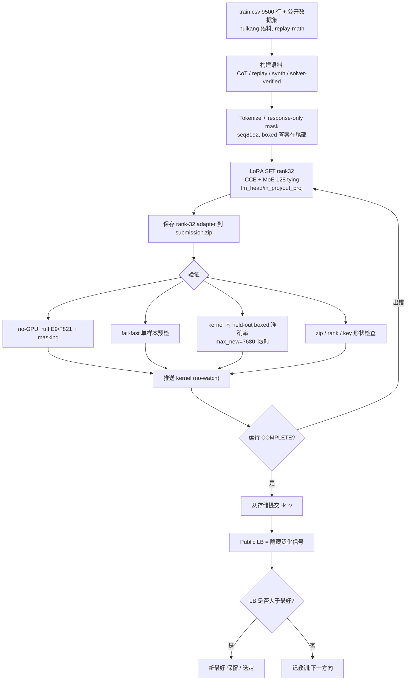
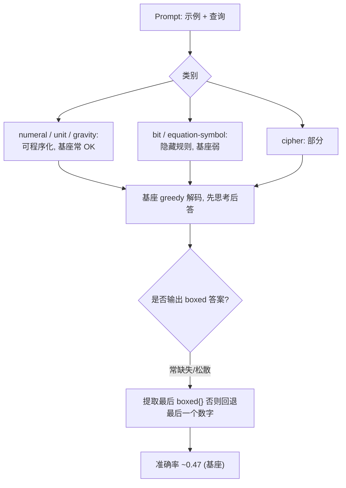
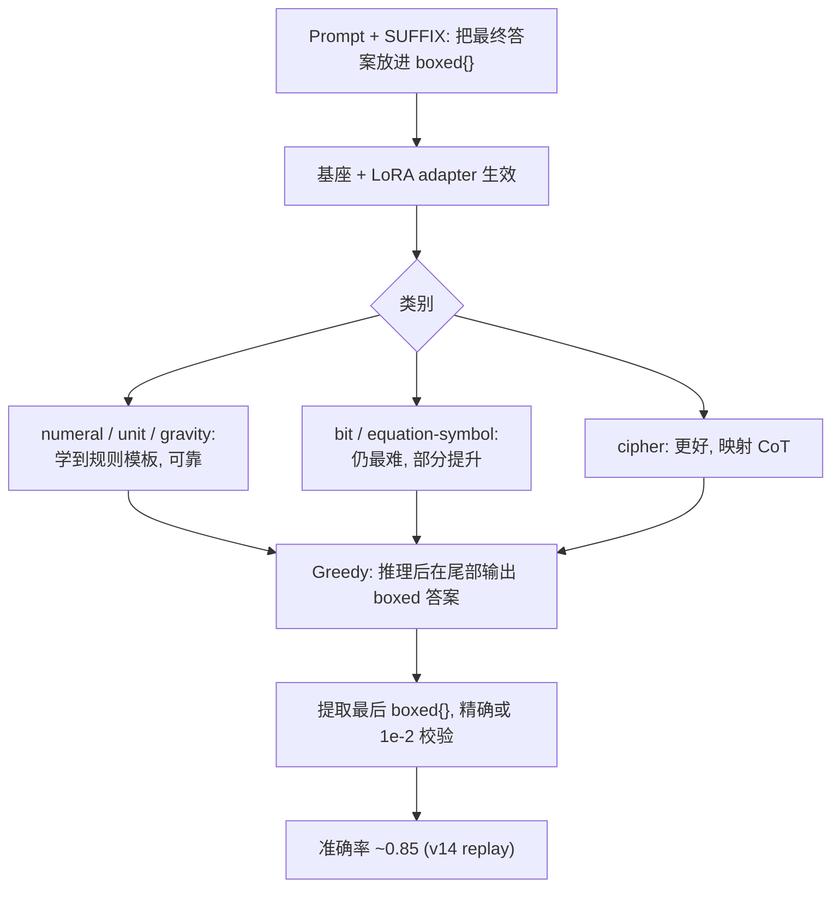
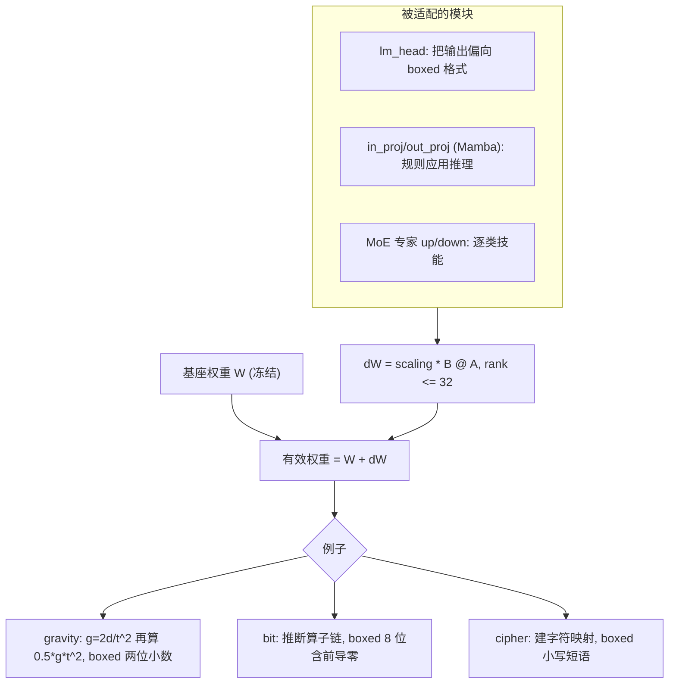

# 笔记 — NVIDIA Nemotron Model Reasoning Challenge(中文)

> 英文规范版:[`notes.md`](./notes.md)(逐节对齐)。本文为验证 / RL 工作流笔记。
> 证据来源:`README.md`、`rules.md`、`tracking.md`、`submissions.md`、`bugs.md`、`insights.md`、
> `strategy.md`、`tasks.md`、`competition.yaml`、`kernels/README.md`、`work/00.nemo.md`,以及对本地
> `train.csv` 的**只读** solver 覆盖率扫描。`unknown` = 证据中没有。撰写本文**未跑 GPU / 30B 推理**。

## 1. 当前验证现状
- **没有单一权威 CV。** `competition.yaml` 记 `cv_score: null`;每个 kernel 只跑了一个极小的 kernel 内
  **held-out boxed 准确率**(`EVAL_N = 8` 行)。榜单(LB)是唯一可信信号,而 public test 只有 **3 行**
  (≈ train 前 3 行,见 `work/00.nemo.md`)——只是 sanity check,不决定成绩。真正目标是**隐藏** benchmark。
- 这个 held-out 检查**修复前会误导**:`EVAL_MAX_NEW = 512` 在 `\boxed{}` 尾巴之前就截断了长 CoT,导致好
  adapter 读出 `0/8`(bug **B4 / T13**;已改 `7680` + `EVAL_TIME_CAP=1800s`)。修复后 v15 本地 held-out
  读 `3/4` 而 LB=0.84——即使修好的本地检查也只是 8 样本的噪声代理,不是 CV。
- 综上,当前验证 = **(a)** 推送前 no-GPU 静态检查、**(b)** fail-fast 单样本预检、**(c)** 8 行 kernel 内
  boxed 准确率嗅探、**(d)** public LB,外加 **(e)** T12 难例 CV(2026-06-15 已跑,见下)。
- **T12 难例 CV(2026-06-15,`harrysun2006/nemo-t12-hardval` v2)已完成:** 移植官方 metric + min-logprob
  每类最难 72 题,对 adapter 排名 —— **soup 0.764 = v14 0.764(均拿满难 cipher/bit)≫ base 0.389 ≈ c1
  0.389 > v15 0.333 > c2 0.278**。要点:**0.86 soup 稳健不稀释**;**CoT/合成增补的 c1/c2/v15 在最难
  cipher/bit 跌到 base 同级或更低**(base 基线排除「没加载上」);**equation 全员未解(≤2/16)**。
  → 守 0.86 soup,private-LB 最终选 **soup + v14**(详见 `submissions.md` / `tracking.md`)。

## 2. 如何验证一个微调后的 Nemotron adapter
分层流水线,便宜的先做(多数 no-GPU 且已存在;GPU 的在 kernel 内跑):

1. **本地 smoke(no GPU)** — `kernels/validate_kernel.py`:`ruff` E9/F821(抓 v7 `texts` 这类未定义名
   typo)+ 组装样本的 response-only **masking** 校验。每次推送前必跑。
2. **fail-fast 预检(kernel 内,数分钟)** — 模型加载后、长训练**之前**,在**一个**样本上跑
   生成→提取路径,让运行期 bug(如 v8 `.shape` / BatchEncoding **B3**)在几分钟内暴露,而非 2h 之后。
3. **官方 metric 兼容** — 与评测器完全对齐:**greedy 解码、`max_tokens=7680`、`temp=0`、`top_p=1.0`**;
   提取**最后一个 `\boxed{...}`**;**精确字符串(忽略大小写)或数值 rel 1e-2** 比较。把官方
   `score()`/`extract_final_answer()`/`verify()` 移植到本地是 **T12(尚未做)**;否则本地分会误导(INS-002)。
4. **解码长度** — 官方上限 7680 new tokens;本地 eval 必须一致(B4)。解码太短=假阴性;CoT 模型常需
   数千 token 才到 boxed 答案。
5. **`\boxed{}` 提取 + 格式** — 确认模型**总是**以单个可提取 `\boxed{}` 收尾;盯住这些会**悄悄**挂掉
   字符串匹配的格式边界:二进制答案**保留前导零**(`01000011` 而非 `1000011`);`gravity`/`unit`
   数值**保留两位小数**;`cipher` **全小写、单空格、无句尾标点**;符号 / `equation` 答案**原样输出**
   (保留引号 / 反斜杠 / 特殊字符)。
6. **adapter zip / rank 检查** — `submission.zip` 根目录直接放 `adapter_config.json` +
   `adapter_model.safetensors`(无嵌套目录),**rank ≤ 32**,`alpha` 与训练一致,key 匹配基模
   (`base_model.model.backbone…`);merge kernel 断言文件大小 + 文件名(规避 B3 类「我本地能加载、评测器
   不能」)。
7. **Kaggle LB** — 真正信号。从 kernel 存储提交(`--kernel/--version`);push **不是**提交(#77)。
   配额 5/队/天(双账号共享)。
8. **隐藏泛化** — LB 近似一个隐藏的**新规则** benchmark。一个从 train 推出的数字若不动 LB(如 cryptarithm
   单类 8%→71% 但总分卡 ~0.86,**B8**),说明本地信号没迁移过去。以 LB 变化(而非本地准确率)为准绳。

## 3. 训练 / 验证集切分策略
**该不该把 `train.csv` 随机切成 train/test/validation?** 仅用于 **smoke / 回归**,不作主质量信号。
本赛是**隐藏规则泛化**:每条 prompt 内嵌一个*新*变换规则,随机切分让 train/val 来自*同一*规则分布,
会**高估**泛化(模型能 pattern-match 兄弟样本)。更好的、与证据对齐的切分:

- **按类别分层(category-stratified)** — 各类(bit / cipher / numeral / unit / gravity / equation)分别留出,
  以看出某改动在*哪一类*涨 / 跌(v10/v15 教训:单类涨可能整体亏)。
- **模板感知(template-aware)** — 按 prompt 模板 / 示例数 / 运算符集合切,使 val 规则**不**是 train 规则的
  近似复制(最接近隐藏设定)。
- **答案类型(answer-type)** — 按 `binary8` / `numeric` / `string-symbol` 分桶,追踪 metric 会独立惩罚的
  格式边界失败(前导零、小数、原样符号)。
- **难例集(hard-val)** — 一小撮*最难拟合*的行(见 §4):确定性 solver 解不出的行、多步 bit 规则、符号
  重写 equation、歧义 cipher。这是对隐藏 benchmark 最便宜的代理,应**每次实验都跟踪**(T12 /
  `work/00.nemo.md` §9-Idea F)。

建议:保留一个极小的**随机 smoke 切分**用于流水线回归,**外加**一个用官方提取器打分的
**category-stratified + hard-val** 集做真正的读数。

## 4. 难验证行与选取标准
选取标准(基于对本地 `train.csv` 的**只读** solver 覆盖率扫描;一个确定性的逐类 solver 解出
gravity/numeral/unit 100%、**cipher 38%、bit 10%、equation 0.4%**——*解不出*的行即难拟合行):

- **bit** — 多算子组合(XOR/AND/OR + 移位 / 旋转 + majority/choice),有界 solver 拟合不了(≈90% 未解):
  从 ~8 对里归纳规则确实难。
- **equation(符号重写)** — `A op B = result` 符号串,其重写规则不在小型固定库内(≈99.6% 未解);
  另有混在同类里的**数值** equation(算术答案)——需双轨处理(`work/00.nemo.md` Idea E)。
- **cipher** — 查询需要示例里没出现过的字符,或非干净替换(≈62% 未解)。
- **格式边界** — 带前导零的二进制答案;对舍入敏感的数值。

| id | 类别 | 为何难 | 答案类型 | 验证目的 | 来源/证据 |
|---|---|---|---|---|---|
| 74339109 | bit | 多算子规则,solver 拟合不了(bit 90% 未解) | binary8 | bit 规则归纳泛化 | solver 覆盖率扫描 |
| 368f20dd | bit | 多算子规则,solver 拟合不了 | binary8 | bit 规则归纳泛化 | solver 覆盖率扫描 |
| 8bca1334 | bit | 多算子规则,solver 拟合不了 | binary8 | bit 规则归纳泛化 | solver 覆盖率扫描 |
| da931308 | equation | 符号重写不在固定规则库 | string/symbol | 符号变换 + 原样输出 | solver 覆盖率扫描 |
| 1a493b13 | equation | 符号重写,短符号答案 | string/symbol | 符号变换 + 原样输出 | solver 覆盖率扫描 |
| 124db55f | equation | **数值** equation 答案(算术轨) | numeric | 双轨 equation(数值 vs 符号) | solver 覆盖率扫描 |
| db677e8c | cipher | 查询字符未在示例出现 / 映射缺口 | string/symbol | cipher 超越查表的泛化 | solver 覆盖率扫描 |
| 902410ec | cipher | 更长短语,映射覆盖缺口 | string/symbol | cipher 泛化 + 空格格式 | solver 覆盖率扫描 |
| 000b53cf | bit | **前导零**二进制答案(`01000011`) | binary8 | 前导零格式(字符串匹配) | train.csv(亦为 public test 行) |
| 001b24c4 | numeral | 规则简单,但 Roman 需精确字符串输出 | string | 格式 / 回归锚点(应永远通过) | train.csv |

> 所有 id 来自本地 `train.csv`(`~/competitions/kaggle-…/data/train.csv`,9500 行)。逐行对 LB 的贡献
> `unknown`(隐藏测试)。若别的环境没有 `train.csv`,用相同标准重派:取各类 solver-**未解**行 + 前导零 /
> 小数格式边界行。

## 5. RL / 自蒸馏尝试与教训
实际**尝试 / 评分 / 计划 / 从未跑**的情况(LB 来自 `submissions.md` / `tracking.md`):

| 方法 | 状态 | LB | 教训 |
|---|---|---|---|
| Answer-only SFT (v5) | 已试已评 | 0.61 | 学会 boxed 格式;上限低 |
| CoT SFT + response-only masking (v7 / ctx4k) | 已试已评 | 0.65 / 0.67 | masking 必需(v6 不 mask = 0.44,**B2**) |
| Replay 配方 SFT(**v14**) | 已试已评 | **0.85(最好)** | CCE + MoE-128 tying + lm_head/in_proj/out_proj LoRA + seq8192 + huikang 语料 + replay-math = 单一最大杠杆 |
| 合成数据增强(v15;b1/b2) | 已评 | v15 0.84;**b1 0.85, b2 0.84** | 剂量是关键:低剂量 b1(~9%)回到 **0.85**(vs v15 24%→0.84)——印证稀释;均未超 0.85 |
| 多 adapter SVD merge(T7) | 已试已评 | 0.82 | 强+弱合并=**稀释**(INS-003);路线关闭 |
| 真实 prompt solver 蒸馏(c1/c2) | 已评 | **c1 0.85, c2 0.83** | 已验证真实 prompt CoT(Idea A/D)持平 **0.85**(c1,均衡);难类侧重(c2)稀释到 0.83 |
| **SVD 模型汤(v14+c1+b1)** | 已评 | **0.86(新最好)** | 三个*分数相当、互补*的 0.85 adapter(replay / 验证 solver-CoT / cryptarithm 合成,均为完整 v14 结构)加权汤(0.4/0.3/0.3)**超过每个成员** —— T7 缺的 §9b-H 条件;merge 路线得证 |
| **v11 拒绝采样自蒸馏** | **已计划,从未跑** | — | D2 已批但无 GPU/时间预算;base 采样→只留答对→SFT |
| **GRPO / PPO / 任何 RL** | **从未尝试** | — | `work/00.nemo.md` §8.5 提议可验证奖励 RL(精确匹配奖励 + 格式 / 长度惩罚),在稳定 SFT *之后*;从未到达 |

### v14 / b1 / b2 / c1 / c2 / soup 到底差在哪
全部是**同一基模上的 rank-32 LoRA**(Nemotron-3-Nano-30B-A3B),且除 soup 外**共用完全相同的 v14
训练骨架**(CCE + MoE-128 专家 tying + lm_head/attention/in_proj/out_proj 上的 LoRA + seq8192 + 7h 守护)。
唯一区别是**加进去的训练数据**(soup 则是合并、非训练):

| 版本 | LB | 相对 v14 骨架是什么 |
|---|---:|---|
| **v14** | 0.85 | 基础配方:huikang 录制顺序语料 + replay-math(2M answer tokens)。无额外数据。 |
| **b1** | 0.85 | v14 **+ ~800 仅 cryptarithm 的*合成* CoT**(~9%)。低剂量合成。 |
| **b2** | 0.84 | v14 **+ ~1000 cryptarithm+bit *合成* CoT**(~11%)。合成更多 + bit 切片。 |
| **c1** | 0.85 | v14 **+ ~1800 *真实 prompt 验证* solver-CoT**(均衡 cipher/bit/numeral/gravity/unit;只保留 solver 复现出真值答案的行)。 |
| **c2** | 0.83 | v14 **+ ~1000 验证 solver-CoT,难类加权**(bit/equation/cipher 偏重,easy 数据更少 → 稀释更多)。 |
| **soup** | **0.86** | **非训练** —— v14 + c1 + b1 的 SVD **模型汤**(加权平均 0.4/0.3/0.3 → rank-32),合并三个分数相当、互补的成员。 |

即:**v14** = 仅配方;**b1/b2** 加*合成*(自造)谜题 CoT;**c1/c2** 加*真实 prompt 验证*的 solver 蒸馏 CoT
(答案对过真值);**soup** 把 v14+c1+b1 合并成一个 rank-32 adapter,是唯一超过 0.85 的(模型汤效应,INS-004)。

**诚实小结:** 没有任何强化学习真正跑过。「类 RL」想法是拒绝采样自蒸馏(已计划未跑)和确定性
**solver 蒸馏**(c1=0.85 / c2=0.83)。所有在干净 replay 配方**之上**加信号的尝试都回归或**持平**
(最好的增补 = 0.85);**v14+c1+b1 模型汤拿到 0.86** —— 新最好。RL 若做,应在稳定 SFT 基线 + 真正本地 metric(T12)
*之后*,奖励 = 官方精确匹配 / 数值容差 + `\boxed{}` 格式奖励。

> **merge 路线得证(audit §9b-H):** b1 与 c1 都在**不同数据**上拿到 0.85(cryptarithm 合成 vs
> 真实 prompt 验证 CoT)—— *分数相当且互补*,这正是 T7 缺的条件(强+弱 → 0.82)。
> **v14 + c1 + b1** 的 SVD 模型汤(权重 0.4/0.3/0.3,rank-32)拿到 **0.86(+0.01,新最好,自训练合规)**
> —— 同盆地的汤超过每个成员。这才是被验证的路线,而非强+弱 merge。

## 6. 工作流图

### 6.1 端到端 训练 / 微调 / 验证流

### 6.2 基座 / 原始 Nemotron 推理(按数据类型)

### 6.3 微调后 Nemotron 推理(按数据类型)

### 6.4 LoRA adapter 贡献(含例子)

## 7. 实践建议
1. **先建本地 metric(T12)** — 移植官方 `score()`/`extract_final_answer()`/`verify()`,对齐
   `max_tokens=7680`/`temp=0`,并保留一个 **category-stratified + hard-val** 集(§4)。没有它,每个实验都
   只能靠 8 行嗅探或 5/天的 LB 名额来判断。
2. **保护 v14(0.85)** — 它是已存最好、也是当前杠杆的天花板;LB 取最大,实验不会拉低它,但别把名额
   浪费在证据显示会稀释它的「增补」上。
3. **最高期望值的未试方向**:针对难类别的**真实 prompt** 验证推理——扩充 solver 的符号重写库
   (目前 `equation` 仅 0.4%),逆向工程真实规则;和/或对 bit/equation 用 teacher 蒸馏朝已知答案生成 CoT。
   注意 B8(单类未必动总分)。
3a. **RL 只在**稳定 SFT 基线 + 真实 metric *之后*做;奖励 = 精确匹配 / 1e-2 + `\boxed{}` 格式奖励。
4. **格式是白捡的分** — 强制前导零、两位小数、cipher 小写单空格、符号原样;按答案类型验证,不只看总准确率。
5. **调度** — 长训练 kernel 安排在深夜跑(~22:00–24:00 AEST),短的(merge/validate)白天跑
   (见 `README.md`);每个 kernel 保留 ≤8h 墙钟守护(B7)。

## 8. 证据与来源文件
- `competitions/nvidia-nemotron/`:`README.md`、`rules.md`、`tracking.md`、`submissions.md`、
  `bugs.md`(B1–B9)、`insights.md`(INS-001..003)、`strategy.md`、`tasks.md`、`competition.yaml`。
- `kernels/README.md` + `kernels/*.py`(配方、成绩轨迹、坑);`lib/nemo_solver.py`(用于 §4 覆盖率证据的
  确定性 solver)。
- `postmortems/2026-06-14-final-sprint-audit.md`(计划 vs 实际,选项表含 §9b)。
- `work/00.nemo.md`(ChatGPT 分析:挑战、Ideas A–F、§8 技巧、§9 路线、§11 矩阵)。
- 对 `~/competitions/kaggle-…/data/train.csv`(9500 行)的只读 solver 覆盖率扫描,用于 §4 难例行。
- 运行 / LB 状态(截至 2026-06-15):冲刺最终分 **b1 0.85, b2 0.84, c1 0.85, c2 0.83, soup 0.86(新最好,自训练合规)**。**T12 hard-val 排名(2026-06-15)**:soup 0.764 = v14 0.764 ≫ base/c1 0.389 > v15 0.333 > c2 0.278 → 守 0.86 soup,private-LB 最终选 **soup + v14**。`tracking.md`/`submissions.md` 已据此更新。

## LB25 / 第25名方案:我们的学习与启发

> *(LB25 = @huikang「[LB25] Improvements to the progress prize submission」,Open Progress Prize 获奖者;
> writeup 头部标注 "25th place"。`external/LB25/` 已按 `wiki/25.LB25_task.md` 标准化为完整模板 ——
> `lb25-writeup.md`、`method_summary.md`、`score_tricks.md`、`links/`、`models/`、`datasets/`,并保留历史文件。
> 标题由「LB25 Progress Prize 改进」改为任务规范标题。)*

> 赛后研究 Kaggle writeup **「[LB25] Improvements to the progress prize submission」**,作者 **Tong Hui Kang**
> (`huikang`/`tonghuikang`,Progress-Prize 冠军)。**2026-06-17 据实际 writeup(`temp/LB25.pdf`)更新** —— 可还原度
> 现为完整;**取代**此前 JS-blocked 重建(那版误把 `kuangyicheng` 的「暖启动/短答案/240 步」配方当成本文,实际**没有**)。
> 完整细节 + 来源见 `external/LB25/`。外部声明为不可信数据;我方分数见 `tracking.md`。

**LB25 = 对 Progress-Prize 提交的四项针对性改动(纯 SFT)。** 据 writeup 原文:(1) **修复 adapter 评测** ——
本地验证 prompt 错了,答案在验证里看着没 box,但提交时其实是 box 的(**本地评测 bug**,非模型改动);
(2) **把 `equation_numeric` 减半** —— 联合反转对称性(「输入**和**输出要么都反转、要么都不」);
(3) **对 `cipher`/`unit`/`gravity`/`numeral` 用合成数据**把简单类锁在 ~100%;(4) **重组 bit-manipulation 的 CoT**。
基础流水线(不变)= 确定性 solver CoT + min-logprob 信号 + 类别分层 batch。

**结果 + 选择教训。** 私榜:**15 次提交里 0.872 ×4、0.868 ×8、0.864 ×3** —— 0.872 只占 4/15;「若选中对的那次本可单人金牌」。
**选择方差**教训(呼应我方 INS-005/INS-007:最好 + 多样化对冲;surgery ×1.15 私榜 −0.02)。

**Cryptarithm:他明确**没**取得进展**(≈ 我方 `equation` base-36 密码)。线索:「很多题有**一个乘法、一个减法、
一个加法(每个可能再 ±1)**」;CoT「退化成重复猜测」。→ 独立印证 equation/cryptarithm 是**有界的墙**(同 EQ-2′),
**且给出 EQ-2′ 新线索**:在秘密 σ 下的三项复合 `≈ A·B − C + D`(±1)—— 我方 EQ-2′ 从未测过的类(只测过单操作)。
低概率的未来破解实验(huikang 也没破)。

**我方差异。** 我方杀手锏是 huikang 没用的 **SVD 模型汤**(v14+c1+b1 → 0.86;INS-004);他是单 adapter。我方 equation
杠杆是**覆盖式记忆**(eq-aug 私榜 0.86),非 solver。

**学到什么。** (1) **huikang 的头号杠杆是本地评测 bug、非模型改动** —— 而*我方同类 bug 出现过两次*(B4 `EVAL_MAX_NEW`
截断;T12 hard-val 误判 eq-spec 0.167 vs LB 0.85)。最便宜高 EV 的动作是**评测↔提交一致性审计**。(2) **顶部选择方差
是真杠杆**(0.872 = 4/15)。(3) **equation/cryptarithm 对所有人有界** —— 不过度投入。(4) 锁住简单类(别让它们回归)。

**周六后可试。** `v16-evalfix`(方案见 `external/LB25/analysis/next_version_plan.md`):**先做评测↔提交一致性审计**
(免费;改动 #1),再 v14 骨架 + 重组的自有 solver 验证 **bit CoT**(改动 #4)+ 对最难 bit/cipher 行的 **min-logprob
重放**(剂量 ≤15%);以 **T12 hard-val ≥ 0.764 且 bit ↑、简单类不回归**把关;soup-grow 进 v14+c1+b1(最好 + 多样化对冲)。
eq-aug 保持独立。约 1 个 GPU session。

## LB80 Progress Prize 改进:我们的学习与启发

> 赛后研究 Kaggle writeup **「Breaking the SFT Ceiling on Nemotron-3-Nano-30B」**,作者 **Mayur Pawar**
> (`mspawar`),80/4190,最终私榜 **0.86**。**直接读自 `temp/LB80.pdf`**(可还原度完整)—— 取代此前重建(那版据讨论
> #688461 误把**另一人**的「per-bit GRPO」当成本文)。完整细节 + 来源见 `external/LB80/`。外部声明为不可信数据;我方分数见 `tracking.md`。

**LB80 方法(诚实的标题)。** 30+ 实验的研究,**证明了 SFT 天花板 = 0.86** —— STaR、GRPO、DPO、权重平均全都**没突破**。
与我方同源(huikang 确定性 solver SFT;V2 0.86,从未被超)。有效杠杆:**seq 4096→8192 = 0.46→0.77**(4096 时 43% 数据被静默截断)、
**全线性 LoRA 含 lm_head、排除 gate_proj**、确定性 solver CoT ≫ 模型/外部 CoT(DeepSeek-R1 长 CoT → 灾难 0.27)。
「+397 名」来自**提交对冲**(V2 + V8-ckpt400)在公私榜双峰失配下 —— 不是更高分。

**改变我方认知的三点:**
1. **equation 密码离线**可破**(97.6%)—— 我方 EQ-0/EQ-2′ 框定错了。** 真实结构是 **`A1A2 OP B1B2`**(两个 2 字符操作数 +
   1 字符运算符、**逐题**符号→数字双射、有限运算符族),**答案引导排列搜索**破 569/583(14 个失败的有 >10 个不同数字符号)。
   我们找的是 5 字符→1-4 字符映射的一个*全局* σ 并「证明」不可破 —— 解错了问题。**→ 重审 EQ-2′ / equation-frontier(PR #113)。**
2. **「发现泄漏」解释了我方 eq-aug 为何封顶。** 答案引导 solver CoT 把映射*作为已知*给出 → 教**核验而非发现**;93–97% 此类轨迹
   *内部不一致*(映射产不出 boxed 答案)。推理时无答案,需要发现。**杠杆是前向可执行、可由 prompt 推导的密码发现 CoT**(长度允许下;榜首 0.90 说明存在)。
3. **标准 RL 是错工具;DPO-with-oracle 才对。** 二值失败(3157 难题全 0/8、~6343 易题全 8/8、**0 边界**)→ STaR 产出 0%、
   GRPO 优势=0(无方差)。我方此前设计的二值奖励 GRPO 会同样失败。DPO 用 solver-CoT(chosen)vs **greedy 失败**(rejected)——
   但 mspawar 的 DPO(V12/V13)也只停在 0.84–0.86。

**待解张力。** mspawar 报「**Model Soup 在 Mamba-2 SSM 上失效**」,而我方 **SVD 汤 +0.01**。多半因*平均的对象*不同(他:完整
SSM A/B/C/D 递推;我们:冻结基座上的 LoRA *delta* + SVD rank-cap,更温和的同 basin 合并)。**值得做一次消融**再下结论。

**周六后可试。** `v17-discovery` + `v17-dpo`(方案见 `external/LB80/analysis/next_version_plan.md`):**(A)** 把 equation 重建为
`A1A2 OP B1B2`、做答案引导 solver,再做**前向可执行的发现 CoT**(经内部一致性审计)≤15% 织入 —— 越过 eq-aug 记忆的真正路径;
**(B)** 可选 **DPO-with-oracle**(greedy 失败作 rejected、solver-CoT 作 chosen、简单类混 SFT)针对 bit。外加 **Mamba-2 合并消融**。
equation 工作回馈 PR #113。RL 需外部 GPU(#83);预期保守。

## LB92 Progress Prize 改进:我们的学习与启发

> 赛后研究 Kaggle writeup **「92th PLACE SOLUTION」**,作者为**团队**(Yoshinari Kawashima + MedudentYamatai;
> DOI 10.34740/kaggle/w/88245)。**直接读自 `temp/LB92.pdf`**(可还原度完整)—— 取代此前仅生态重建(当时作者/分数/方法未知)。
> 完整细节 + 来源见 `external/LB92/`。外部声明为不可信数据;我方分数见 `tracking.md`。

**LB92 方法(数据工程优先)。** 与我方同源(huikang reasoner 几乎没改,87.8% train;建立在公开 0.85 notebook)。明确目标:
**别丢已可解的题**,而非解难题。三支柱:(1) 忠实复现 reasoner;(2) **统计匹配的合成生成器**(从 train.csv 提取字符频率/数值范围/
变换方法分布)+ **合成-vs-原始 eval 差距 QC 环**(训合成 / 评两者 / 闭差距),最终 **2.5:1 合成:原始**;(3) 两个稳定性技巧 ——
**逐字符 tokenization**(合成 token 强制 1 符号=1 token,修 cryptarithm 里 `}!` 之类 BPE 合并)与 **梯度裁剪 1.5**
(公开的 1e9 关闭导致不稳定 + 提交间方差;grad-norm 在 step 107 飙到 25,089)。RL(SimPO/ORPO)**失败**(chosen/rejected 太相似)。

**对我方改变/新增(4 个便宜、可测的杠杆):**
1. **逐字符 tokenization** 用于符号类(equation/cipher/cryptarithm)—— 直击我方弱点的**新、未试**杠杆;BPE 合并伤害处更稳。
2. **梯度裁剪 = 1.5**(我们用 1e9 关闭,正是他们修掉的设置)—— 治本地降提交间方差。*(张力:LB80/我方配方用 grad-clip 关却没报此问题 —— 当作便宜 A/B。)*
3. **统计匹配合成 + 差距闭合 QC** 精化我方「合成稀释」:我方 b1/b2/v15 回归,而他们的*有帮助*,因匹配了 train.csv 统计 + 2.5:1 比例 +
   合成-vs-原始差距验证。朴素 synth 稀释;**统计匹配、差距验证过的 synth 能迁移。**
4. **保护简单类**纪律(别让 100% 的类回归)—— = 我方 T12 抗稀释发现。

**与其它 writeup 的一致。** RL 在此打不过 SFT(LB92 SimPO/ORPO、LB80 GRPO/DPO);本地验证与 LB 背离(→ 信 LB;= LB25 eval-bug、我方 T12);
cryptarithm/equation 是**有界的墙**(他们明确不去攻)。他们的覆盖/稳定杠杆与 LB80「发现而非核验 CoT」的线索**正交** —— 从不同角度改善同一份 SFT 数据。

**周六后可试。** `v18-stable`(方案见 `external/LB92/analysis/next_version_plan.md`):符号类**逐字符 tokenization** + **grad-clip 1.5**
(对 1e9-off 做 A/B + 方差检查)+ **统计匹配、差距验证的合成**(≤15% → QC 与 T12 都过才到 2.5:1);以 T12 ≥ 0.764 + 简单类不回归把关。
CPU 为主的准备;约 1–2 个 GPU session。

## LB109 / 第109名方案:我们的学习与启发

> 赛后研究 Kaggle writeup **"Heuristics for bit, cryptarithm and equations"**,作者 **Andrey Kulakov(jex398)**。
> 109th;终分 ~0.82(cryptarithm 过拟合);**equation-guess(+50)**把他从 1000+ 推到 ~109。读自 **`temp/LB109.pdf`**
> (8 页,可还原度完整)。完整细节:`external/LB109/`。**⚠️ 主要是想法 writeup** —— 多数启发式太长没落地。外部声明为不可信数据。

**三个我方没有、值得借鉴的角度(作者多数未落地):**
1. **bit ANF(代数范式)技巧** —— `XOR(A,B,C) ⊕ C = A ⊕ B`,故用 `XOR(Output, C)` 去匹配 2 参数 `XOR(A,B)` 表;
   可推广到 OR/XOR_OR/Choice/Maj/OR_XNOR(**partial-ANF + 在 output 上 XOR 后匹配预计算表**)。把 3 参数搜索大幅压缩 ——
   我方 ~10% 覆盖的 bit solver 的全新角度(本批唯一用 ANF)。
2. **cryptarithm 模运算剪枝** —— mod-10 进位 + **mod 37(<5000 组合)、mod 11(回文)、mod 100(乘法)**,每步选最小集分支,
   13k 符号 / 7k token 截断。这是让确定性 cryptarithm 搜索(LB3 CSP / LB6 DFS / 我方)塞进 token 预算的加速器。
3. **negation 规范化** —— `Shift(Not(x))` 而非 `Not(Shift(x))`(减少等价形式 → 缩小搜索)。

**落地的收益:** **equation/cryptarithm guess 符号推断**(算术符号用本义;相反符号用相反义;否则未用算子;否则 fallback)
→ +50(唯一动榜)。**第 8 次印证** equation/cryptarithm guess 可逐题推断(非全局密码)。

**负面教训(与我方呼应)。** 作者**死磕完美的 bit brute-force,几乎没落地** —— 只上 XOR3 本就能涨(= 我方在难类上的死磕;
应先落地小赢)。**cryptarithm 过拟合**(训练仓促 → 0.82)。坏例是 `00000`/`11111` 输出列 → 应**按长度+信息量给候选打分**做
token 预算剪枝。

**下一版想法(`lb109-v1`,仅计划 —— 赛已结束)。** 见 `external/LB109/analysis/next_version_plan.md`:bit ANF investigator +
negation 规范化;cryptarithm 模运算剪枝(mod 10/37/11/100)接在类约束搜索上;equation/cryptarithm guess 符号推断;
按长度+信息量给候选打分;加 CV 闸防过拟合;无 GPU 复核 equation-deduce(与 `lb{1,3,5,6,10,13}-v1` 共享)。
保底 = soup(0.86/0.85)+ eq-aug(0.86/0.86);回归则回滚。

## LB88 / 第88名方案:我们的学习与启发

> 赛后研究 Kaggle writeup **"88th PLACE SOLUTION"**,作者 **Yoshinari Kawashima + MedudentYamatai**
> (DOI 10.34740/kaggle/w/88245)。**⚠️ 与上方 LB92 节是同一篇 writeup**(同 DOI/作者/url `92th-place-solution`;
> 渲染头部现显示 "88th place",名次 92 → 88)。读自 **`temp/LB88.pdf`**(8 页,可还原度完整)。
> 完整细节:`external/LB88/`(交叉引用 `external/LB92/` 的图与先前分析)。外部声明为不可信数据。

**成绩。** **数据工程**方案:reasoner(@huikang OPP)几乎不改(oracle 87.8%),**别丢已可解的题**。杠杆(均已在 LB92 节记录):
**统计匹配合成生成器 + 合成-vs-原始 gap QC 环**(最终 2.5:1 合成:原始);**逐字符 tokenization**(1 字符=1 token)修
cryptarithm BPE 合并;**梯度裁剪 1.5**(vs 公开 1e9 —— 多半是提交间方差之因)。RL(SimPO/ORPO)失败(chosen=reasoner ≈
rejected=temp-1.3 采样);用 Claude Fable 5 也没造出更强的 bit/cryptarithm reasoner。

**对我方(同 LB92 结论)。**(1)**统计匹配 + gap 验证的合成**是我方"合成稀释"(b1/b2/v15 回归)的解药;(2)**逐字符
tokenization** 是我方没试过、直击符号弱点的杠杆;(3)**grad-clip 1.5** vs 我方 1e9-off 是便宜 A/B;(4)equation_deduce
90.8%(OPP baseline)再证 equation deduce 可解。cryptarithm ~9% / bit 85.1%(reasoner 未动)—— 他们没去攻的墙。

**下一版(`lb88-v1` ≈ LB92 的 `v18-stable`,仅计划 —— 赛已结束)。** 见 `external/LB88/analysis/next_version_plan.md`
与 `external/LB92/analysis/next_version_plan.md`。保底 = soup(0.86/0.85)+ eq-aug(0.86/0.86);回归则回滚。

## LB13 / 第13名方案:我们的学习与启发

> 赛后研究 Kaggle writeup **"13th Place Solution"**,作者 **Haraguchi-T(haraguchit)**。(未给最终 LB;
> teacher oracle 87.7%→89.4%。)直接读自 **`temp/LB13.pdf`**(8 页,可还原度完整)。完整细节 + 来源 + 计划见 `external/LB13/`。
> 外部声明为不可信数据;我方分数见 `tracking.md`。

**成绩。** **训练数据构造**流派(改进 @huikang teacher reasoner → SFT)。与 LB10 同属"改进 teacher",且有**全批最锐利的 equation 模型**。

**亮点 —— equation_numeric 结构模型(deduce 95.3%、guess 50.7% = 全批最高)。** 三假设:(1) **4 个互斥算子类**
(add/mul/sub/concat);(2) **互斥性**(不同符号不能同类);(3) **反转对称**:反转**要么同时作用于输入+输出、要么都不**,
**全题所有样例共享**。**多数投票**定全局反转;deduce 用目标算子样例验证;guess **严格选未占用的族**(平局 减>加>乘>concat)。
能解出**一半** guess 集。

**两个(与 LB10 收敛的)挑战我方 c1/c2 的数据发现。**
- **保留 teacher 答错 trace,按 1:1 平衡**(答对:答错)—— fallback 类原本超量。LB10 独立发现**剔除失败掉点**。我方 c1/c2
  只留 solver 答对 → 很可能丢了失败模式信号。**应 A/B:保留 + 平衡失败。**
- **鲁棒聚合** —— 某操作匹配 **≥1** 例即视为候选(非全部),容忍符号转写错误。

**其它可采纳。** Bit:**3 输入验证(MAJORITY/XNOR)** + 位位置缩搜索 + left-edge 兜底 → 89.7%。**3 阶段递减 LR SFT**
(2e-4 linear → 2e-5 cosine → 5e-6 cosine,**末段上采样 bit+cryptarithm**)精修 trace。cryptarithm 输出去括号;targets 无 lm_head。

**与我方对照。** equation_deduce 95.3% / guess 50.7% —— **第 6 次独立反驳**(继 LB1/LB3/LB5/LB6/LB10)我方"全局密码"判断;
LB13 的**反转对称 + 族互斥**是**最可操作的 equation 结构**,直接用于复核。cryptarithm ~10%(仅兜底)—— 缺上行杠杆(接 LB1/LB3)。

**下一版想法(`lb13-v1`,仅计划 —— 赛已结束)。** 见 `external/LB13/analysis/next_version_plan.md`:采纳 equation
对称+互斥求解器;**A/B 保留+平衡失败 trace(1:1)** vs 我方 verified-only;鲁棒聚合;bit 3 输入验证;**3 阶段递减 LR SFT**;
接 LB1/LB3 cryptarithm;无 GPU 复核 equation-deduce(与 `lb{1,3,5,6,10}-v1` 共享)。保底 = soup(0.86/0.85)+ eq-aug(0.86/0.86);回归则回滚。
## LB10 / 第10名方案:我们的学习与启发

> 赛后研究 Kaggle writeup **"10th Place Solution"**,作者 **Rick(rikitomo0526)、neilus、eikichi**。
> **Public 0.860 / Private 0.880。** 直接读自 **`temp/LB10.pdf`**(12 页,可还原度完整)。完整细节 + 来源 + 计划见 `external/LB10/`。
> 外部声明为不可信数据;我方分数见 `tracking.md`。

**成绩。** 0.88 private,靠**确定性程序生成 trace**(非 LLM 蒸馏)+ LoRA SFT。本批最清晰的一句:**分数被确定性
teacher 的 oracle 覆盖率上限框住** —— 杠杆是更好的 reasoner,不是 SFT 超参。Oracle:bit 98.8%、cipher/trivial
100%、equation_deduce 93.1%、equation_guess 41.2%、**cryptarithm ~9%**;总 90.6%。

**亮点 —— rotate/shift key-table bit reasoner(85.14%→98.75%)。** `out[i]=F(rotl(x,a),shl(x,b),shr(x,c))`,
**F 是共享 3 输入布尔函数,从样例读成 3-bit-key→输出位的表**;从**边界位**(bit0 shr=0、bit7 shl=0,各只依赖两列)
恢复 (a,b,c)。trace 更短、不跑飞(去逐样例位回显 + 候选枚举)。剩 20/1602(11 欠定:key 未见;9 候选选择错)。
**Equation:** deduce 按频率重排(+14);guess 双轴重建 —— 操作(有常规含义且无 seen 占用则用,否则取
add/无符号 abs-diff/mul 中首个未用)+ wrapper(从样例最多的 seen 算子锁定)→ 21→56。

**两个直接挑战我方做法的负结果。**
1. **剔除失败/低置信 trace 反而掉点** —— 失败模式有用(常是 `rule_unknown` 兜底)。**我方 c1/c2 只留 solver
   答对的行** → 可能丢了信号。**应 A/B。**
2. **LoRA merge(SVD + seed soup)都没打过单一最佳**(rank-32 提不出互补性;soup 退到最差成员)。与我方 soup +0.01、
   LB5 迭代 soup、LB80 "Mamba soup 失效" 形成**张力** → soup 收益**依赖成员互补 + 平均对象,非普适**;逐案消融。

**其它可采纳。** **alpha/r=4**(高 LoRA alpha → 更遵循确定性 CoT);priority 2×(3× 过拟合);加 low-logprob 题 +
失败模式 demo 重训;**oracle 上限 vs 拟合度** + **logprob learnability**(区分"solver 错"与"模型没学会")—— 我方缺
的诊断层;**按 validation 选模(非 public)**(低 public/高 val 的 run 赢私榜)。课程学习、两阶段、cryptarithm
add/sub/mul trace 均失败。

**与我方对照。** equation_deduce 93.1% —— **第 5 次独立反驳**我方"全局密码"判断;无 GPU 复核。cryptarithm ~9%
再次确认它是 LB10 缺的上行杠杆(接 LB1 目录 / LB3 两阶段)。LB10 的 key-table bit reasoner 比 LB1/LB5 枚举更对齐
生成规则,可用于我方 ~10% 覆盖的 bit 求解器。

**下一版想法(`lb10-v1`,仅计划 —— 赛已结束)。** 见 `external/LB10/analysis/next_version_plan.md`:rotate/shift
key-table bit reasoner;equation 候选重排 + 双轴 guess;**A/B 保留失败 vs 我方 verified-only**;**A/B LoRA merge**
(刻画 soup 何时有效);oracle-vs-fidelity + logprob 诊断;alpha/r=4;按 validation 选模;接 LB1/LB3 cryptarithm;
无 GPU 复核 equation-deduce(共享)。保底 = soup(0.86/0.85)+ eq-aug(0.86/0.86);回归则回滚。
## LB6 / 第6名方案:我们的学习与启发

> 赛后研究 Kaggle writeup **"[2nd public / 6th private] place solution"**,作者 **Yurnero、Alehandreus**。
> 直接读自 **`temp/LB6.pdf`**(7 页,可还原度完整)。完整细节 + 来源 + 计划见 `external/LB6/`。
> 外部声明为不可信数据;我方分数见 `tracking.md`/`submissions.md`。

**成绩。** 2nd public / 6th private,建立在 @huikang OPP 上。三支柱:验证策略、bit/cryptarithm 算法求解器、大规模合成数据。**对我方最有价值的是验证/归因工具。**

1. **逐域 LB 探测(DUMMY 屏蔽)—— 直接解我方 B8。** 目标域用真 CoT;**其它所有域训练模型输出
   `I will ignore this problem\n\boxed{DUMMY}`** → public LB 返回**纯单域信号**。这正是我方"cryptarithm 单类
   8%→71% 但总分卡 ~0.86"(B8)时缺的归因工具。推断 test=500(250/250),0.01 ≈ 3 题(-0/-1/-2 记号)。
2. **全量 train 当验证**(≈10×950 holdout)+ 匹配分布合成 —— 比 10% holdout 可靠(LoRA 连部分 train 都欠拟合)。
   这是继 LB3 防泄漏留出、LB5 无泄漏生成器之后的第三种验证范式。

**求解器。** Bit:模板集(shl/shr/rotr + 成对 + 三元 MAJ/CH)、遍历移位、**单调 skip**、**hex 计算 + hex 乘法
cheatsheet**(连 `<=` 都用 hex)→ 1508/1602。Cryptarithm:**按已映射方程数为深度的 DFS** + **反向搜索**
(~40% 反向解)+ operation-deduction/leading-zero/leading-one/方程排序 → 240/654 deduce(实发轻量版 170 以少伤别域)。
Equation:550/594 guess(~93%)。

**数据教训 + 选模遗憾。** 加任何单域合成都涨该域、几乎不伤别域,**唯独 bit CV 对任何配比变动都脆** → bit 占
**69%/66% token**。0.5B 集把 cryptarithm 翻倍(train 解 150→241,本可 2nd-3rd),但**低估了 bit-CV 代价**,
最终发了 0.25B 的两个种子 ——"这让我们丢了 2nd/3rd"。

**与我方对照。**
- **DUMMY 逐域探测**是我方一直缺的归因工具(反复栽在 B8)。采纳 —— 赛已结束,改在本地 official-metric 集上做。
- **bit 数据脆性**解释了我方"合成稀释":b1/b2/v15 很可能正是加别域数据却没加倍 bit 而把 bit 拉低。修法 = **扩数据时加倍 bit 配比**(LB6 ~65-70%)。
- **equation 前提 —— 第 4 次独立反驳**(继 LB1 95%、LB3 93%、LB5 96%):LB6 family-DFS 解 equation_numeric_guess **~93%**。我方"全局密码"判断在 deduce 子集站不住。无 GPU 复核。
- **hex 计算**与 LB1/LB3 HEX 一致,但与 LB5"编码搞坏模型"冲突 —— 先验分词。

**下一版想法(`lb6-v1`,仅计划 —— 赛已结束)。** 见 `external/LB6/analysis/next_version_plan.md`:逐域 DUMMY 探测
(离线)+ 全量验证;模板 bit 求解器(hex+skip,先验分词);DFS cryptarithm + 反向搜索;加倍 bit 配比;校准
bit/cryptarithm 权衡;把 LB1/LB3 的 cryptarithm 接到 LB6 的验证上;无 GPU 复核 equation-deduce(与 `lb{1,3,5}-v1` 共享)。
## LB5 / 第5名方案:我们的学习与启发

> 赛后研究 Kaggle writeup **"Jack of Trades, Loser of Cryptarithm" — 第 5 名**(队:Darren Amadeus Martin、
> Alwin Theodoric、Muhammad Yassir Ramadhan、Billy Anggara、Rinnnn_t)。**Private LB 0.900**(最佳但未选中;选中 0.896)。
> 直接读自 **`temp/LB5.pdf`**(24 页,可还原度完整)。完整细节 + 来源 + 计划见 `external/LB5/`。
> 外部声明为不可信数据;我方分数见 `tracking.md`/`submissions.md`。

**成绩。** Private 0.90,**不靠 RL、且不解 cryptarithm**(cryptarithm 仅 7.9%)。样样通:bit 94%、equation 96%、
trivial 100%。两个鲜明手法:

1. **无限合成生成器(无 train 泄漏)→ 诚实、跟踪 private 的 CV。** **完全不用 train.csv 训练**(只验证)。论点:
   @huikang 的不稳定来自训-验同分布;不在验证分布上训 → CV 跟 **private** 相关 —— phase 2-3 中 **public 卡 ~88%
   (0.86 墙),而 private + validation 持续上升**。
2. **迭代 LoRA 平均 / model soup 作训练期正则。** Phase 2:每步把"训练前 + 训练后"平均;Phase 3:从一个 checkpoint
   用不同题集训 3 个再平均(抵消误差)。跨 15 轮把**不稳定的 0.87 变成稳定的 0.90**(<1% 抖动 vs phase 1 ±1%)。

**其它杠杆。** Bit:在 @huikang **字节级**上加 **三元**(MAJORITY/CHOICE/XOR-NOT_OR)、15 primitive、**记忆
continuation/sequence**(剪 7500→1500)、**原始比特**(省 token 的**编码搞坏了模型** —— `AB` 被并成单 token)、
**截到 ~7 个样例** → 94%。Equation:**2-world/4-family/13-rule** 确定性求解 + family guess + phase-3 lookup 串 → 96%。
训练:@huikang trainer、**不量化不 packing**(Unsloth 4bit+packing **搞坏 Nemotron** Mamba SSM)、**弃 DoRA**(vLLM 不支持)。

**与我方对照(差距约 +0.05 private;LB5 不解 cryptarithm 也到了)。**
- **迭代 LoRA 平均** 对我方最关键:我方 soup 是**一次性**(+0.01);LB5 把它**迭代地当正则**贯穿训练,正是它把
  0.87 稳到 0.90。我方应试迭代 / 多种子 soup。
- **无泄漏生成器 → 跟踪 private 的 CV** 直击我方"随机切高估泛化"与"追 public LB"。与 LB3 的"防泄漏留出"互补
  (LB3 小心地切;LB5 干脆不碰验证分布)。
- **equation 前提 —— 第 3 次独立反驳(继 LB1 95%、LB3 93%):** LB5 per-prompt 13-rule 求解器 ~96%。我方"全局密码"
  判断在 **deduce** 子集上是错的。无 GPU 复核。
- **cryptarithm 优先级信号:** LB5 用 **7.9%** cryptarithm 就到 0.90 —— 0.90 不需要它,但 0.90→0.92(LB1)**正是**
  cryptarithm。冲顶时才优先它。
- **编码张力:** LB1/LB3 用 **HEX 成功**;LB5 编码**搞坏模型**。多半是分词(并成单 token)—— 做 HEX 前先验分词。

**下一版想法(`lb5-v1`,仅计划 —— 赛已结束)。** 见 `external/LB5/analysis/next_version_plan.md`:迭代 LoRA 平均 +
多种子 soup;无泄漏生成器 → 跟踪 private 的 CV;三元字节级 bit 求解器(原始比特、7 样例截断);2-world/4-family/13-rule
equation;HEX-vs-原始比特 A/B(分词探针);无 GPU 复核 equation-deduce(与 `lb1-v1`/`lb3-v1` 共享);可把 LB3 的两阶段
cryptarithm 接到 soup 稳定基上冲 >0.90。保底 = soup(0.86/0.85)+ eq-aug(0.86/0.86);回归则回滚。
## LB3 / 第3名方案:我们的学习与启发

> 赛后研究 Kaggle writeup **"3rd Place Solution"**,作者 **YS-L(liauys)**。**Private LB 0.900**(本地验证 90.46%)。
> 直接读自 **`temp/LB3.pdf`**(17 页,可还原度完整)。完整细节 + 来源 + 计划见 `external/LB3/`。
> 外部声明为不可信数据;我方分数见 `tracking.md`/`submissions.md`。
> (注:`wiki/25.LB3_task.md` 的 `notes_section_en` 把名次误写成「1st Place」;实际是**第 3 名**,故此处用正确标题。)

**成绩。** Private 0.900,**不靠 RL**。在 llkh0a/huikang/youkinasa/kemshim 之上的两个亮点:

1. **两阶段训练(记忆 → 执行)** —— 头号杠杆。第一阶段让模型**回忆查表**(`<RECALL_DOMAINS>`/`<RECALL_ROWS>`
   drill 补全,每样本打包 16 个、请求 mask 不计 loss);第二阶段以该 adapter 为初始,学**执行** trace(注入 3K
   drill 保记忆)。sample efficiency ~3×:12K cryptarithm 下**直训解 0、两阶段解 7**(直训要 36K)。第一阶段
   overall-exact 97.1%。模块化 —— 改 solver/格式可复用第一阶段。
2. **CSP cryptarithm 求解器** —— 找 MUL 样例 → 从乘法模式查表发射域 + 候选映射 → **多样例交集 / join** →
   anchor 映射 → **有界回溯**(每方程 ≤2 未知、最少未知优先)。预算内解 24.2%(deduce 27.8%、guess 9.8%)。
   比 LB1 的 4205 条完整签名目录更轻(LB3 只记乘法模式)。

**其它杠杆。** Bit:**hex + 保留末两比特**的列压缩(**−25% token**)→ 腾预算搜 **MAJ**;OR-NOT 优先(+0.6%)。
Numeric:**13 算子最小集** + **算子族猜测**(deduce 上限 93.79%)。建模:huikang **CCE 环**、**关闭 MoE tie
weights**、**小 eff batch(4)**(大了欠训)、手动 LM-head LoRA、rank32/α32、LR 2e-4 linear、grad-norm 10。
**增广靠复用原题**(非自由生成)以保留官方生成器结构。

**验证(对我方很重要)。** 10% 分层留出,排除验证行**及其派生的增广样本**(防泄漏)。它**很好地跟踪 private
LB,但不跟踪 public LB** —— 「0.86 的墙」是 public 假象;一个 **public 0.85** 的提交 **private 拿 0.90**。另有
**perfect-trace-rate** 前瞻指标(bit >85%、cipher/numeric >95%)与**单类别隔离**。

**与我方对照(差距约 +0.05 private)。**
- 我方既无**两阶段记忆预训练**(完全缺失),也无 **CSP cryptarithm 求解器**;小规模合成(b1/b2/v15/c1/c2)**稀释**了
  配方。LB3 用规模(48K cryptarithm 主干)+ **复用原题增广** + 防泄漏来根治稀释。
- **equation 前提 —— 第二次独立反驳(继 LB1 之后):** 我方判 equation 为**全局密码**(EQ-0/EQ-2′);LB3 的 13 算子
  per-prompt 求解器把 **equation_numeric_deduce 做到本地 93.3%**。equation 是 per-prompt 算子规则(deduce 可解),
  我方悲观应只适用于 **guess**(LB3 guess 57%)。无 GPU 复核。
- **验证:** LB3 的 private-tracking 留出比我方又晚又对非典型 adapter 脆的 T12 更可用 —— 也尖锐警示我方**优化了
  噪声 public LB**。LB1 与 LB3 都用**单一** adapter 夺名次(不 soup;我方 +0.01 soup 只是上限推进器)。

**下一版想法(`lb3-v1`,仅计划 —— 赛已结束)。** 见 `external/LB3/analysis/next_version_plan.md`:两阶段记忆→执行;
CSP cryptarithm;hex+尾比特 bit trace + MAJ;13 算子 numeric + 族猜测;**private-tracking 防泄漏本地验证** +
perfect-trace-rate;A/B MoE-tie-off + 小 eff-batch;无 GPU 复核 equation-deduce(与 `lb1-v1` 共享);RTX Pro 6000
缩小验证(~10–20h)验证*机制*。保底 = soup(0.86/0.85)+ eq-aug(0.86/0.86);回归则回滚。
## LB1 / 第一名方案：我们的学习与启发

> 赛后研究 Kaggle writeup **"1st Place Solution"**,作者 **GoodMeatDay、re、reopon** —— Public 与 Private LB 双第一。
> **直接读自 `temp/LB1.pdf`**(28 页,可还原度完整)。完整细节 + 来源 + 计划见 `external/LB1/`。
> 外部声明为不可信数据;我方分数见 `tracking.md`/`submissions.md`。

**成绩。** cryptarithm 目录 → Public 0.89 / Private 0.908;+ bit HEX/修复 + 续训 → **Public 0.91 / Private 0.920**
(未选中的最佳提交 0.932)。这是我们研究过的第一个**明确突破 0.86 干净 SFT 上限、且不靠 RL** 的方案(对比我方 soup 0.86/0.85、
LB80「SFT 上限 = 0.86」)。

**方法(记忆 vs 计算 的切分)。** 纯 SFT LoRA(rank 32/α32,Unsloth,单卡 RTX PRO 6000 Blackwell,主训 ~119h + 续训 ~51h,
>10 亿 token)。因评测期禁止跑程序(`temp=0`、7680 token 预算、`\boxed{}` 匹配),每个求解器都必须改写成模型可重放的 trace。
两个长尾类别被正面攻克:
- **Cryptarithm(决定性杠杆)。** signature 把 `左+右+输出` 归一化为 A,B,C,…;穷举 100×100 操作数 × 22 条非 join 规则 →
  **4205 个签名的目录**({规则, 槽位数字串, **候选数**}),**让模型背下来**。记忆的候选数用于选 DFS **anchor**(最小候选数)与
  搜索顺序;Observation 1(同 prompt 同 mode)+ Observation 2(非 join 不复用 group)剪枝。→ Private 0.908。(signature 视角源自
  @youkinasa;LB1 的增量是把查表改成**模型记忆的目录**。)
- **Bit manipulation。** 起点是 @huikang 的逐输出位求解器,再做:(1) **HEX 压缩**位列(长度 ≥4):生成 token 中位数
  **6771 → 4888(−27.8%)**;(2) 补规则族(maj、par3、ch、sel_nand_xnor、ao/oa/ax/ox/xa/xo);(3) **rule-sequence 目录**
  (5238 条合法 8 规则序列)+ **Hamming 距离修复**(取最近 ≤32 条,用第一条匹配全 8 位的;拒绝 `default 1` 兜底)。→ Private 0.920。
- 简单类(cipher/numeral/unit/gravity)≈ 照搬 @huikang;cipher 用 **train 77 词表**约束。

**与我方对比(差距约 +0.07 private,全在 cryptarithm + bit)。**
- 我方合成了 cryptarithm/bit(b1/b2/v15/c1/c2),但**没有可记忆目录**、**从未 HEX 压缩** trace,且增广**稀释**了干净 replay
  配方(把最难切片拉到 ≤ base)。LB1 用约 100× 我方的合成量作为**主干**,而非附加。
- **需复核的 equation 前提(重要):** 我方判定 equation-numeric 是**全局密码 / 不可恢复 PRF**(EQ-0/EQ-2′)。LB1 的覆盖表显示
  **equation-numeric *deduce*(已见算子)≈ 95% 可解**(per-prompt 24 规则推断)—— 我方的悲观可能只适用于 *guess*(未见算子)子集
  (他们 guess ≈ 52%)。一个便宜的无 GPU 探针即可定论。
- **Souping:** LB1 **没** soup(单一续训 adapter);我方 +0.01 soup 是上限推进器,不能替代解决难类别。选模方差对他们也有影响
  (未选 0.932 vs 选中 0.920)—— 印证「提交你真正的最好、信 LB 聚合」(= INS-002 / T12 警示)。

**教训。**(1)7680 token 预算是**首要设计约束** —— 度量「预算内是否正确」。(2)把求解器改写成**可记忆目录 + trace 内短验证**,
而非自由 CoT。(3)**HEX 压缩**对长串 trace 是便宜、通用的解绑。(4)保护干净配方;用 **规则强制一致性**(Obs.1/Obs.2)放量合成,
别稀释。(5)新颖性审计(`external/LB1/source_index.md`):HEX、signature 目录、候选数记忆、rule-sequence 目录 + Hamming 修复
都是 **LB1 的增量** —— @huikang 公开代码里没有。

**下一版想法(`lb1-v1`,仅计划 —— 赛已结束)。** 见 `external/LB1/analysis/next_version_plan.md`:signature 目录 + 候选数 +
分阶段 DFS trace(cryptarithm);HEX + 补规则 + rule-sequence 目录 + Hamming 修复(bit);先用无 GPU 探针复核 equation deduce 前提;
把「7680 token 内正确」移植进本地 scorer;在 RTX Pro 6000 上做**缩小规模**验证(~7–14h)—— 验证*机制*,而非 LB1 的 170h 体量。
保底 = soup(0.86/0.85)+ eq-aug(0.86/0.86);回归则回滚。
