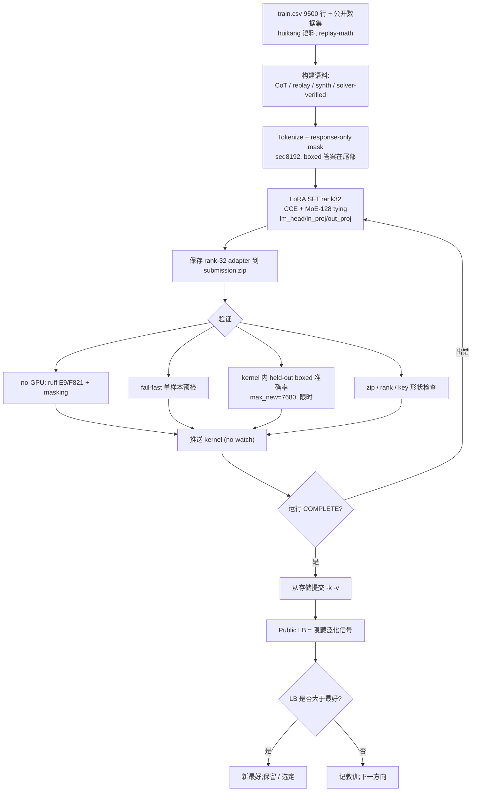
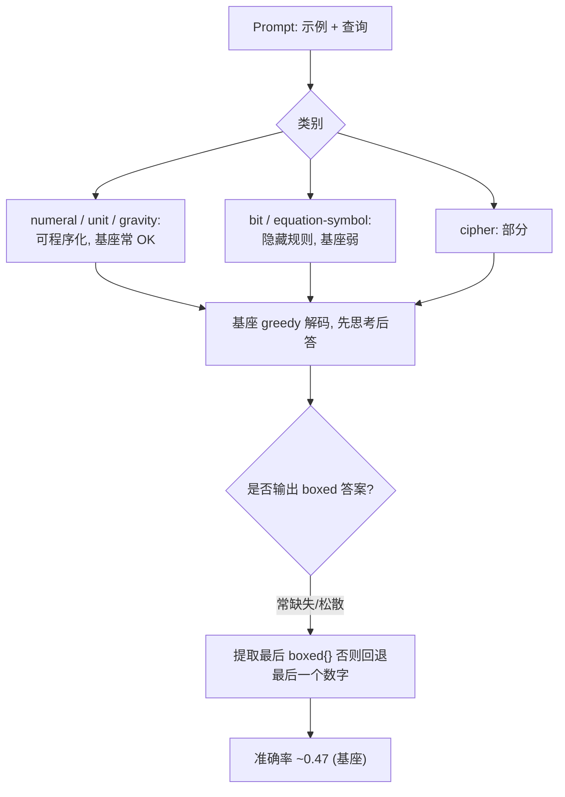
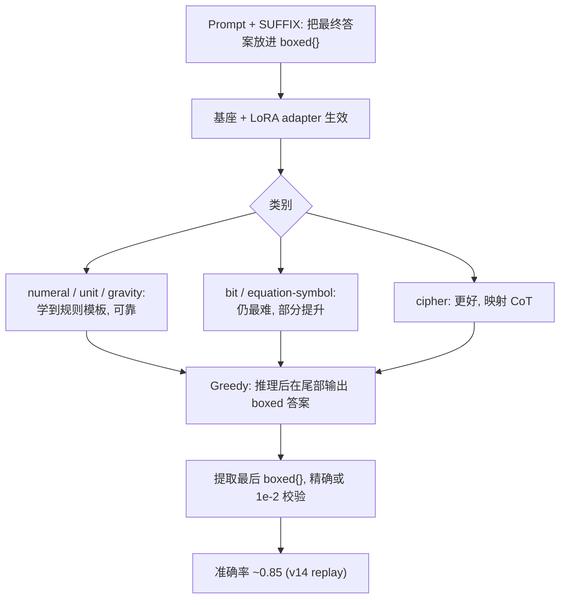
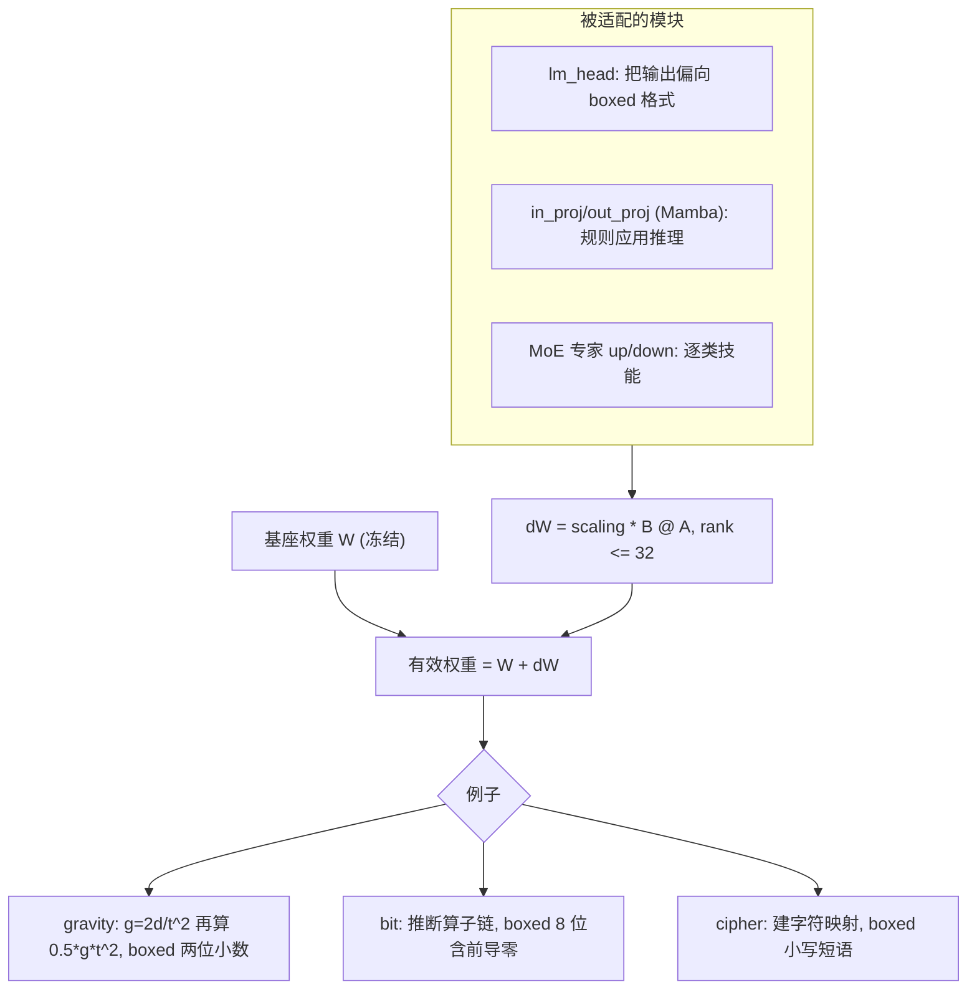

# 笔记 — NVIDIA Nemotron Model Reasoning Challenge(中文)

> 英文规范版:[`notes.md`](./notes.md)(逐节对齐)。本文为验证 / RL 工作流笔记。
> 证据来源:`README.md`、`rules.md`、`tracking.md`、`submissions.md`、`bugs.md`、`insights.md`、
> `strategy.md`、`tasks.md`、`competition.yaml`、`kernels/README.md`、`work/00.nemo.md`,以及对本地
> `train.csv` 的**只读** solver 覆盖率扫描。`unknown` = 证据中没有。撰写本文**未跑 GPU / 30B 推理**。

## 1. 当前验证现状
- **没有单一权威 CV。** `competition.yaml` 记 `cv_score: null`;每个 kernel 只跑了一个极小的 kernel 内
  **held-out boxed 准确率**(`EVAL_N = 8` 行)。榜单(LB)是唯一可信信号,而 public test 只有 **3 行**
  (≈ train 前 3 行,见 `work/00.nemo.md`)——只是 sanity check,不决定成绩。真正目标是**隐藏** benchmark。
- 这个 held-out 检查**修复前会误导**:`EVAL_MAX_NEW = 512` 在 `\boxed{}` 尾巴之前就截断了长 CoT,导致好
  adapter 读出 `0/8`(bug **B4 / T13**;已改 `7680` + `EVAL_TIME_CAP=1800s`)。修复后 v15 本地 held-out
  读 `3/4` 而 LB=0.84——即使修好的本地检查也只是 8 样本的噪声代理,不是 CV。
- 综上,当前验证 = **(a)** 推送前 no-GPU 静态检查、**(b)** fail-fast 单样本预检、**(c)** 8 行 kernel 内
  boxed 准确率嗅探、**(d)** public LB,外加 **(e)** T12 难例 CV(2026-06-15 已跑,见下)。
- **T12 难例 CV(2026-06-15,`harrysun2006/nemo-t12-hardval` v2)已完成:** 移植官方 metric + min-logprob
  每类最难 72 题,对 adapter 排名 —— **soup 0.764 = v14 0.764(均拿满难 cipher/bit)≫ base 0.389 ≈ c1
  0.389 > v15 0.333 > c2 0.278**。要点:**0.86 soup 稳健不稀释**;**CoT/合成增补的 c1/c2/v15 在最难
  cipher/bit 跌到 base 同级或更低**(base 基线排除「没加载上」);**equation 全员未解(≤2/16)**。
  → 守 0.86 soup,private-LB 最终选 **soup + v14**(详见 `submissions.md` / `tracking.md`)。

## 2. 如何验证一个微调后的 Nemotron adapter
分层流水线,便宜的先做(多数 no-GPU 且已存在;GPU 的在 kernel 内跑):

1. **本地 smoke(no GPU)** — `kernels/validate_kernel.py`:`ruff` E9/F821(抓 v7 `texts` 这类未定义名
   typo)+ 组装样本的 response-only **masking** 校验。每次推送前必跑。
2. **fail-fast 预检(kernel 内,数分钟)** — 模型加载后、长训练**之前**,在**一个**样本上跑
   生成→提取路径,让运行期 bug(如 v8 `.shape` / BatchEncoding **B3**)在几分钟内暴露,而非 2h 之后。
3. **官方 metric 兼容** — 与评测器完全对齐:**greedy 解码、`max_tokens=7680`、`temp=0`、`top_p=1.0`**;
   提取**最后一个 `\boxed{...}`**;**精确字符串(忽略大小写)或数值 rel 1e-2** 比较。把官方
   `score()`/`extract_final_answer()`/`verify()` 移植到本地是 **T12(尚未做)**;否则本地分会误导(INS-002)。
4. **解码长度** — 官方上限 7680 new tokens;本地 eval 必须一致(B4)。解码太短=假阴性;CoT 模型常需
   数千 token 才到 boxed 答案。
5. **`\boxed{}` 提取 + 格式** — 确认模型**总是**以单个可提取 `\boxed{}` 收尾;盯住这些会**悄悄**挂掉
   字符串匹配的格式边界:二进制答案**保留前导零**(`01000011` 而非 `1000011`);`gravity`/`unit`
   数值**保留两位小数**;`cipher` **全小写、单空格、无句尾标点**;符号 / `equation` 答案**原样输出**
   (保留引号 / 反斜杠 / 特殊字符)。
6. **adapter zip / rank 检查** — `submission.zip` 根目录直接放 `adapter_config.json` +
   `adapter_model.safetensors`(无嵌套目录),**rank ≤ 32**,`alpha` 与训练一致,key 匹配基模
   (`base_model.model.backbone…`);merge kernel 断言文件大小 + 文件名(规避 B3 类「我本地能加载、评测器
   不能」)。
7. **Kaggle LB** — 真正信号。从 kernel 存储提交(`--kernel/--version`);push **不是**提交(#77)。
   配额 5/队/天(双账号共享)。
8. **隐藏泛化** — LB 近似一个隐藏的**新规则** benchmark。一个从 train 推出的数字若不动 LB(如 cryptarithm
   单类 8%→71% 但总分卡 ~0.86,**B8**),说明本地信号没迁移过去。以 LB 变化(而非本地准确率)为准绳。

## 3. 训练 / 验证集切分策略
**该不该把 `train.csv` 随机切成 train/test/validation?** 仅用于 **smoke / 回归**,不作主质量信号。
本赛是**隐藏规则泛化**:每条 prompt 内嵌一个*新*变换规则,随机切分让 train/val 来自*同一*规则分布,
会**高估**泛化(模型能 pattern-match 兄弟样本)。更好的、与证据对齐的切分:

- **按类别分层(category-stratified)** — 各类(bit / cipher / numeral / unit / gravity / equation)分别留出,
  以看出某改动在*哪一类*涨 / 跌(v10/v15 教训:单类涨可能整体亏)。
- **模板感知(template-aware)** — 按 prompt 模板 / 示例数 / 运算符集合切,使 val 规则**不**是 train 规则的
  近似复制(最接近隐藏设定)。
- **答案类型(answer-type)** — 按 `binary8` / `numeric` / `string-symbol` 分桶,追踪 metric 会独立惩罚的
  格式边界失败(前导零、小数、原样符号)。
- **难例集(hard-val)** — 一小撮*最难拟合*的行(见 §4):确定性 solver 解不出的行、多步 bit 规则、符号
  重写 equation、歧义 cipher。这是对隐藏 benchmark 最便宜的代理,应**每次实验都跟踪**(T12 /
  `work/00.nemo.md` §9-Idea F)。

建议:保留一个极小的**随机 smoke 切分**用于流水线回归,**外加**一个用官方提取器打分的
**category-stratified + hard-val** 集做真正的读数。

## 4. 难验证行与选取标准
选取标准(基于对本地 `train.csv` 的**只读** solver 覆盖率扫描;一个确定性的逐类 solver 解出
gravity/numeral/unit 100%、**cipher 38%、bit 10%、equation 0.4%**——*解不出*的行即难拟合行):

- **bit** — 多算子组合(XOR/AND/OR + 移位 / 旋转 + majority/choice),有界 solver 拟合不了(≈90% 未解):
  从 ~8 对里归纳规则确实难。
- **equation(符号重写)** — `A op B = result` 符号串,其重写规则不在小型固定库内(≈99.6% 未解);
  另有混在同类里的**数值** equation(算术答案)——需双轨处理(`work/00.nemo.md` Idea E)。
- **cipher** — 查询需要示例里没出现过的字符,或非干净替换(≈62% 未解)。
- **格式边界** — 带前导零的二进制答案;对舍入敏感的数值。

| id | 类别 | 为何难 | 答案类型 | 验证目的 | 来源/证据 |
|---|---|---|---|---|---|
| 74339109 | bit | 多算子规则,solver 拟合不了(bit 90% 未解) | binary8 | bit 规则归纳泛化 | solver 覆盖率扫描 |
| 368f20dd | bit | 多算子规则,solver 拟合不了 | binary8 | bit 规则归纳泛化 | solver 覆盖率扫描 |
| 8bca1334 | bit | 多算子规则,solver 拟合不了 | binary8 | bit 规则归纳泛化 | solver 覆盖率扫描 |
| da931308 | equation | 符号重写不在固定规则库 | string/symbol | 符号变换 + 原样输出 | solver 覆盖率扫描 |
| 1a493b13 | equation | 符号重写,短符号答案 | string/symbol | 符号变换 + 原样输出 | solver 覆盖率扫描 |
| 124db55f | equation | **数值** equation 答案(算术轨) | numeric | 双轨 equation(数值 vs 符号) | solver 覆盖率扫描 |
| db677e8c | cipher | 查询字符未在示例出现 / 映射缺口 | string/symbol | cipher 超越查表的泛化 | solver 覆盖率扫描 |
| 902410ec | cipher | 更长短语,映射覆盖缺口 | string/symbol | cipher 泛化 + 空格格式 | solver 覆盖率扫描 |
| 000b53cf | bit | **前导零**二进制答案(`01000011`) | binary8 | 前导零格式(字符串匹配) | train.csv(亦为 public test 行) |
| 001b24c4 | numeral | 规则简单,但 Roman 需精确字符串输出 | string | 格式 / 回归锚点(应永远通过) | train.csv |

> 所有 id 来自本地 `train.csv`(`~/competitions/kaggle-…/data/train.csv`,9500 行)。逐行对 LB 的贡献
> `unknown`(隐藏测试)。若别的环境没有 `train.csv`,用相同标准重派:取各类 solver-**未解**行 + 前导零 /
> 小数格式边界行。

## 5. RL / 自蒸馏尝试与教训
实际**尝试 / 评分 / 计划 / 从未跑**的情况(LB 来自 `submissions.md` / `tracking.md`):

| 方法 | 状态 | LB | 教训 |
|---|---|---|---|
| Answer-only SFT (v5) | 已试已评 | 0.61 | 学会 boxed 格式;上限低 |
| CoT SFT + response-only masking (v7 / ctx4k) | 已试已评 | 0.65 / 0.67 | masking 必需(v6 不 mask = 0.44,**B2**) |
| Replay 配方 SFT(**v14**) | 已试已评 | **0.85(最好)** | CCE + MoE-128 tying + lm_head/in_proj/out_proj LoRA + seq8192 + huikang 语料 + replay-math = 单一最大杠杆 |
| 合成数据增强(v15;b1/b2) | 已评 | v15 0.84;**b1 0.85, b2 0.84** | 剂量是关键:低剂量 b1(~9%)回到 **0.85**(vs v15 24%→0.84)——印证稀释;均未超 0.85 |
| 多 adapter SVD merge(T7) | 已试已评 | 0.82 | 强+弱合并=**稀释**(INS-003);路线关闭 |
| 真实 prompt solver 蒸馏(c1/c2) | 已评 | **c1 0.85, c2 0.83** | 已验证真实 prompt CoT(Idea A/D)持平 **0.85**(c1,均衡);难类侧重(c2)稀释到 0.83 |
| **SVD 模型汤(v14+c1+b1)** | 已评 | **0.86(新最好)** | 三个*分数相当、互补*的 0.85 adapter(replay / 验证 solver-CoT / cryptarithm 合成,均为完整 v14 结构)加权汤(0.4/0.3/0.3)**超过每个成员** —— T7 缺的 §9b-H 条件;merge 路线得证 |
| **v11 拒绝采样自蒸馏** | **已计划,从未跑** | — | D2 已批但无 GPU/时间预算;base 采样→只留答对→SFT |
| **GRPO / PPO / 任何 RL** | **从未尝试** | — | `work/00.nemo.md` §8.5 提议可验证奖励 RL(精确匹配奖励 + 格式 / 长度惩罚),在稳定 SFT *之后*;从未到达 |

### v14 / b1 / b2 / c1 / c2 / soup 到底差在哪
全部是**同一基模上的 rank-32 LoRA**(Nemotron-3-Nano-30B-A3B),且除 soup 外**共用完全相同的 v14
训练骨架**(CCE + MoE-128 专家 tying + lm_head/attention/in_proj/out_proj 上的 LoRA + seq8192 + 7h 守护)。
唯一区别是**加进去的训练数据**(soup 则是合并、非训练):

| 版本 | LB | 相对 v14 骨架是什么 |
|---|---:|---|
| **v14** | 0.85 | 基础配方:huikang 录制顺序语料 + replay-math(2M answer tokens)。无额外数据。 |
| **b1** | 0.85 | v14 **+ ~800 仅 cryptarithm 的*合成* CoT**(~9%)。低剂量合成。 |
| **b2** | 0.84 | v14 **+ ~1000 cryptarithm+bit *合成* CoT**(~11%)。合成更多 + bit 切片。 |
| **c1** | 0.85 | v14 **+ ~1800 *真实 prompt 验证* solver-CoT**(均衡 cipher/bit/numeral/gravity/unit;只保留 solver 复现出真值答案的行)。 |
| **c2** | 0.83 | v14 **+ ~1000 验证 solver-CoT,难类加权**(bit/equation/cipher 偏重,easy 数据更少 → 稀释更多)。 |
| **soup** | **0.86** | **非训练** —— v14 + c1 + b1 的 SVD **模型汤**(加权平均 0.4/0.3/0.3 → rank-32),合并三个分数相当、互补的成员。 |

即:**v14** = 仅配方;**b1/b2** 加*合成*(自造)谜题 CoT;**c1/c2** 加*真实 prompt 验证*的 solver 蒸馏 CoT
(答案对过真值);**soup** 把 v14+c1+b1 合并成一个 rank-32 adapter,是唯一超过 0.85 的(模型汤效应,INS-004)。

**诚实小结:** 没有任何强化学习真正跑过。「类 RL」想法是拒绝采样自蒸馏(已计划未跑)和确定性
**solver 蒸馏**(c1=0.85 / c2=0.83)。所有在干净 replay 配方**之上**加信号的尝试都回归或**持平**
(最好的增补 = 0.85);**v14+c1+b1 模型汤拿到 0.86** —— 新最好。RL 若做,应在稳定 SFT 基线 + 真正本地 metric(T12)
*之后*,奖励 = 官方精确匹配 / 数值容差 + `\boxed{}` 格式奖励。

> **merge 路线得证(audit §9b-H):** b1 与 c1 都在**不同数据**上拿到 0.85(cryptarithm 合成 vs
> 真实 prompt 验证 CoT)—— *分数相当且互补*,这正是 T7 缺的条件(强+弱 → 0.82)。
> **v14 + c1 + b1** 的 SVD 模型汤(权重 0.4/0.3/0.3,rank-32)拿到 **0.86(+0.01,新最好,自训练合规)**
> —— 同盆地的汤超过每个成员。这才是被验证的路线,而非强+弱 merge。

## 6. 工作流图

### 6.1 端到端 训练 / 微调 / 验证流

### 6.2 基座 / 原始 Nemotron 推理(按数据类型)

### 6.3 微调后 Nemotron 推理(按数据类型)

### 6.4 LoRA adapter 贡献(含例子)

## 7. 实践建议
1. **先建本地 metric(T12)** — 移植官方 `score()`/`extract_final_answer()`/`verify()`,对齐
   `max_tokens=7680`/`temp=0`,并保留一个 **category-stratified + hard-val** 集(§4)。没有它,每个实验都
   只能靠 8 行嗅探或 5/天的 LB 名额来判断。
2. **保护 v14(0.85)** — 它是已存最好、也是当前杠杆的天花板;LB 取最大,实验不会拉低它,但别把名额
   浪费在证据显示会稀释它的「增补」上。
3. **最高期望值的未试方向**:针对难类别的**真实 prompt** 验证推理——扩充 solver 的符号重写库
   (目前 `equation` 仅 0.4%),逆向工程真实规则;和/或对 bit/equation 用 teacher 蒸馏朝已知答案生成 CoT。
   注意 B8(单类未必动总分)。
3a. **RL 只在**稳定 SFT 基线 + 真实 metric *之后*做;奖励 = 精确匹配 / 1e-2 + `\boxed{}` 格式奖励。
4. **格式是白捡的分** — 强制前导零、两位小数、cipher 小写单空格、符号原样;按答案类型验证,不只看总准确率。
5. **调度** — 长训练 kernel 安排在深夜跑(~22:00–24:00 AEST),短的(merge/validate)白天跑
   (见 `README.md`);每个 kernel 保留 ≤8h 墙钟守护(B7)。

## 8. 证据与来源文件
- `competitions/nvidia-nemotron/`:`README.md`、`rules.md`、`tracking.md`、`submissions.md`、
  `bugs.md`(B1–B9)、`insights.md`(INS-001..003)、`strategy.md`、`tasks.md`、`competition.yaml`。
- `kernels/README.md` + `kernels/*.py`(配方、成绩轨迹、坑);`lib/nemo_solver.py`(用于 §4 覆盖率证据的
  确定性 solver)。
- `postmortems/2026-06-14-final-sprint-audit.md`(计划 vs 实际,选项表含 §9b)。
- `work/00.nemo.md`(ChatGPT 分析:挑战、Ideas A–F、§8 技巧、§9 路线、§11 矩阵)。
- 对 `~/competitions/kaggle-…/data/train.csv`(9500 行)的只读 solver 覆盖率扫描,用于 §4 难例行。
- 运行 / LB 状态(截至 2026-06-15):冲刺最终分 **b1 0.85, b2 0.84, c1 0.85, c2 0.83, soup 0.86(新最好,自训练合规)**。**T12 hard-val 排名(2026-06-15)**:soup 0.764 = v14 0.764 ≫ base/c1 0.389 > v15 0.333 > c2 0.278 → 守 0.86 soup,private-LB 最终选 **soup + v14**。`tracking.md`/`submissions.md` 已据此更新。
